## A model predicts the political views of U.S. adults

<div class="single-chart"><div class="bars synthetic"><div class="bar" data-x="1" style="height:14%"></div><div class="bar" data-x="2" style="height:34%"></div><div class="bar" data-x="3" style="height:30%"></div><div class="bar" data-x="4" style="height:100%"></div><div class="bar" data-x="5" style="height:33%"></div><div class="bar" data-x="6" style="height:45%"></div><div class="bar" data-x="7" style="height:17%"></div></div><div class="chart-note">Instructor-generated example · predicted percentages across a seven-point ideology scale</div></div>

<div class="question" style="margin-top:28px;"><strong>Would you use this as an estimate of U.S. public opinion?</strong><br>What would you want to know before deciding?</div>

---

## Here is the 2024 GSS distribution

<div class="single-chart"><div class="bars"><div class="bar" data-x="1" style="height:12%"></div><div class="bar" data-x="2" style="height:37%"></div><div class="bar" data-x="3" style="height:32%"></div><div class="bar" data-x="4" style="height:100%"></div><div class="bar" data-x="5" style="height:33%"></div><div class="bar" data-x="6" style="height:45%"></div><div class="bar" data-x="7" style="height:16%"></div></div><div class="chart-note">2024 GSS · unweighted valid responses · N = 3,160</div></div>

<div class="answer" style="font-size:1.02em; margin-top:28px;">The shapes are close because I deliberately made the first one close. Visual similarity tells us nothing about how the first distribution was produced.</div>

<div class="citation">General Social Survey, 2024 Cross-section Codebook, Release 3a, <code>POLVIEWS</code>.</div>

---

## What we will work out today

<div class="three-questions"><div><strong>What was generated?</strong>An aggregate distribution, an answer for a demographic profile, or a prediction about a particular person?</div><div><strong>What comparison was made?</strong>A majority answer, the whole distribution, subgroup differences, associations, or individual answers?</div><div><strong>What does that comparison support?</strong>Exploration, prediction, population description or replacement of human measurement?</div></div>

---

## The basic persona method

<div class="process" style="grid-template-columns:repeat(5,1fr);"><div><strong>Start with profiles</strong><br>usually demographic or survey records</div><div><strong>Write a persona prompt</strong><br>one profile at a time</div><div><strong>Ask the survey item</strong><br>using the original wording</div><div><strong>Generate an answer</strong><br>text, category or probabilities</div><div><strong>Compare patterns</strong><br>with human data</div></div>

<div class="record" style="margin-top:36px;">Age: 42 · Education: bachelor's degree · Party ID: independent
Question: “Where would you place yourself?”
Model output: 4 (moderate, middle of the road)</div>

<div class="purpose"><strong>Persona-based silicon sampling</strong> repeats this procedure across many profiles. The profiles may come from survey records, population margins, researcher-written cases, or another model.</div>

---

## There are two quite different classroom demonstrations

<div class="cols"><div><h3>1 · Predict the aggregate</h3><p>The model receives the question and is asked for seven percentages for U.S. adults.</p><div class="output">{1: 4, 2: 13, 3: 12, 4: 36,
 5: 12, 6: 16, 7: 7}</div><p class="compact">One model call returns one predicted distribution.</p></div><div><h3>2 · Predict one profile at a time</h3><p>The model receives selected fields from an actual GSS record and predicts that respondent’s answer.</p><div class="output">{"case_id": 1042,
 "predicted_polviews": 4}</div><p class="compact">Many calls create case-level predictions that can be compared with held-out answers.</p></div></div>

---

## Three different designs are called “synthetic respondents”

<table class="tbl"><tr><th>Design</th><th>What the model receives</th><th>What it produces</th><th>Relevant human comparison</th></tr><tr><td><strong>Aggregate prediction</strong></td><td>A question and a population description</td><td>One distribution</td><td>Observed population distribution</td></tr><tr><td><strong>Demographic persona</strong></td><td>One short profile and the question</td><td>One answer or probability vector</td><td>Held-out answers and subgroup distributions</td></tr><tr><td><strong>Interview-grounded agent</strong></td><td>Material supplied by an observed participant</td><td>A prediction for that person</td><td>That participant's held-out answer or retest</td></tr></table>

<div class="purpose">An aggregate distribution, a demographic-persona answer and a prediction for one observed person require different validation.</div>

---

## Start with the question people answered

<div class="cols6040">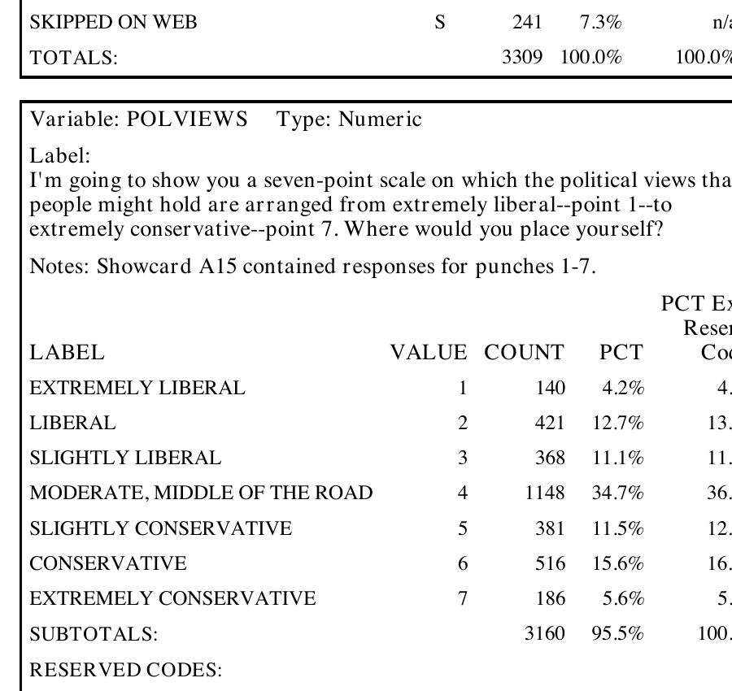<div><p>The GSS asks respondents to locate themselves from <strong>extremely liberal (1)</strong> to <strong>extremely conservative (7)</strong>.</p><div class="scale-row"><span>1</span><span>2</span><span>3</span><span>4</span><span>5</span><span>6</span><span>7</span></div><div class="warning-box"><strong>Phrasing in the prompt should match phrasing in the original question.</strong></div><p class="compact">The codebook also shows 149 reserve-code cases: “don’t know,” no answer, or skipped on web.</p></div></div>

<div class="citation">GSS (2026), 2024 Cross-section Codebook, Release 3a, p. 173.</div>

---

## Surveys already contain a long chain of decisions

<div class="process"><div><strong>Target population</strong><br>Who is the claim about?</div><div><strong>Sampling frame</strong><br>Who could be selected?</div><div><strong>Sample</strong><br>Who was selected?</div><div><strong>Respondents</strong><br>Who answered?</div><div><strong>Recorded data</strong><br>What was retained?</div><div><strong>Estimate</strong><br>How were cases combined?</div></div>

<div class="question" style="margin-top:40px;"><strong>Example:</strong> If telephone coverage misses a group, increasing the sample size does not put that group back into the frame.</div>

---

## Sampling error is only one source of survey error

<div class="cols6040">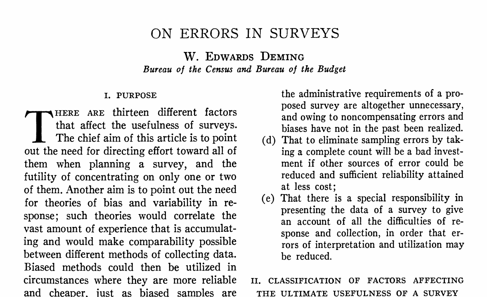<div><p>Deming distinguished sampling variation from errors introduced by the questionnaire, interviewers, respondents and data processing.</p><p>A complete count can still give a poor estimate when the measurement process is weak.</p><div class="question" style="font-size:.9em; padding:13px 18px;"><strong>For this lecture:</strong> generating more model answers only reduces Monte Carlo variation. It cannot repair a badly specified question or a systematically distorted response process.</div></div></div>

<div class="citation">W. Edwards Deming (1944), “On Errors in Surveys,” <em>American Sociological Review</em> 9(4): 359–369.</div>

---

## Probability sampling connects cases to a population

<div class="cols4060">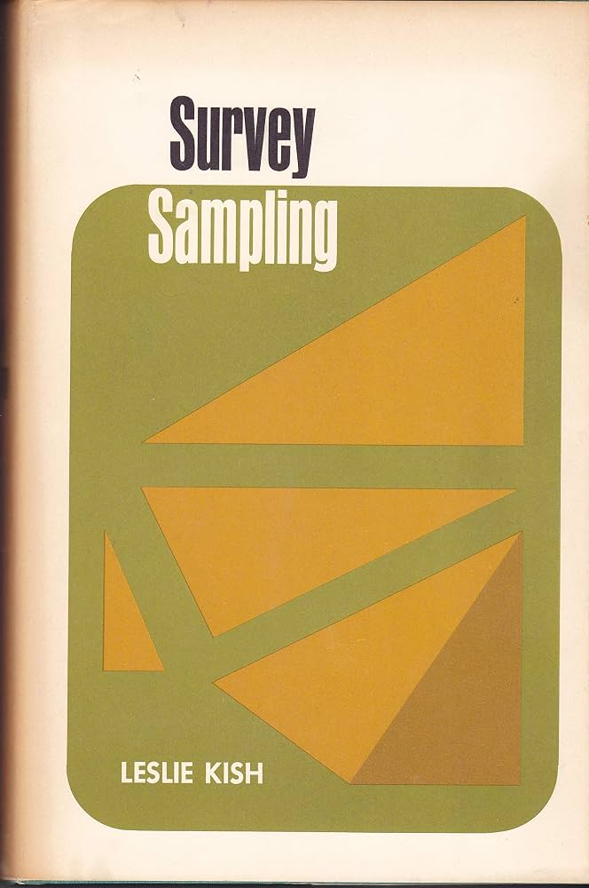<div><p>Kish explains how known selection probabilities, stratification, clustering and weights support estimates about a defined population.</p><p><strong>A sampled case contributes through the sampling design.</strong> It does not have to resemble an average citizen.</p><p>A list of plausible demographic profiles has no equivalent link to a population unless the researcher supplies one.</p></div></div>

<div class="citation">Leslie Kish (1965), <em>Survey Sampling</em>. New York: Wiley.</div>

---

## Total survey error separates two sets of problems

<div class="tse-overview"><div><h3>Measurement</h3><div class="tse-track"><span>Construct</span><span>Question</span><span>Answer</span><span>Recorded value</span></div><p>Does the recorded value capture the intended concept?</p></div><div><h3>Representation</h3><div class="tse-track"><span>Target population</span><span>Frame</span><span>Selected cases</span><span>Respondents</span></div><p>Which people can the estimate describe?</p></div></div>

<p style="margin-top:26px;">The final estimate inherits problems from either side. A well-worded question cannot repair missing groups, and a representative sample cannot repair a poor measure.</p>

<div class="citation">Groves & Lyberg (2010), “Total Survey Error: Past, Present, and Future,” <em>Public Opinion Quarterly</em> 74(5): 849–879, especially Figure 3.</div>

---

## The sources of error in more detail

<div class="tse-tabset"><div class="tse-tab-column"><h3>Measurement</h3><div class="tse-tabs"><button class="tse-tab active" data-target="tse-construct">Construct</button><button class="tse-tab" data-target="tse-question">Question</button><button class="tse-tab" data-target="tse-answer">Answer</button><button class="tse-tab" data-target="tse-processing">Processing</button></div><div class="tse-panel active" id="tse-construct"><strong>Construct validity</strong><p>Does “political ideology” mean what the study claims it means?</p></div><div class="tse-panel" id="tse-question"><strong>Question wording</strong><p>Order, labels and context can change how respondents understand the task.</p></div><div class="tse-panel" id="tse-answer"><strong>Response error</strong><p>Recall, uncertainty, social desirability and scale use affect the answer.</p></div><div class="tse-panel" id="tse-processing"><strong>Processing error</strong><p>Coding, parsing and recoding can change the value stored for analysis.</p></div></div><div class="tse-tab-column"><h3>Representation</h3><div class="tse-tabs"><button class="tse-tab active" data-target="tse-population">Population</button><button class="tse-tab" data-target="tse-frame">Frame</button><button class="tse-tab" data-target="tse-selection">Selection</button><button class="tse-tab" data-target="tse-nonresponse">Nonresponse</button></div><div class="tse-panel active" id="tse-population"><strong>Target population</strong><p>The claim must name the people, place and period it concerns.</p></div><div class="tse-panel" id="tse-frame"><strong>Coverage error</strong><p>Some members of the population may never appear in the sampling frame.</p></div><div class="tse-panel" id="tse-selection"><strong>Sampling error</strong><p>Different probability samples produce different estimates.</p></div><div class="tse-panel" id="tse-nonresponse"><strong>Nonresponse error</strong><p>Respondents can differ systematically from selected people who do not answer.</p></div></div></div>

<div class="citation">Click a label to reveal its definition. Terminology follows Groves & Lyberg (2010).</div>

---

## Synthetic responses change both parts of the design

<table class="tbl"><tr><th></th><th>Human survey</th><th>LLM routine</th></tr><tr><td><strong>Measurement</strong></td><td>A person interprets the question, retrieves relevant information, forms a judgment and selects a response.</td><td>The prompt, model and decoding settings generate a token sequence that is parsed into a response.</td></tr><tr><td><strong>Representation</strong></td><td>The frame, selection probabilities, nonresponse and weights connect respondents to a target population.</td><td>The source of the profiles and the rule used to combine predictions determine what population claim is possible.</td></tr><tr><td><strong>Immediate check</strong></td><td>Pretest the question and inspect response patterns.</td><td>Compare the model output with human data collected for the same target and question.</td></tr></table>

---

## Simulmatics built a computational electorate in 1960

<div class="cols4060">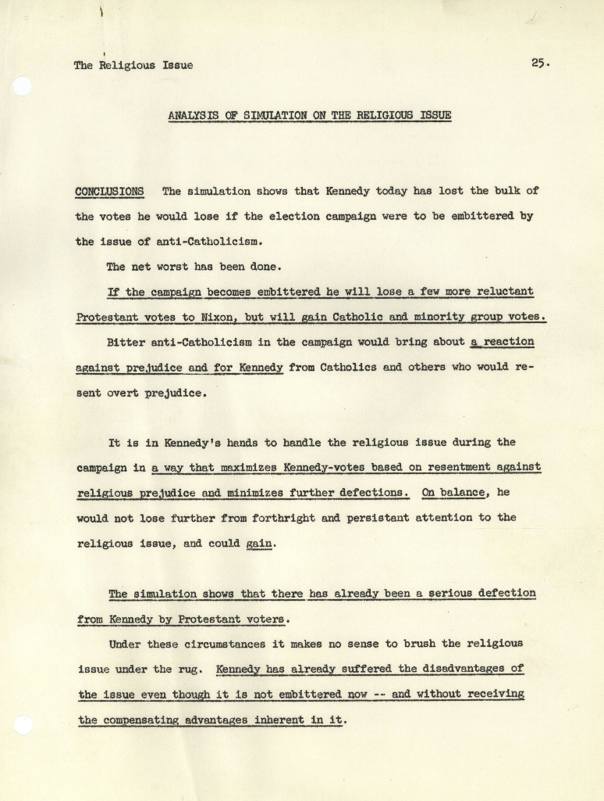<div><p>Simulmatics advised John F. Kennedy’s campaign using accumulated polling records and a computer model.</p><p>This page reports its analysis of the “religious issue.” The output becomes advice about whether Kennedy should confront anti-Catholicism directly.</p><div class="criterion"><strong>Its source material:</strong> more than 100,000 earlier interviews, reduced to 480 voter types.</div></div></div>

<div class="citation">Simulmatics, “Analysis of Simulation on the Religious Issue,” p. 25, JFK Library, Lawrence F. O’Brien Papers, LOBPP-016-010; historical details synthesized in Clinton et al. (2026).</div>

---

## Pool and Abelson explained what went into the machine

<div class="cols6040">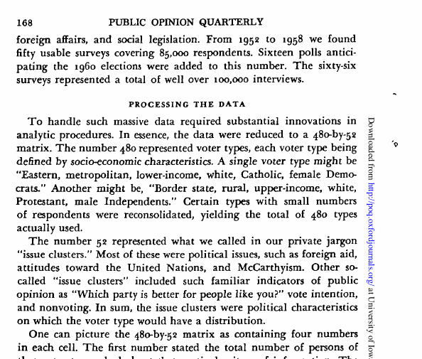<div><p>The project assembled <strong>66 earlier surveys</strong> containing more than <strong>100,000 interviews</strong>.</p><p>It reduced those records to a <strong>480 voter-type × 52 issue-cluster</strong> matrix.</p><p>Each matrix cell stored a base count and the percentages classified as <strong>pro</strong>, <strong>anti</strong> and <strong>undecided or confused</strong>.</p><p class="compact">Questions entered the same issue cluster only when the researchers judged them politically equivalent and their response patterns correlated across voter types.</p></div></div>

<div class="citation">de Sola Pool & Abelson (1961), “The Simulmatics Project,” <em>Public Opinion Quarterly</em> 25(2): 167–183, pp. 167–168.</div>

---

## How the Simulmatics calculation worked

<div class="sim-calc"><div><span>1</span><strong>Classify the voter</strong><p>Place each record in one of 480 types using region, settlement, income, race, religion, sex and party.</p></div><div><span>2</span><strong>Choose an equation</strong><p>Religion and party created nine cross-pressure groups. Each group received a different vote equation.</p></div><div><span>3</span><strong>Calculate a type-level vote</strong><p>The equation used earlier vote intentions, turnout and anti-Catholic responses for that voter type.</p></div><div><span>4</span><strong>Construct each state</strong><p>Weight the 480 type-level estimates by the estimated number of each type living in the state.</p></div></div>

<div class="question" style="font-size:.84em; padding:12px 18px; margin-top:20px;"><strong>Example from the paper:</strong> for Protestant Democrats, the model began with 1958 vote intentions, estimated which anti-Catholic respondents would defect, and increased the nonvoting adjustment because cross-pressured voters were expected to abstain more often.</div>

<div class="citation">de Sola Pool & Abelson (1961), pp. 175–180. The computer ran a separate calculation for each voter type and then formed weighted state estimates.</div>

---

## Lepore asks who gets to use the “people machine”

<div class="cols4060">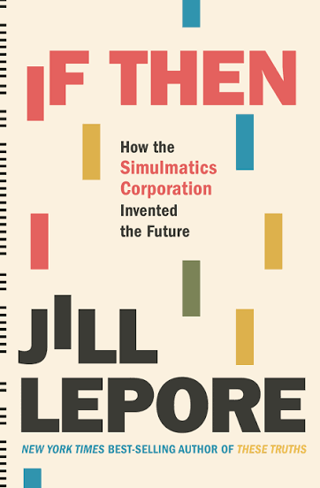<div><p><em>If Then</em> follows Simulmatics from political consulting into advertising, counterinsurgency and other attempts to predict and shape behaviour.</p><p>The Kennedy campaign received the reports. The people represented in the archived surveys did not see or challenge the categories used to classify them.</p><div class="question" style="font-size:.91em; padding:13px 18px;"><strong>Questions for the historical case</strong><br>Who defined the voter types?<br>Who could query the model?<br>How did the advice affect campaign decisions?</div></div></div>

<div class="citation">Jill Lepore (2020), <em>If Then</em>; Lepore & Berman (2021), “The People Machine,” <em>Harvard Data Science Review</em>.</div>

---

## Bourdieu questions what a poll has made countable

<div class="cols6040">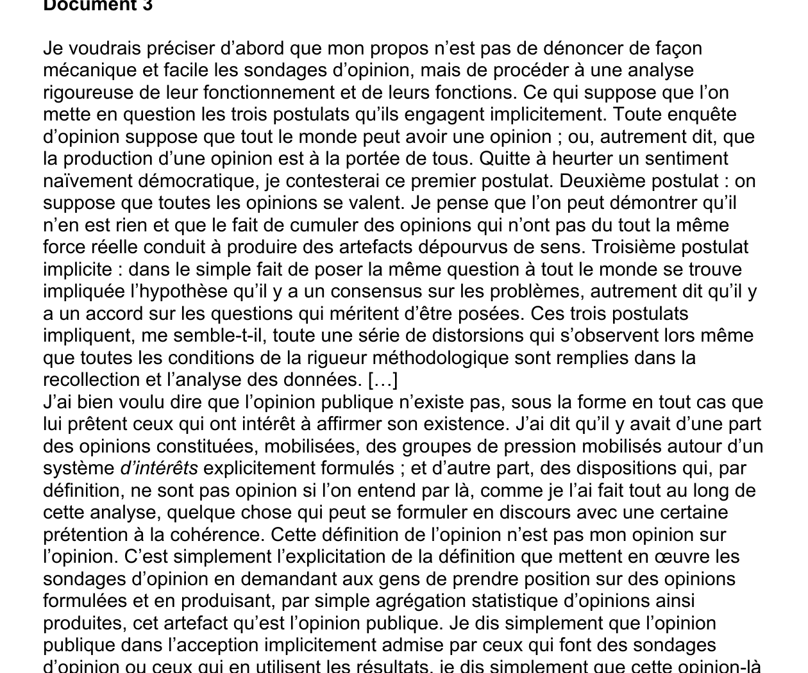<div><div class="quote" style="font-size:.9em;">« Toute enquête d’opinion suppose que tout le monde peut avoir une opinion… »</div><p><strong>Translation:</strong> “Every opinion poll assumes that everyone can have an opinion.”</p><p class="compact">Bourdieu then adds two further assumptions: opinions can be treated as equivalent units, and there is agreement about which questions deserve to be asked.</p></div></div>

<div class="citation">Pierre Bourdieu (1973), “L’opinion publique n’existe pas,” <em>Les Temps modernes</em> 318.</div>

---

## A model can make these assumptions harder to see

<table class="tbl"><tr><th>Bourdieu’s criticism</th><th>What happens in a persona prompt</th></tr><tr><td>Not everyone has a formed opinion on every issue.</td><td>A forced-choice instruction requires every model call to return a scale point.</td></tr><tr><td>Answers differ in certainty, information and social force.</td><td>One integer makes a weak prediction look as definite as a strong one.</td></tr><tr><td>The questionnaire imposes a problem and its categories.</td><td>The prompt may make supplied demographic labels look more relevant than they are.</td></tr></table>

<div class="question" style="margin-top:30px;"><strong>What happens to “don’t know”?</strong> In the 2024 GSS, 99 respondents received that reserve code. A forced synthetic answer removes that possibility by design.</div>

---

## Zaller treats a survey response as something assembled at the time

<div class="cols4060">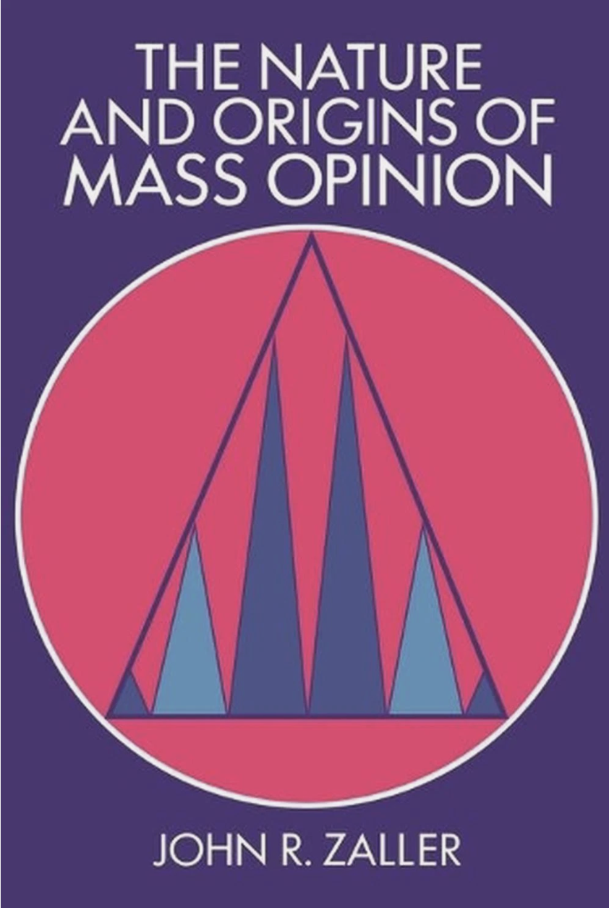<div><p>In Zaller’s reception–acceptance–sampling model, people encounter political messages, accept some considerations, and sample from accessible considerations when answering.</p><div class="answer" style="font-size:1em;">The same person can give a different answer when different considerations are accessible.</div><p class="compact">A persona prompt supplies a short, researcher-selected set of considerations. We do not know whether the model handles the question as a person does; we observe only the outputs it returns.</p></div></div>

<div class="citation">John Zaller (1992), <em>The Nature and Origins of Mass Opinion</em>. Cambridge University Press.</div>

---

## McCall treats categories as provisional analytical tools

<div class="cols"><div>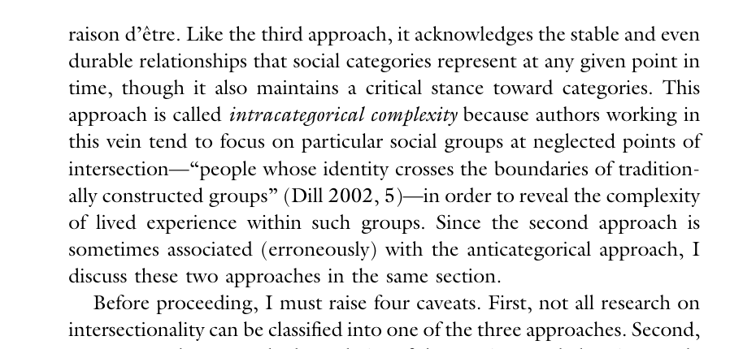<p class="compact"><strong>Intracategorical analysis</strong> examines variation and lived experience within a social group.</p></div><div>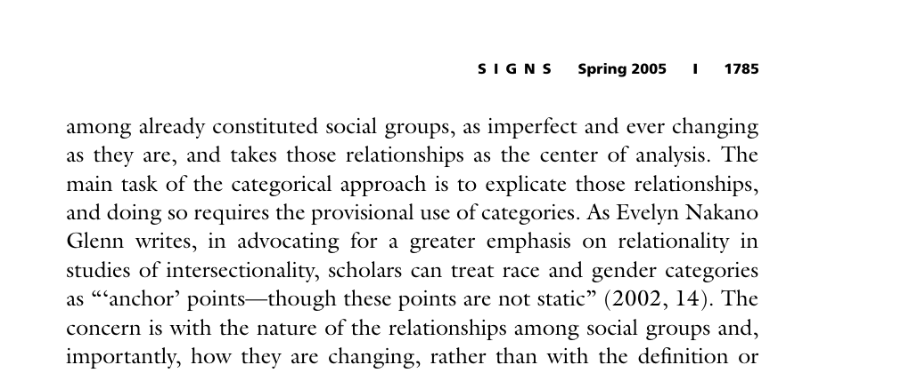<p class="compact"><strong>Intercategorical analysis</strong> uses categories provisionally to study relationships and inequalities among groups.</p></div></div>

<div class="citation">Leslie McCall (2005), “The Complexity of Intersectionality,” <em>Signs</em> 30(3): 1771–1800, pp. 1773–74 and 1784–85.</div>

---

## How a respondent produces a survey answer

<div class="response-process"><div><span>1</span><strong>Comprehend</strong><p>What does the question mean?</p></div><div><span>2</span><strong>Retrieve</strong><p>Which memories or considerations come to mind?</p></div><div><span>3</span><strong>Judge</strong><p>How are those considerations combined?</p></div><div><span>4</span><strong>Respond</strong><p>Which scale category expresses that judgment?</p></div></div>

<div class="cols" style="margin-top:30px;"><div><p>The CASM tradition studies errors and variation at each stage of this process.</p></div><div><p>Zaller adds that different political considerations may be accessible at different moments.</p></div></div>

<div class="citation">National Research Council (1984), <em>Cognitive Aspects of Survey Methodology</em>; Tourangeau, Rips & Rasinski (2000), <em>The Psychology of Survey Response</em>; Zaller (1992).</div>

---

## A demographic persona skips over that response process

<div class="persona-casm"><div><div class="record">age: 34
gender: woman
education: bachelor's degree
party identification: independent</div><p>These are classifications selected by the researcher.</p></div><div class="persona-output"><span>MODEL CALL</span><strong>“4 (moderate)”</strong></div><div><h3>What remains unobserved</h3><ul><li>how this person understands “liberal” and “conservative”;</li><li>which experiences and political considerations matter;</li><li>how certain or ambivalent the person feels;</li><li>how the person would use the seven response categories.</li></ul></div></div>

<div class="citation">The omitted stages follow the CASM response model. The profile and output are teaching examples.</div>

---

## Three different checks answer three different questions

<div class="validation-levels"><div><strong>Output check</strong><p>Did the model return a usable category or seven probabilities?</p></div><div><strong>Predictive check</strong><p>How often does the output match held-out human answers?</p></div><div><strong>Population check</strong><p>Does the full synthetic distribution match the target population, including variation within groups?</p></div></div>

<p style="margin-top:28px;">The next studies test different rows of this list. Their results should not be treated as interchangeable evidence.</p>

---

## One persona call has three inputs and two outputs

<div class="annotated-record"><div class="record">profile = {"age": 42,
           "education": "bachelor's degree",
           "party_id": "independent"}

question = "I'm going to show you a seven-point scale ..."

instruction = "Return one integer from 1 to 7."</div><ul class="field-list"><li><code>profile</code>: selected fields from a source record.</li><li><code>question</code>: the GSS wording and endpoints.</li><li><code>instruction</code>: the requested output format.</li><li><code>raw_response</code>: text returned by the model.</li><li><code>parsed_response</code>: the value retained for analysis.</li></ul></div>

---

## Argyle and colleagues proposed “silicon samples”

<div class="cols4060">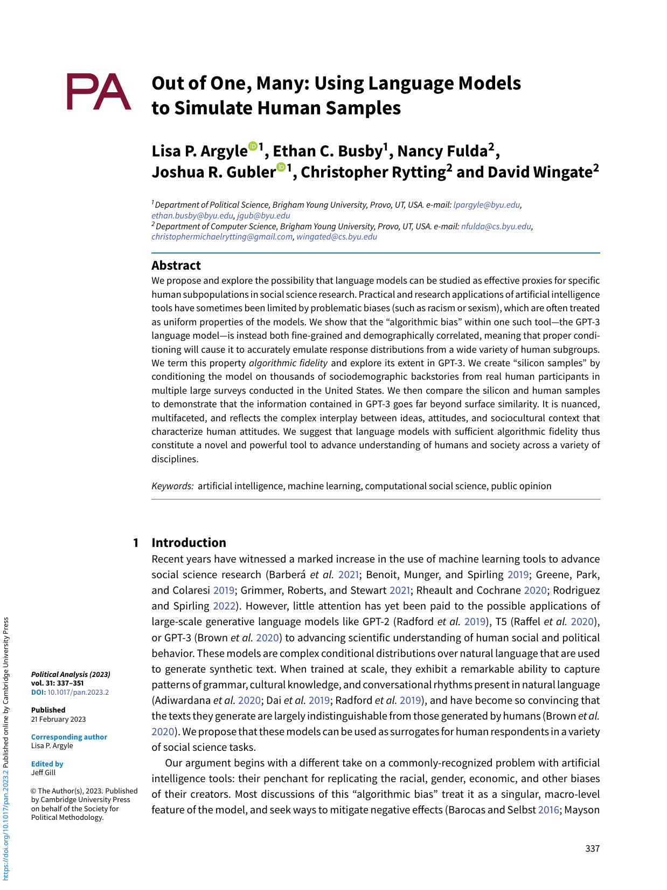<div><div class="study-card"><p><strong>Material:</strong> demographic backstories derived from large U.S. surveys.</p><p><strong>Procedure:</strong> GPT-3 generated completions after each backstory.</p><p><strong>Comparison:</strong> patterns in model completions versus patterns in human data.</p></div><p>Their term <strong>algorithmic fidelity</strong> refers to preserving patterned relationships in a particular human population.</p></div></div>

<div class="citation">Argyle et al. (2023), “Out of One, Many,” <em>Political Analysis</em> 31(3): 337–351. https://doi.org/10.1017/pan.2023.2</div>

---

## In Study 2, they used ANES profiles to predict reported vote

<div class="process" style="grid-template-columns:repeat(4,1fr);"><div><strong>1</strong><br>Start with a respondent profile from the 2012, 2016 or 2020 ANES.</div><div><strong>2</strong><br>Include demographics and political characteristics, but not the reported vote.</div><div><strong>3</strong><br>Ask GPT-3 to complete: “In [year], I voted for...”</div><div><strong>4</strong><br>Compare the model’s Republican/Democratic prediction with the ANES answer.</div></div>

<div class="warning-box" style="font-size:.88em; margin-top:36px;">The 2020 election occurred after GPT-3’s training cut-off. That made the final comparison a test beyond the period covered by its training data.</div>

<div class="citation">Argyle et al. (2023), Study 2, pp. 344–346.</div>

---

## Overall agreement was high, but independents were not well predicted

<div class="cols6040">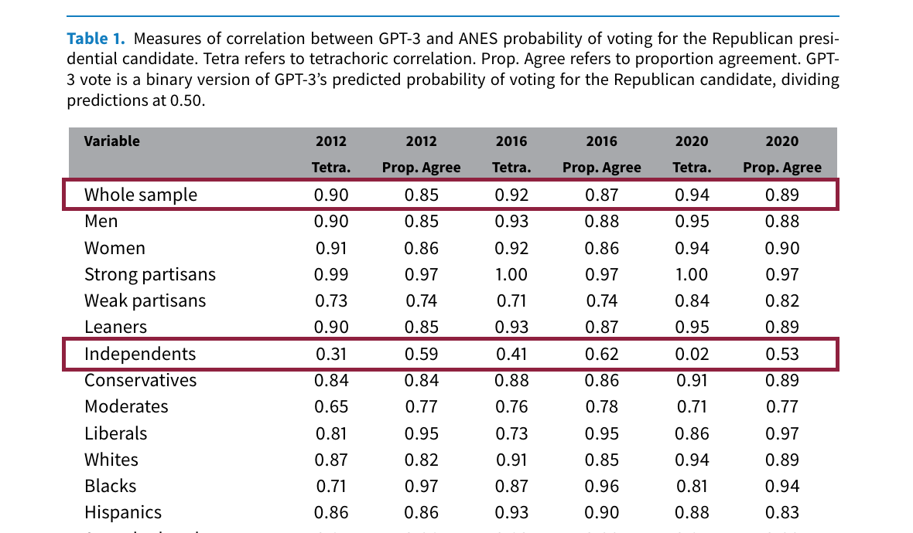<div><p><strong>Whole sample</strong><br>Tetrachoric correlations: 0.90–0.94<br>Proportion agreement: 0.85–0.89</p><p><strong>Independents</strong><br>Tetrachoric correlations: 0.02–0.41<br>Proportion agreement: 0.53–0.62</p><div class="criterion">A strong result for the full sample can coexist with a much weaker result for an important subgroup.</div></div></div>

<div class="citation">Argyle et al. (2023), Table 1. The table compares GPT-3 predictions with reported ANES presidential vote in 2012, 2016 and 2020.</div>

---

## A broader sociological standard asks what the stand-in must preserve

<div class="cols6040">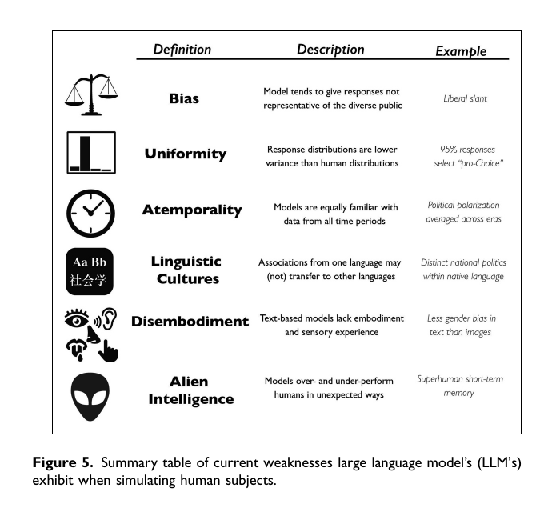<div><p>Kozlowski and Evans ask what an artificial stand-in would need to preserve about culture, time, embodiment, difference and interaction.</p><div class="six-list"><div><strong>Bias</strong></div><div><strong>Uniformity</strong></div><div><strong>Atemporality</strong></div><div><strong>Sensory experience</strong></div><div><strong>Linguistic cultures</strong></div><div><strong>Alien intelligence</strong></div></div><div class="criterion"><strong>The relevant test depends on the social feature the study needs.</strong></div></div></div>

<div class="citation">Additional reading: Kozlowski & Evans (2025), “Simulating Subjects,” <em>Sociological Methods & Research</em> 54(3): 1017–1073, Figure 5.</div>

---

## Park and colleagues build agents from long interviews

<div class="cols4060">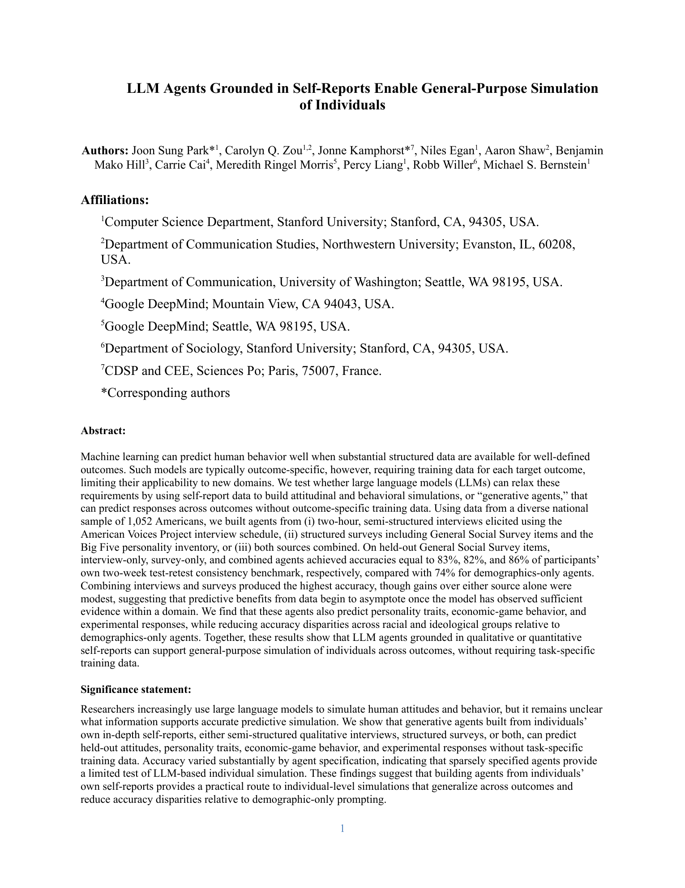<div><div class="criterion"><strong>1,052 participants</strong> each completed a roughly <strong>two-hour semi-structured interview</strong>.</div><p>Park and colleagues built agents from those interviews, then predicted held-out GSS, personality, economic-game and experimental answers.</p><p class="compact">The comparison is <strong>person-to-prediction</strong>. It does not establish that the agents form a representative population.</p></div></div>

<div class="citation">Park et al. (2026), “LLM Agents Grounded in Self-Reports Enable General-Purpose Simulation of Individuals,” revised version of “Generative Agent Simulations of 1,000 People,” arXiv:2411.10109.</div>

---

## The human retest provides an important benchmark

<div class="cols6040">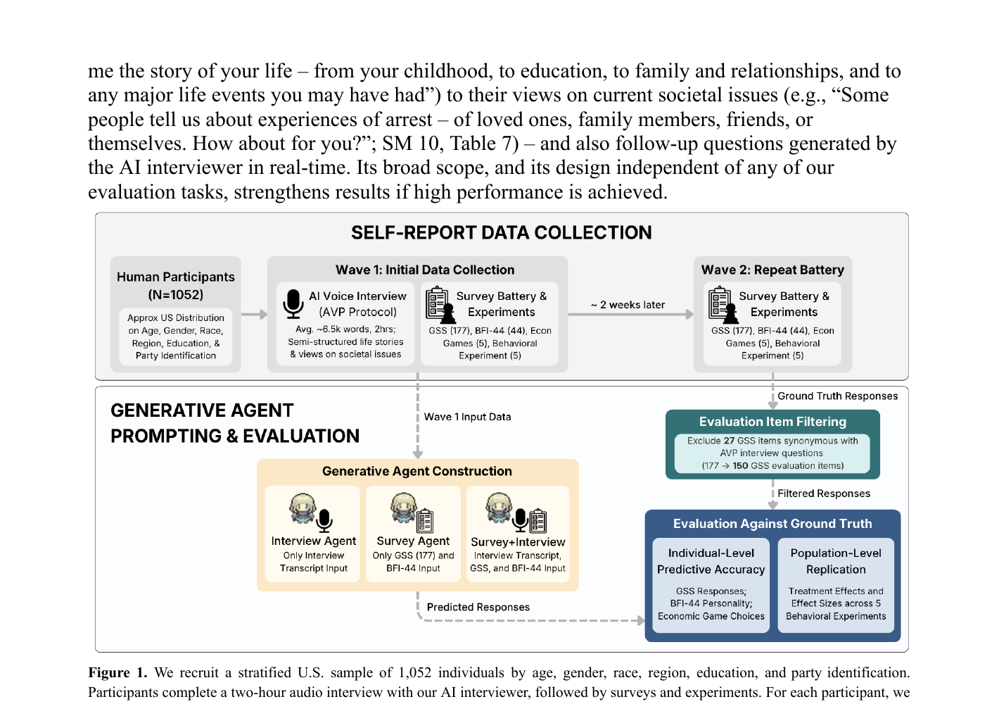<div><p>Participants answered the evaluation measures and completed them again two weeks later.</p><p>The agents answered the held-out measures too.</p><div class="criterion"><strong>The paper scales agent performance against participants’ own test–retest consistency.</strong></div><p class="compact">That is more informative than pretending a person would reproduce every answer perfectly.</p></div></div>

<div class="citation">Park et al. (2024), Figure 1.</div>

---

## Simulmatics and Park construct different kinds of stand-in

<table class="tbl"><tr><th></th><th>Simulmatics</th><th>Park et al.</th></tr><tr><td><strong>Human material</strong></td><td>Archived opinion polls</td><td>Two-hour individual interviews</td></tr><tr><td><strong>Representational unit</strong></td><td>480 voter types</td><td>1,052 interview-grounded agents</td></tr><tr><td><strong>Output</strong></td><td>Response to campaign scenarios</td><td>Held-out individual answers</td></tr><tr><td><strong>Primary comparison</strong></td><td>Group response and campaign usefulness</td><td>Person-to-prediction correspondence</td></tr><tr><td><strong>Unresolved question</strong></td><td>What disappears inside a voter type?</td><td>What disappears when an interview becomes model context?</td></tr></table>

<div class="purpose">Park can compare each agent with held-out answers from the person who was interviewed. Estimating public opinion would still require a population design.</div>

---

## Break

<div class="break-slide"><div><h2>When we return</h2><p>What the validation studies actually compare.</p></div></div>

---

## “Does it match people?” can mean several things

<div class="validation-grid"><div><strong>Majority answer</strong>Does the model select the most common option?</div><div><strong>Full distribution</strong>Does it preserve the spread across all options?</div><div><strong>Within-group variation</strong>Does it preserve disagreement within a category?</div><div><strong>Between-group differences</strong>Are gaps in the right direction and of a similar size?</div><div><strong>Associations</strong>Are relationships among variables preserved?</div><div><strong>Individual prediction</strong>Does it predict held-out answers for the same people?</div><div><strong>Stability</strong>Does the result survive prompt and model changes?</div><div><strong>Baseline</strong>Does it beat a simple human-data model?</div><div><strong>Decision</strong>Would it support the same substantive conclusion?</div></div>

---

## Boelaert and colleagues test opinion-poll questions directly

<div class="cols4060">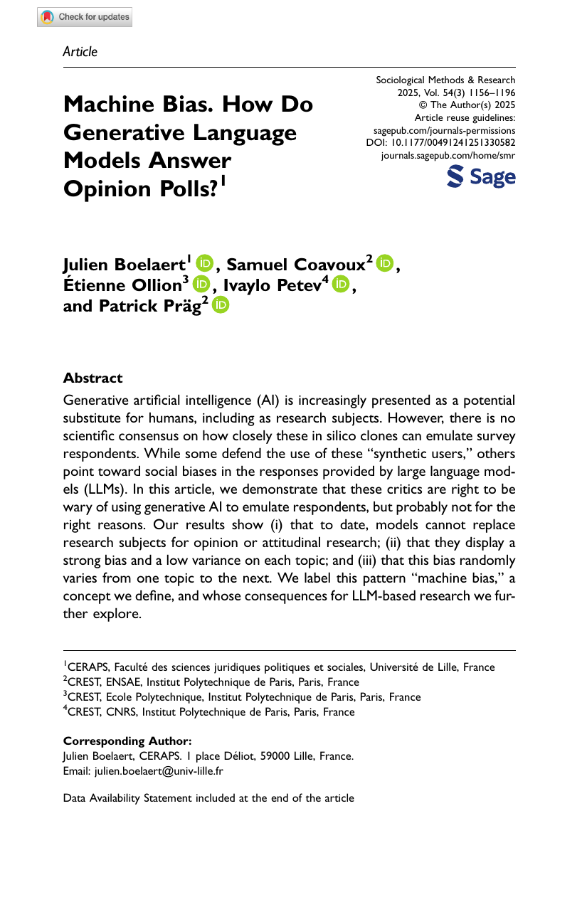<div><p>They compare LLM answers with 148 nationally representative polls from the United States, Britain, France, Germany and Italy.</p><p>The study varies model, prompt, temperature and repeated runs.</p><div class="criterion"><strong>Outcome:</strong> distance between the complete model and human response distributions.</div></div></div>

<div class="citation">Boelaert et al. (2025), “Machine Bias,” <em>Sociological Methods & Research</em> 54(3): 1156–1196.</div>

---

## Their distance measure uses every response category

<div class="cols6040">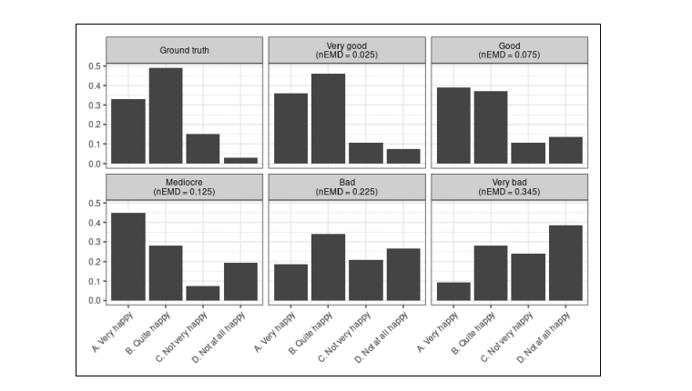<div><p>The normalized Earth Mover’s Distance asks how much probability mass must move, and how far, to turn one ordered distribution into another.</p><div class="output">human: [0.10, 0.20, 0.40, 0.20, 0.10]
model: [0.02, 0.08, 0.70, 0.15, 0.05]</div><p class="compact">Matching the mode is not enough if the rest of the distribution is displaced.</p></div></div>

<div class="citation">Boelaert et al. (2025), Figure 1.</div>

---

## Performance varies by topic, model and country

<div class="cols boelaert-pair" style="--figure-height:315px;">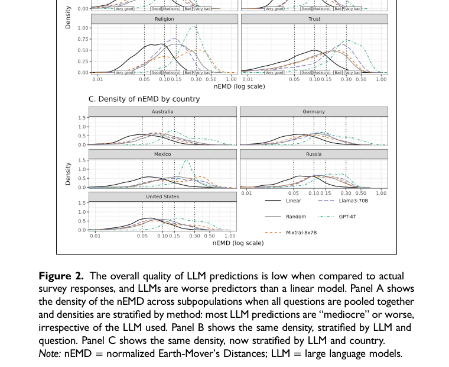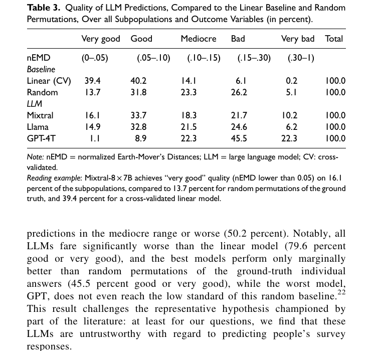</div>

<p class="compact">The error differs by outcome, country and model. Political ideology is among the better-performing topics in this study, while other topics show much larger discrepancies.</p>

<div class="citation">Boelaert et al. (2025), Figure 2.</div>

---

## Broska and colleagues keep human observations in the design

<div class="cols6040">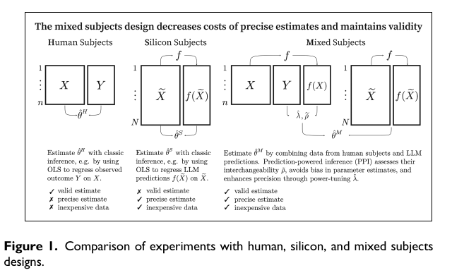<div style="font-size:.91em;"><p><strong>Human observations remain the reference data.</strong></p><p>The model predicts the same outcome for observed people and for additional cases.</p><p>Prediction-powered inference estimates the model's error from the observed human outcomes.</p><p>The predictions add information only when they track the human outcome.</p></div></div>

<div class="citation">Broska, Howes & van Loon (2025), “The Mixed Subjects Design,” <em>Sociological Methods & Research</em> 54(3): 1074–1109, Figure 1.</div>

---

## More LLM predictions can add very little information

<div class="cols4060">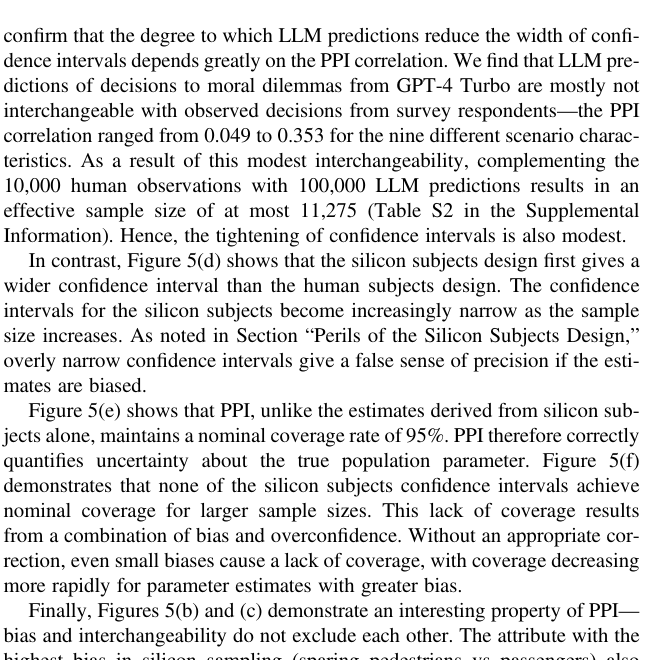<div><p>In the Moral Machine application, the correlation between human and model outcomes ranged from <strong>0.049 to 0.353</strong>.</p><p>Adding <strong>100,000 LLM predictions</strong> to <strong>10,000 human observations</strong> produced an effective sample size of at most <strong>11,275</strong>.</p><p>For one contrast, the LLM-only estimate was <strong>49 percentage points</strong>; the human estimate was <strong>11 points</strong>.</p></div></div>

<div class="citation">Broska, Howes & van Loon (2025), pp. 1098–1100. Human observations remain in every mixed-subjects estimate.</div>

---

## The Prolific study tests four information conditions

<div class="cols4060">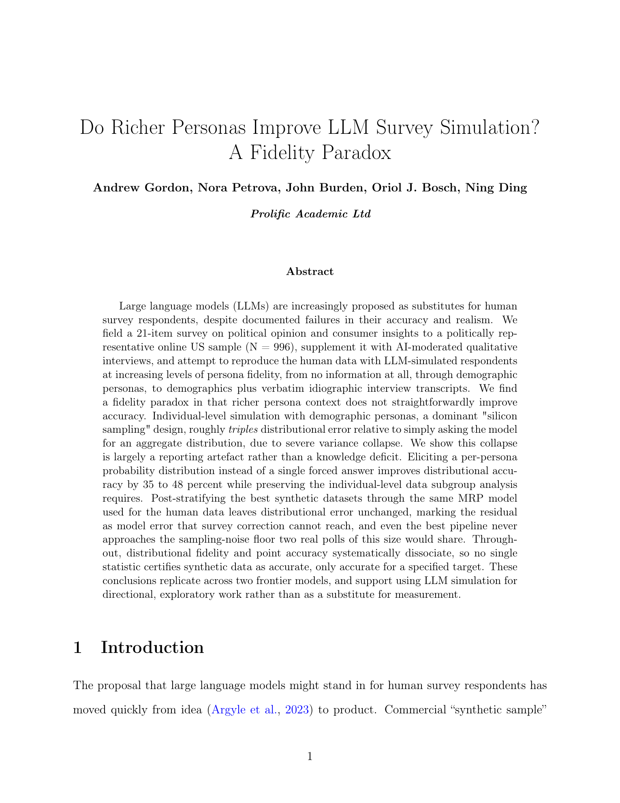<div><p><strong>Human study:</strong> 996 U.S. participants completed a 21-item survey and an AI-moderated voice interview.</p><p><strong>Models:</strong> Claude Sonnet 4.6 and GPT-5.4.</p><p><strong>Comparison:</strong> distributions generated with progressively richer information about the sample or individual.</p></div></div>

<div class="citation">Gordon, Petrova, Burden, Bosch & Ding (2026), “Do Richer Personas Improve LLM Survey Simulation? A Fidelity Paradox.”</div>

---

## L1–L4 describe exactly what the model receives

<table class="tbl"><tr><th>Condition</th><th>Input</th><th>Output level</th></tr><tr><td><strong>L1 · questions only</strong></td><td>Survey questions; no respondent profile</td><td>Aggregate distribution</td></tr><tr><td><strong>L2 · sample description</strong></td><td>Questions plus aggregate sample demographics</td><td>Aggregate distribution</td></tr><tr><td><strong>L3 · demographic persona</strong></td><td>One respondent’s demographic fields</td><td>One prediction per person</td></tr><tr><td><strong>L4 · interview grounded</strong></td><td>That respondent’s fields plus transcript or distilled values</td><td>One prediction per person</td></tr></table>

<div class="purpose">These are the four conditions tested in the Prolific study.</div>

---

## Demographic personas have the largest distributional error

<div class="cols6040">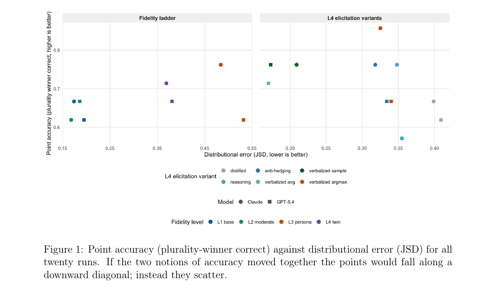<div><p>The figure reports Jensen–Shannon distance between human and model distributions.</p><div class="criterion"><strong>Lower is closer.</strong></div><p>Forced-choice demographic personas produce substantially more error than the aggregate questions-only condition.</p><p>Interview grounding helps relative to demographics alone, but does not beat the aggregate baseline.</p></div></div>

<div class="citation">Gordon et al. (2026), Figure 1.</div>

---

## Asking for probabilities changes the result

<div class="cols"><div><div class="question"><strong>Forced answer</strong><br>Choose one option.</div><div class="output" style="margin-top:18px;">4</div></div><div><div class="question"><strong>Probability output</strong><br>Give a probability for every option.</div><div class="output" style="margin-top:18px;">{"1": .05, "2": .10, "3": .18,
 "4": .32, "5": .17, "6": .12,
 "7": .06}</div></div></div>

<div class="answer" style="font-size:1em; margin-top:28px;">In the study, sampling from probability outputs reduces distributional error by 35–48% across the comparisons.</div>

---

## Post-stratification does not remove the remaining mismatch

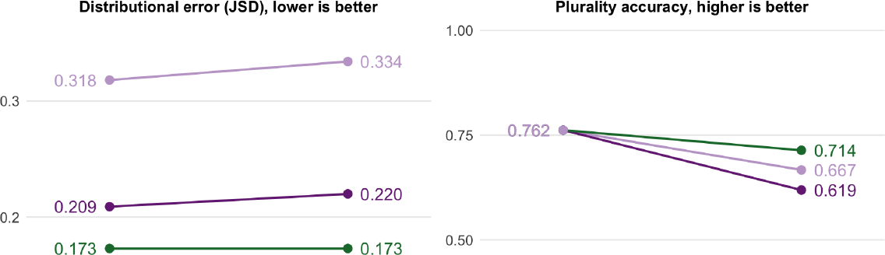

<div class="poststrat-reading"><div><strong>What changes?</strong><p>The same synthetic cases are reweighted through the MRP procedure used for the human data.</p></div><div><strong>Distributional error</strong><p>JSD is unchanged for GPT-5.4 and slightly worse for both Claude variants.</p></div><div><strong>Plurality accuracy</strong><p>All three variants fall from 0.762 after post-stratification.</p></div></div>

<div class="citation">Gordon et al. (2026), Figure 2.</div>

---

## What the current evidence supports

<div class="continuum"><div><strong>Debug a pipeline</strong>Do records parse and plots render?</div><div><strong>Pilot an instrument</strong>Where does wording confuse the model?</div><div><strong>Explore sensitivity</strong>Which results move across prompts and models?</div><div><strong>Predict held-out answers</strong>Compare with people and simpler baselines.</div><div><strong>Replace human measurement</strong>Show that every population feature needed by the claim is preserved.</div></div>

<p style="margin-top:30px;">The studies provide direct evidence for pipeline testing, instrument development and sensitivity analysis. Replacing human measurement requires validation against the population feature used in the final claim.</p>

---

## Week 7 coding task: change what the model receives and returns

<table class="tbl"><tr><th>Condition</th><th>Persona information</th><th>Requested output</th></tr><tr><td><strong>A · forced answer</strong></td><td>Age, education, region and party identification</td><td>One category from 1 to 7</td></tr><tr><td><strong>B · sparse distribution</strong></td><td>The same four demographic fields</td><td>Seven probabilities</td></tr><tr><td><strong>C · richer distribution</strong></td><td>Demographics plus two attitudinal statements</td><td>Seven probabilities</td></tr></table>

<p style="margin-top:24px;">The question and model stay fixed. We can see what changes when the persona and elicitation format change.</p>

---

## Store the survey item and two personas

::: {.code-small}
```python
question = (
    "Where would you place yourself from 1 "
    "(extremely liberal) to 7 (extremely conservative)?"
)

sparse_persona = {
    "age_group": "30–44",
    "education": "bachelor's degree",
    "region": "South",
    "party_identification": "independent",
}

rich_persona = sparse_persona | {
    "economic_view": "government should reduce inequality",
    "social_view": "often supports traditional social norms",
}
```
:::

<div class="purpose"><code>|</code> creates a new dictionary containing the original fields plus the two added key–value pairs.</div>

---

## Condition A requests one forced answer

::: {.code-tiny}
```python
forced_prompt = f"""
Predict this person's answer to the survey item.
Return one category from 1 to 7.

PERSONA: {json.dumps(sparse_persona)}
QUESTION: {question}
"""

forced_schema = {
    "type": "object",
    "properties": {
        "category": {"type": "integer", "minimum": 1, "maximum": 7}
    },
    "required": ["category"],
}
```
:::

<p class="compact">The model has to collapse any uncertainty into one integer.</p>

---

## Conditions B and C request a probability distribution

::: {.code-small}
```python
distribution_schema = {
    "type": "object",
    "properties": {
        "probabilities": {
            "type": "array",
            "items": {"type": "number", "minimum": 0, "maximum": 1},
            "minItems": 7,
            "maxItems": 7,
        }
    },
    "required": ["probabilities"],
}
```
:::

<p class="compact">Both prompts use this schema. Condition B inserts <code>sparse_persona</code>; Condition C inserts <code>rich_persona</code>.</p>

---

## Build the sparse and rich prompts

::: {.code-small}
```python
sparse_distribution_prompt = f"""
Predict probabilities for all seven answers.
PERSONA: {json.dumps(sparse_persona)}
QUESTION: {question}
"""

rich_distribution_prompt = f"""
Predict probabilities for all seven answers.
PERSONA: {json.dumps(rich_persona)}
QUESTION: {question}
"""
```
:::

<div class="cols"><div><strong>Same question</strong><br>The response scale and wording remain fixed.</div><div><strong>Different persona</strong><br>The second string contains two additional attitudinal fields.</div></div>

---

## The route-specific call remains visible

::: {.code-tiny}
```python
messages = [{"role": "user", "content": sparse_distribution_prompt}]

if ROUTE == "openrouter":
    with OpenRouter(api_key=os.environ["OPENROUTER_API_KEY"]) as client:
        response = client.chat.send(
            model=HOSTED_MODEL,
            messages=messages,
            response_format={"type": "json_schema", "json_schema": {
                "name": "distribution", "strict": True,
                "schema": distribution_schema,
            }},
        )
    raw_sparse = response.choices[0].message.content
else:
    response = ollama.chat(
        model=LOCAL_MODEL, messages=messages,
        format=distribution_schema, options={"temperature": 0},
    )
    raw_sparse = response.message.content
```
:::

---

## Parse the two distributions and check the arithmetic

::: {.code-small}
```python
sparse_result = json.loads(raw_sparse)
rich_result = json.loads(raw_rich)

sparse_probabilities = sparse_result["probabilities"]
rich_probabilities = rich_result["probabilities"]

print("Seven sparse values:", len(sparse_probabilities) == 7)
print("Sparse sum:", sum(sparse_probabilities))
print("Rich sum:", sum(rich_probabilities))
```
:::

<p class="compact"><code>json.loads</code> creates dictionaries. Square brackets retrieve the list stored under <code>probabilities</code>. <code>len</code> counts values and <code>sum</code> adds them.</p>

---

## Plot the two probability distributions

::: {.code-small}
```python
scale = [1, 2, 3, 4, 5, 6, 7]

plt.plot(scale, sparse_probabilities, marker="o", label="sparse persona")
plt.plot(scale, rich_probabilities, marker="o", label="richer persona")
plt.xlabel("Political views category")
plt.ylabel("Model-assigned probability")
plt.legend()
plt.show()
```
:::

<p class="compact">The x-values come from <code>scale</code>. The two probability lists supply the y-values.</p>

---

## Compare the three output objects

<table class="tbl"><tr><th>Output</th><th>Python type</th><th>What it shows</th></tr><tr><td><code>forced_category</code></td><td>integer</td><td>The single answer selected under forced choice</td></tr><tr><td><code>sparse_probabilities</code></td><td>list of seven numbers</td><td>The uncertainty implied by demographic labels</td></tr><tr><td><code>rich_probabilities</code></td><td>list of seven numbers</td><td>How two attitudinal statements move probability across the scale</td></tr></table>

<p style="margin-top:24px;">The held-out human answer supports one exact-match check. The two distributions support a sensitivity comparison across persona specifications.</p>

---

## Completion task

<div class="three-questions"><div><strong>Run all three conditions</strong>Explain the input and output of each model call.</div><div><strong>Change one attitude</strong>Edit one value in <code>rich_persona</code>, then rerun Condition C.</div><div><strong>Interpret the plot</strong>Describe what moved and why this is a sensitivity check.</div></div>

<p style="margin-top:30px;">In the recording, explain the dictionary merge operator, list indexing, JSON conversion and the x and y values in the plot.</p>

---

## What would make the opening prediction more convincing?

<div class="three-questions"><div><strong>Re-run it</strong>Change prompt phrasing, model and date. Does the apparent fit survive?</div><div><strong>Try other questions</strong>Does it work beyond one ideology item that models may have seen discussed online?</div><div><strong>Inspect social variation</strong>Does it preserve subgroup distributions and within-group disagreement?</div></div>

<p style="margin-top:35px;">A close histogram warrants further testing. Evidence for population representation also requires other questions, other models, subgroup comparisons and a defensible link between the generated cases and U.S. adults.</p>

---

## Next week: predicting outcomes we did not observe

<div class="cols"><div><h3>Ashokkumar et al.</h3><p>Can LLMs predict the results of social-science experiments?</p><p>We will separate rank-order prediction from calibration and effect-size inflation.</p></div><div><h3>Centaur</h3><p>Can a model trained across many psychology experiments predict human choices in held-out tasks?</p><p>It is useful context, but less directly about population representation.</p></div></div>

<p class="compact">Week 8 focuses on the held-out outcome, the comparison baseline and the scope of the resulting prediction claim.</p>

<div class="citation">Ashokkumar et al. (2026), <em>Nature</em>, https://doi.org/10.1038/s41586-026-10742-x; Binz et al. (2025), <em>Nature</em>, https://doi.org/10.1038/s41586-025-09215-4.</div>

---

## Additional reading

- Kozlowski & Evans (2025), “Simulating Subjects.”
- Broska, Howes & van Loon (2025), “The Mixed Subjects Design.”
- Gordon et al. (2026), “Do Richer Personas Improve LLM Survey Simulation? A Fidelity Paradox.”
- Lepore & Berman (2021), “The People Machine: The Earliest Machine Learning?”

<p style="margin-top:36px;">For every result, state what the model produced, which human evidence supplied the comparison and which claim that comparison evaluates.</p>

<script>
document.addEventListener("DOMContentLoaded", () => {
  document.querySelectorAll(".tse-tab").forEach((button) => {
    button.addEventListener("click", () => {
      const column = button.closest(".tse-tab-column");
      column.querySelectorAll(".tse-tab").forEach((tab) => tab.classList.remove("active"));
      column.querySelectorAll(".tse-panel").forEach((panel) => panel.classList.remove("active"));
      button.classList.add("active");
      column.querySelector("#" + button.dataset.target).classList.add("active");
    });
  });
});
</script>
