## Prediction targets

<div class="campaign-brief">A campaign asks: <strong>Which voters might support us, where are they, and how could they respond to what we say?</strong></div>

<div class="question-list"><div><span>Now</span><p>What does the electorate report today?</p></div><div><span>Election day</span><p>Who will vote, and what will the final result be?</p></div><div><span>Campaign response</span><p>How might different voters react to a message?</p></div><div><span>Missing answer</span><p>What would one person say if we asked another question?</p></div></div>

<div class="plain-note">These questions require different data and different checks. An LLM can return an answer to all four.</div>

---

## National and state polling in 2016

<div class="aapor-layout">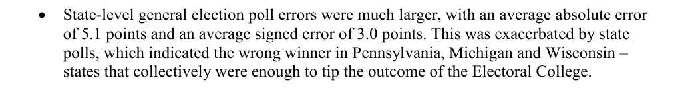<div class="aapor-results"><div><span>National polls</span><b>2.2 points</b><p>Average absolute error. They correctly showed Clinton winning the popular vote.</p></div><div><span>State polls</span><b>5.1 points</b><p>Average absolute error. Pennsylvania, Michigan and Wisconsin were called for the wrong winner.</p></div></div></div>

<div class="plain-note">Those three states were enough to change the Electoral College result. The national and state polls were estimating different quantities from different samples.</div>

<p class="citation">AAPOR Ad Hoc Committee on 2016 Election Polling (2017), <em>An Evaluation of 2016 Election Polls in the U.S.</em>, pp. 8–11.</p>

---

## Sources of state polling error in 2016

<div class="diagnosis-layout">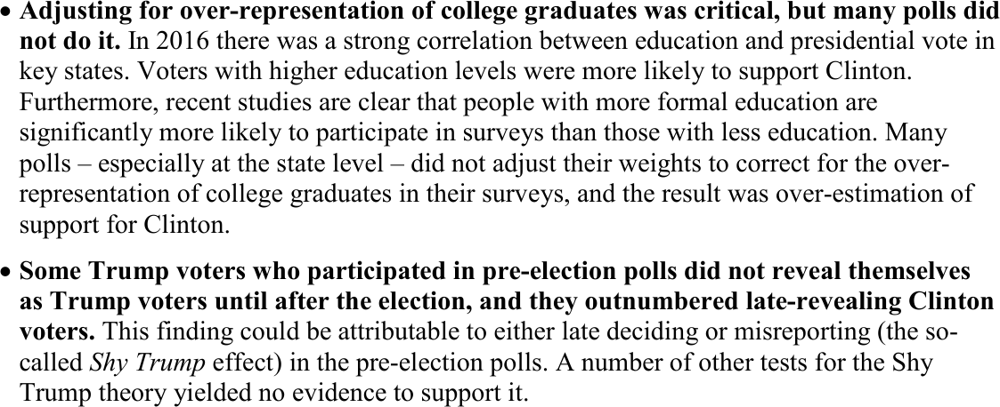<div class="diagnosis-points"><div><b>Education weighting</b><p>College graduates answer surveys at higher rates and were more likely to support Clinton. Many state polls did not correct for their over-representation.</p></div><div><b>Late movement</b><p>About 13% of voters in Wisconsin, Florida and Pennsylvania decided in the final week. Those voters broke heavily for Trump.</p></div></div></div>

<div class="plain-note"><strong>Less convincing explanations:</strong> AAPOR found no general evidence for a “shy Trump” effect. Changes in turnout may have contributed, but likely-voter models produced small and inconsistent effects in the available tests.</div>

<p class="citation">AAPOR Ad Hoc Committee (2017), Executive Summary, pp. 2–3. The committee included survey researchers and election-polling practitioners.</p>

---

## Correlated polling errors in election forecasts

<div class="forecast-layout"><div class="forecast-pipeline"><div>State polls overstated Clinton in several related states</div><i>+</i><div>A model decides how often state errors move together</div><i>+</i><div>Thousands of simulated elections</div><i>→</i><div>Win probability</div></div><div class="forecast-range"><span>Published forecasts for Clinton</span><div><b>71%</b><em>to</em><b>&gt;99%</b></div><p>More polls do not remove an error shared across states. The forecast must allow for that possibility.</p></div></div>

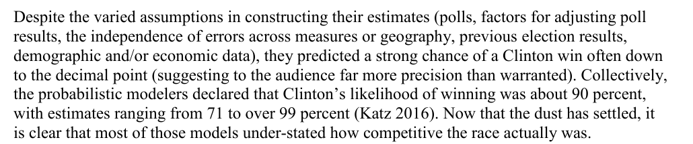

<p class="citation">AAPOR (2017), pp. 48–50. The committee agreed that polls and forecasts answer different questions, but did not reach a single verdict on forecasting. It recommended greater caution about precise probabilities.</p>

---

## The World3 model

<div class="world3-layout">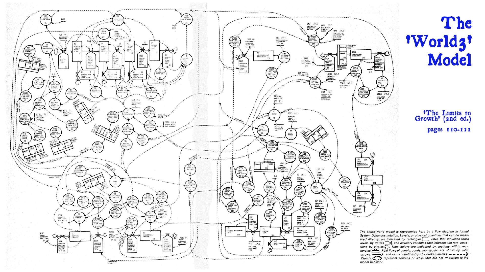<div><p>The 1972 <em>Limits to Growth</em> project linked population, food production, industrial output, pollution and non-renewable resources.</p><p>The model asked how feedback among these quantities could produce long-run global trajectories.</p><div class="history-point">World3 represents society through stocks, flows and feedback loops rather than individual survey responses.</div></div></div>

<p class="citation">Meadows, Meadows, Randers & Behrens (1972), <em>The Limits to Growth</em>. World3 diagram reproduced by Resilience.org (2021).</p>

---

## Sugarscape and the Sentient World Simulation

<div class="odd-models"><div class="odd-model sugarscape">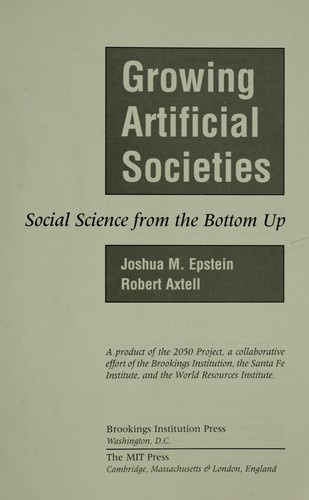<div><b>Sugarscape</b><p>Agents move around a landscape looking for sugar. Simple local rules generate wealth inequality, migration, trade, conflict and population collapse.</p><small>Epstein & Axtell, 1996</small></div></div><div class="odd-model sws"><div class="sws-document"><span>DRAFT · 2006</span><b>Sentient World Simulation</b><em>A Continuously Running Model of the Real World</em></div><div><p>The proposal described a “synthetic mirror” updated with events, polls, demographics and economic reports.</p><p>It was intended to test possible courses of action, including military psychological operations.</p><small>Cerri & Chaturvedi, 2006</small></div></div></div>

<p class="citation">Epstein & Axtell (1996), <em>Growing Artificial Societies</em>; Cerri & Chaturvedi (2006), <em>Sentient World Simulation</em>, Purdue University and U.S. Joint Forces Command concept paper.</p>

---

## Companies now sell simulated audiences

<div class="current-systems"><div class="current-system"><div><b>Simile</b><p>Builds simulated populations from human data, then compares how the same population responds when a concept, price or message changes.</p><small>Its site reports weekly comparisons with real human responses.</small></div></div><div class="current-system societies"><div><b>Artificial Societies</b><p>Links 12 to 3,500 personas in social networks and exposes them to messages and scenarios.</p><small>It markets surveys, focus groups, experiments and scenario cascades.</small></div></div></div>

<div class="plain-note">These are company descriptions of their products. They tell us what is being sold, not how well either system predicts a new population or intervention.</div>

<p class="citation">Simile, “Simulating human behavior”; Artificial Societies, “Solutions: AI Audience Simulation.” Company websites accessed 26 October 2026.</p>

---

## Polling, forecasting and intervention effects

<div class="prediction-jobs"><div><b>Current opinion</b><p>What do sampled respondents report at a particular time?</p><small>Polling</small></div><div><b>Opinion where samples are thin</b><p>What is support in a state or subgroup with few direct observations?</p><small>Small-area estimation</small></div><div><b>A later result</b><p>What vote will occur after the campaign and turnout decisions?</p><small>Election forecasting</small></div><div><b>Response to an intervention</b><p>How might voters respond if a campaign changes its message?</p><small>Experiment or simulation</small></div></div>

<div class="plain-note">Before judging a model, specify its target. A good estimate of today's popular vote is not automatically a good forecast of the Electoral College or of how voters would react to a new message.</div>

<p class="citation">Gelman & King (1993), <em>British Journal of Political Science</em> 23(4): 409–451; Linzer (2013), <em>Journal of the American Statistical Association</em> 108(501): 124–134.</p>

---

## Prediction tasks for LLMs

<table class="closed-table prediction-table"><thead><tr><th>Request</th><th>Possible model output</th><th>Evidence needed for a check</th></tr></thead><tbody><tr><td>Fill a skipped answer</td><td>One predicted response</td><td>The person’s held-out answer</td></tr><tr><td>Estimate an earlier year</td><td>An opinion distribution</td><td>A comparable survey from that year</td></tr><tr><td>Describe a state</td><td>State support for a policy</td><td>Representative state data</td></tr><tr><td>Predict a campaign effect</td><td>A difference between messages</td><td>A randomized human experiment</td></tr></tbody></table>

<div class="plain-note">Similar-looking Python output can represent an individual answer, an aggregate estimate or an experimental effect. Each requires different validation data.</div>

---

## Estimating state opinion

<div class="opening-case"><div><span>Observed</span><p>A national survey contains people from every state, but too few respondents in many states for a reliable state estimate.</p></div><div><span>Wanted</span><p>Support for same-sex marriage in each state, followed by an analysis of whether state policy responds to those preferences.</p></div></div>

<div class="big-question">State estimates require information beyond the respondents observed in each state.</div>

---

## Lax and Phillips estimate state opinion

<div class="paper-layout">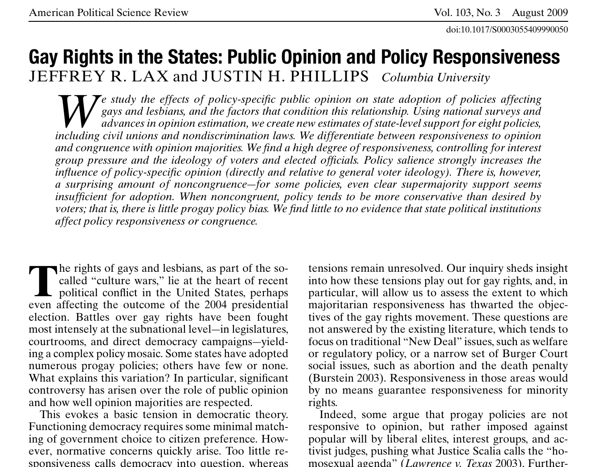<div><p>The substantive question is whether state policies on gay and lesbian rights respond to state public opinion.</p><p>The obstacle is measurement: national surveys contain too few respondents in many states.</p><p>Their approach uses human survey answers, a multilevel model, and population counts—not simulated respondents.</p></div></div>

<p class="citation" style="font-size:.48em;">Lax, J. R., and J. H. Phillips. (2009). “Gay Rights in the States: Public Opinion and Policy Responsiveness.” <em>American Political Science Review</em> 103(3):367–386. https://doi.org/10.1017/S0003055409990050.</p>

---

## Multilevel regression and poststratification

<div class="mrp"><div><b>1. Estimate responses</b><p>Use observed survey answers to estimate how opinion varies across demographic and geographic groups.</p></div><div><b>2. Reweight to the state</b><p>Combine those estimates with known population counts for each demographic cell in each state.</p></div></div>

<div class="example-strip"><code>survey answers</code><i>+</i><code>statistical model</code><i>+</i><code>state population counts</code><i>→</i><code>estimated state opinion</code></div>

<p class="citation">Lax and Phillips (2009), pp. 371–373 and online appendix.</p>

---

## State opinion predicts policy adoption

<div class="figure-layout">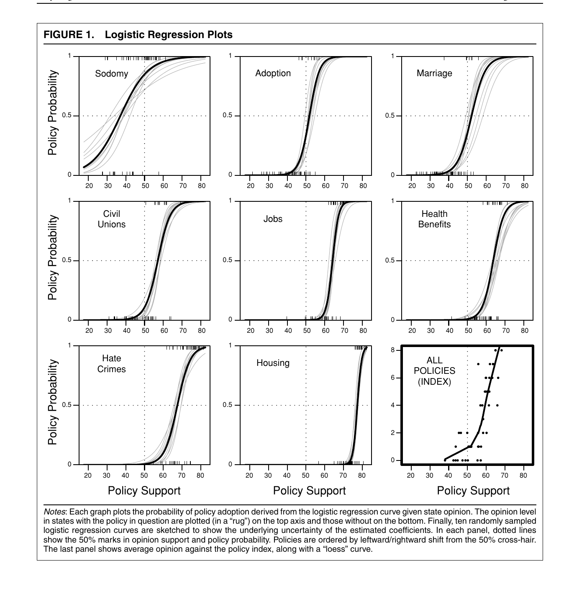<div><p>Each panel relates estimated public support to the probability that a state has adopted a policy.</p><p>For every policy, greater support is associated with a higher probability of adoption.</p><p>The location of the curve matters as well as its slope. Some policies remain unlikely even when a majority supports them.</p></div></div>

<p class="citation">Lax and Phillips (2009), Figure 1, p. 374.</p>

---

## Responsiveness and policy congruence

<div class="result-comparison"><div><b>Adoption and marriage</b><p>The curves pass close to the point where 50% support corresponds to a 50% probability of adoption.</p><p>These policies were comparatively congruent with state opinion.</p></div><div><b>Jobs, housing, health and hate-crime laws</b><p>At 50% public support, adoption remained very unlikely.</p><p>For housing protection, support had to exceed roughly 75% before adoption reached a 50% probability.</p></div></div>

<div class="big-question compact-question">Responsiveness means that policy changes with opinion. Congruence asks whether the majority actually gets its preferred policy.</div>

<p class="citation">Lax and Phillips (2009), pp. 374–376. The authors report higher adoption probabilities as policy-specific support rises, alongside substantial differences in congruence across policies.</p>

---

## Evidence used by Lax and Phillips

<div class="evidence-chain"><div><b>Human responses</b><p>People answered real survey questions.</p></div><div><b>Population counts</b><p>Census cells tell us who lives in each state.</p></div><div><b>Validated estimates</b><p>MRP is compared with direct estimates and election data.</p></div><div><b>Policy outcomes</b><p>State law supplies the substantive outcome.</p></div></div>

<div class="plain-note">An LLM prediction would insert generated answers into this evidence chain. The resulting estimates would need a separate validation step.</div>

---

## Four missing-data targets

<table class="closed-table"><thead><tr><th>Target</th><th>Example</th><th>What we would compare with</th></tr></thead><tbody><tr><td>One person's answer</td><td>A respondent skipped <code>POLVIEWS</code>.</td><td>The held-out answer from that person.</td></tr><tr><td>A survey item in an earlier year</td><td>The GSS did not ask an item in 1988.</td><td>A comparable poll from 1988, if one exists.</td></tr><tr><td>An aggregate quantity</td><td>Support for same-sex marriage in Utah.</td><td>A sufficiently large state poll or election result.</td></tr><tr><td>A relationship</td><td>Whether policy is more likely where support is higher.</td><td>Observed policy and validated opinion estimates.</td></tr></tbody></table>

<div class="plain-note">Kim and Lee study the first two rows directly. Results for one target do not establish accuracy for the others.</div>

---

## Kim and Lee predict missing survey answers

<div class="paper-layout">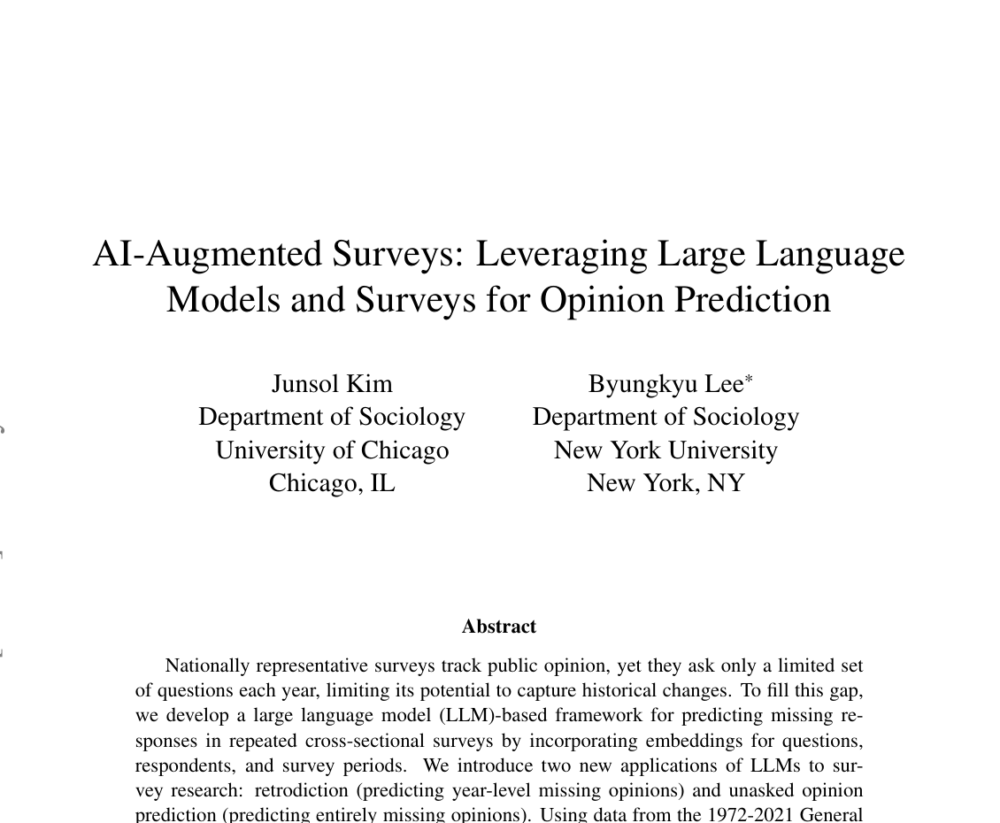<div><p>The data are 3,110 binarized opinions from 68,846 GSS respondents between 1972 and 2021.</p><p>The model learns from survey questions, respondents' other answers, and survey years.</p><p>The paper asks whether this combination can predict opinions that were not observed.</p></div></div>

<p class="citation">Kim, J., and B. Lee. (2026). “AI-Augmented Surveys: Leveraging Large Language Models and Surveys for Opinion Prediction.” arXiv:2305.09620v4.</p>

---

## Imputation, retrodiction and unasked opinions

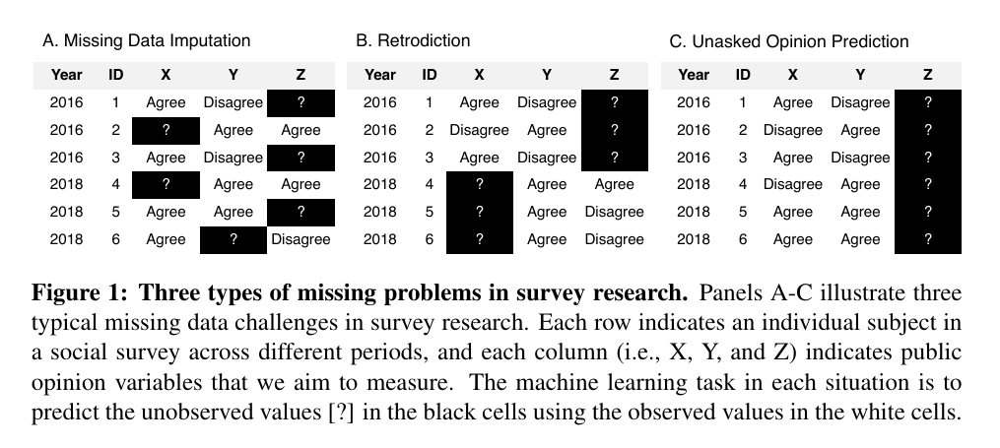

<div class="three-jobs"><div><b>Imputation</b><p>An answer is missing inside an otherwise observed survey.</p></div><div><b>Retrodiction</b><p>An item was not asked in a particular survey year.</p></div><div><b>Unasked opinion</b><p>An item has never been asked in the survey data.</p></div></div>

<p class="citation">Kim and Lee (2026), Figure 1, p. 3.</p>

---

## How retrodiction is evaluated

<div class="result-comparison"><div><b>Masked GSS question-year cells</b><p>The researchers remove question-year combinations that the GSS actually observed. The model never sees those responses during training.</p><p>Because the answers still exist in the research data, they can assess individual predictions and survey-weighted aggregate estimates.</p></div><div><b>Years when the GSS did not ask the question</b><p>No GSS respondent-level answers exist for these years.</p><p>The researchers compare the predicted national percentage with independent surveys in the Roper archive that asked a closely matched question.</p></div></div>

<div class="plain-note">Only the masked-data exercise can assess individual accuracy. Validation for genuinely unobserved GSS years is aggregate.</div>

<p class="citation">Kim and Lee (2026), “Model Evaluation,” pp. 10–12, and “External validation using surveys from Roper Center archive,” pp. 17–19.</p>

---

## Kim and Lee train a survey-specific model

<div class="figure-layout wide-left">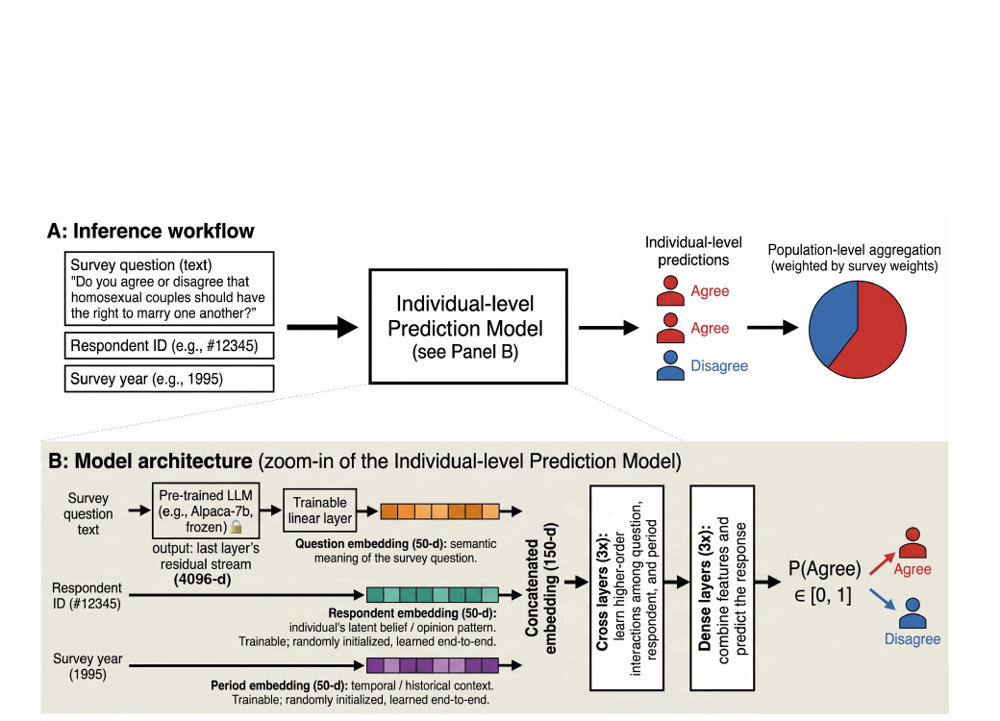<div><p>The model incorporates embeddings for the survey question, the respondent and the survey period.</p><p>It is fine-tuned on observed GSS responses, then predicts an individual answer that can be aggregated with survey weights.</p><p>The human survey data calibrate the model. They are not replaced by a demographic description.</p></div></div>

<p class="citation">Kim and Lee (2026), Figure 2, p. 7.</p>

---

## Performance across the three prediction tasks

<div class="figure-layout">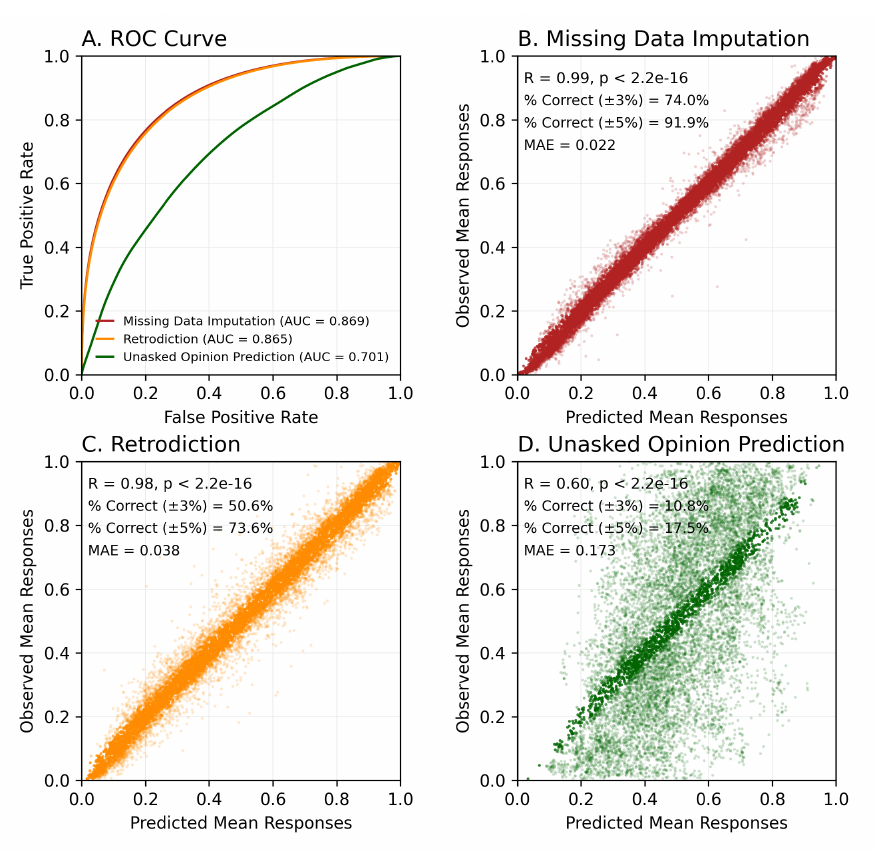<div><p><strong>Imputation:</strong> 91.9% of observed aggregate values fall within five percentage points of the prediction.</p><p><strong>Masked retrodiction:</strong> 73.6% of held-out GSS question-year means fall within five points.</p><p><strong>Unasked opinion:</strong> only 17.5% fall within five points. Even a ten-point interval contains 34.3%.</p><p>These percentages come from cross-validation against GSS observations that the researchers temporarily withheld.</p></div></div>

<p class="citation">Kim and Lee (2026), Figure 3 and discussion, pp. 15–18.</p>

---

## External validation with the Roper archive

<div class="figure-layout wide-left">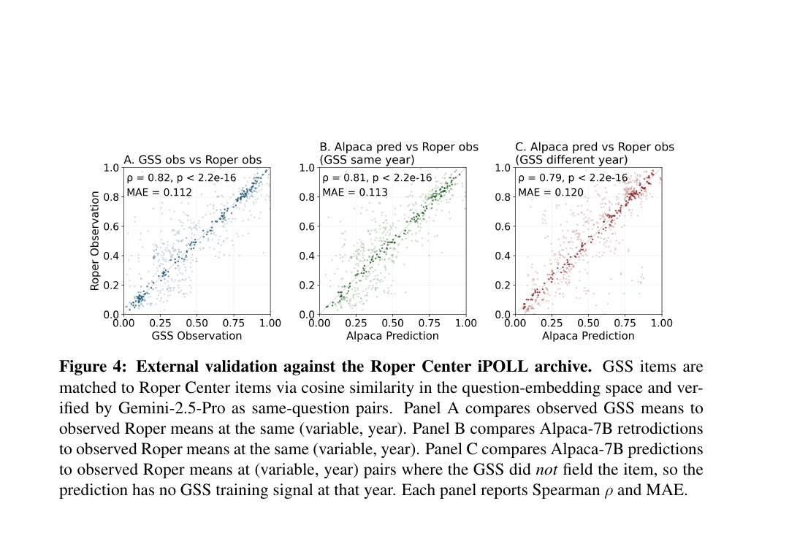<div><p>Kim and Lee match GSS questions to national surveys in the Roper iPOLL archive.</p><p>Observed GSS and Roper estimates correlate at <strong>ρ = .82</strong>.</p><p>For years when the GSS did not ask the item, model predictions correlate with Roper estimates at <strong>ρ = .79</strong>, with mean absolute error of <strong>.120</strong>.</p><p>This tests national percentages from independent samples. It cannot determine whether the model correctly predicted any particular person's response.</p></div></div>

<p class="citation">Kim and Lee (2026), Figure 4 and discussion, pp. 18–19.</p>

---

## Statistical realism in synthetic social data

<div class="paper-layout">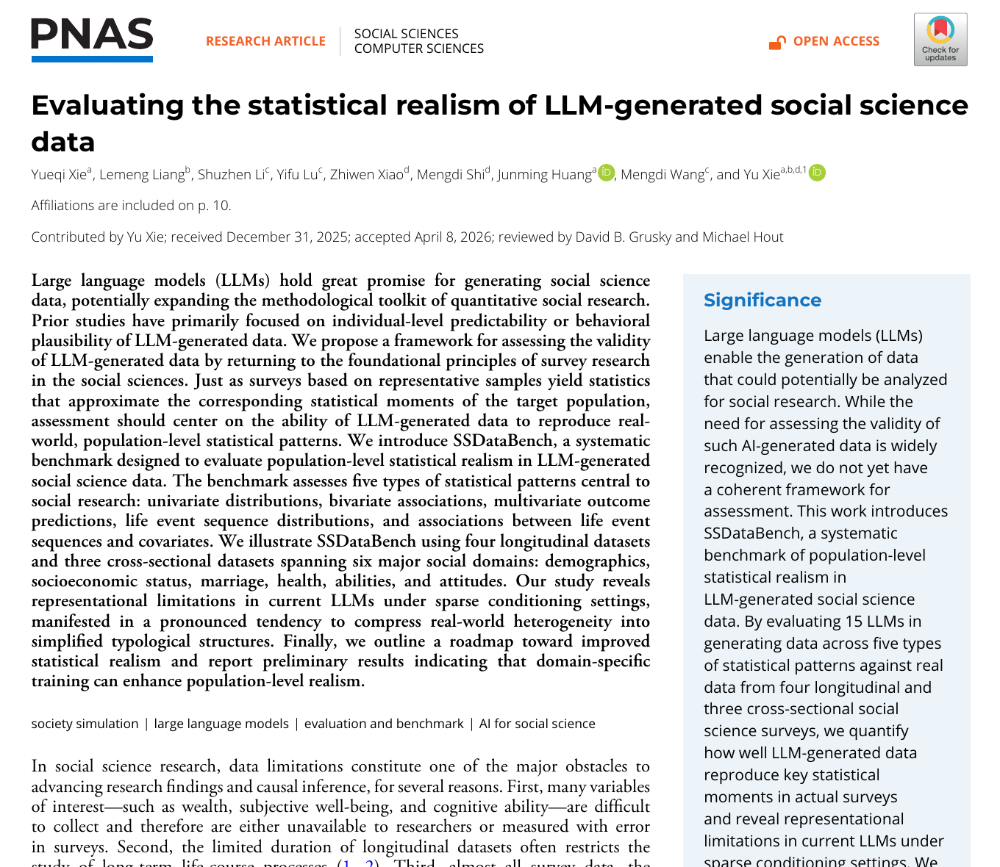<div><p>They evaluate 15 models against four longitudinal and three cross-sectional social-science datasets.</p><p>The benchmark evaluates whether the generated population preserves statistical patterns found in the observed data.</p><p>Individual records can sound plausible while these population-level patterns are wrong.</p></div></div>

<p class="citation" style="font-size:.48em;">Xie, Y., L. Liang, S. Li, et al. (2026). “Evaluating the Statistical Realism of LLM-Generated Social Science Data.” <em>PNAS</em> 123(19):e2538145123. https://doi.org/10.1073/pnas.2538145123.</p>

---

## Five tests of population realism

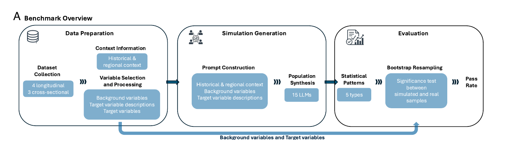

<div class="five-tests"><div><b>1 · Distribution</b><p>Does one variable have the same shape?</p></div><div><b>2 · Association</b><p>Is the relationship between two variables preserved?</p></div><div><b>3 · Prediction</b><p>Do covariates predict an outcome in the same way?</p></div><div><b>4 · Sequence</b><p>Are life events ordered similarly?</p></div><div><b>5 · Sequence by group</b><p>Do those sequences vary with a covariate?</p></div></div>

<p class="citation">Xie et al. (2026), Figure 1, p. 3.</p>

---

## No model passes all five tests reliably

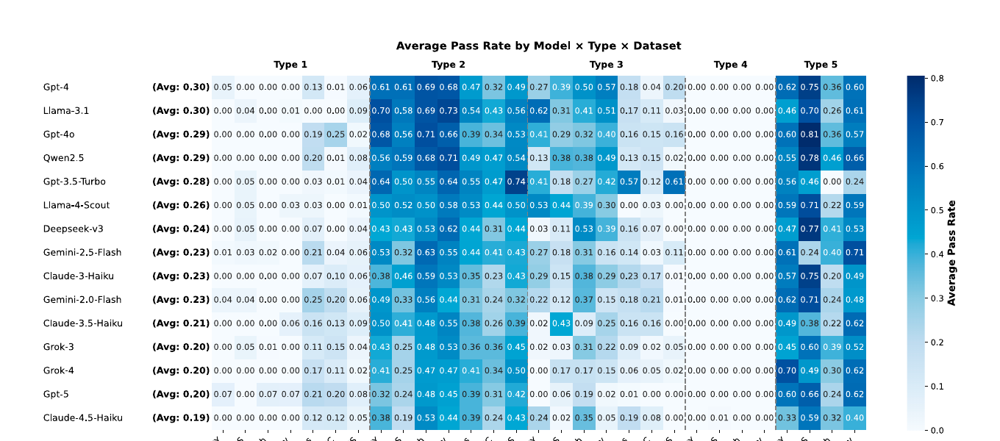

<div class="reading-figure"><b>How to read this:</b> darker cells indicate a larger share of statistical tests on which simulated and observed data were not significantly different. Performance varies by model, dataset and type of pattern; no row is uniformly dark.</div>

<p class="citation">Xie et al. (2026), Figure 2, p. 5.</p>

---

## The generated data often compress real heterogeneity

<div class="figure-layout">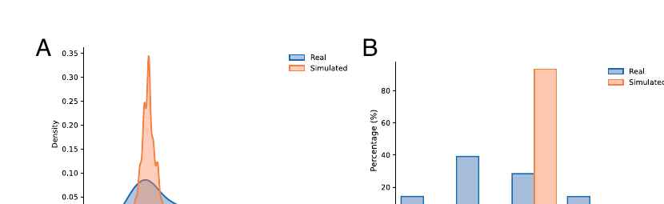<div><p>For age at first marriage, the generated distribution is concentrated between roughly 17 and 26. The observed data have much longer tails.</p><p>For self-rated memory, generated cases cluster heavily around “good.” The observed answers are spread across the response scale.</p><p>In both examples, the synthetic population contains fewer unusual cases.</p></div></div>

<p class="citation">Xie et al. (2026), Figure 3 and discussion, pp. 5–7.</p>

---

## Ashokkumar and colleagues predict experimental effects

<div class="paper-layout title-page-layout">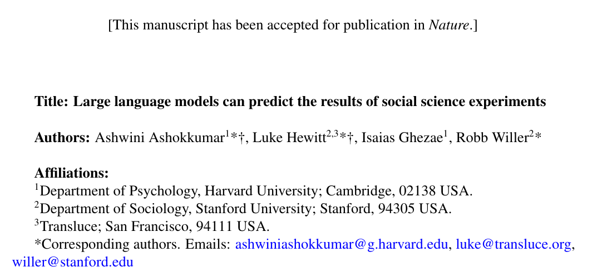<div><p>The archive contains 70 nationally representative US survey experiments and 469 treatment effects.</p><p>The model receives the study materials and demographically varied participant profiles. It simulates responses under each experimental condition.</p><p>The model prediction is the difference between the simulated treatment and control conditions. The published human experiment supplies the comparison.</p></div></div>

<p class="citation">Ashokkumar, Hewitt, Ghezae & Willer (2026), “Large Language Models Can Predict the Results of Social Science Experiments,” <em>Nature</em> 656:115–122.</p>

---

## The forecasts rank effects well but overstate their size

<div class="figure-layout wide-left">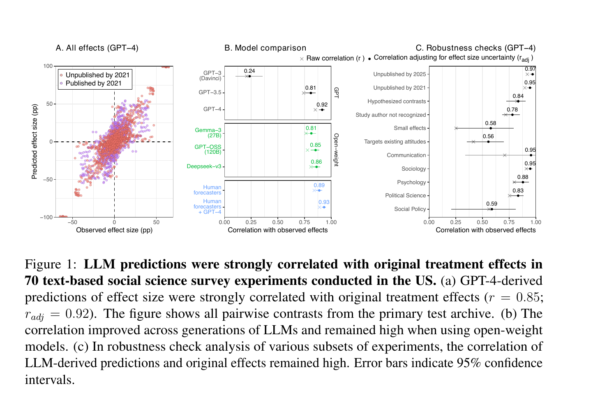<div><p>Across the main archive, predicted and observed effects correlate at <strong>r = .85</strong>.</p><p>The relationship remains strong for experiments unavailable before the model's training cutoff.</p><p>But the predicted effects are roughly <strong>twice as large</strong> as the observed effects on average.</p></div></div>

<p class="citation">Ashokkumar et al. (2026), Figure 1 and pp. 5–6. The correlation is about ranking; calibration asks whether the magnitudes are right.</p>

---

## Binz and colleagues introduce Centaur

<div class="paper-layout title-page-layout">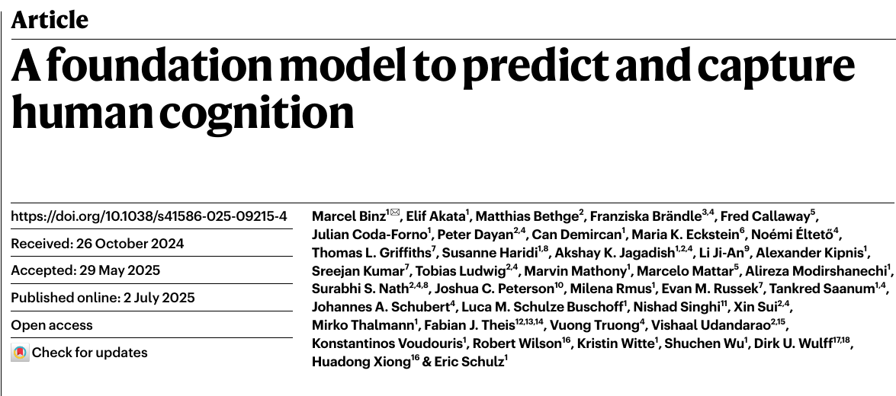<div><p>Centaur is a language model fine-tuned to predict trial-by-trial behaviour in psychology experiments.</p><p>The paper asks whether one model can predict choices across many tasks rather than fitting a separate cognitive model for each experiment.</p><p>The next two slides show the training data and the tests on modified or previously unseen tasks.</p></div></div>

<p class="citation">Binz et al. (2025), “A Foundation Model to Predict and Capture Human Cognition,” <em>Nature</em> 644:1002–1009.</p>

---

## Centaur and the Psych-101 dataset

<div class="centaur-layout">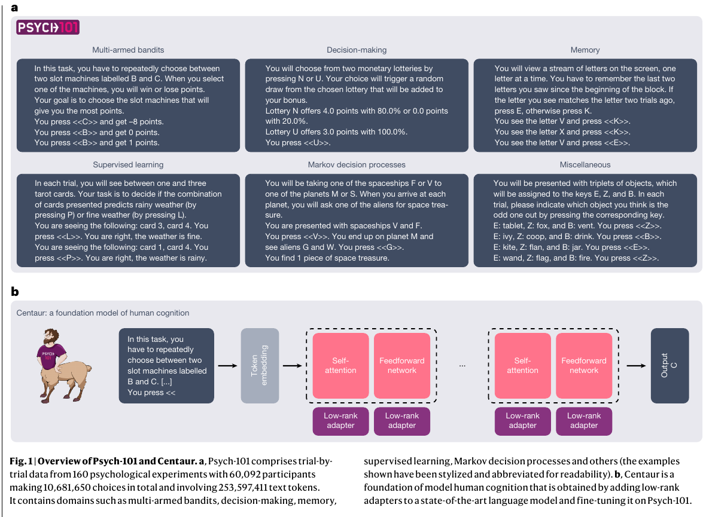<div><p><strong>Psych-101 contains 160 experiments, 60,092 participants and 10,681,650 choices.</strong></p><p>The tasks cover bandit problems, decision-making, memory, supervised learning and Markov decision processes.</p><p>Centaur adds low-rank adapters to a language model and fine-tunes them on this common text representation.</p></div></div>

<p class="citation">Binz et al. (2025), “A Foundation Model to Predict and Capture Human Cognition,” <em>Nature</em> 644:1002–1009, Figure 1.</p>

---

## Centaur on modified and unseen tasks

<div class="centaur-layout heldout">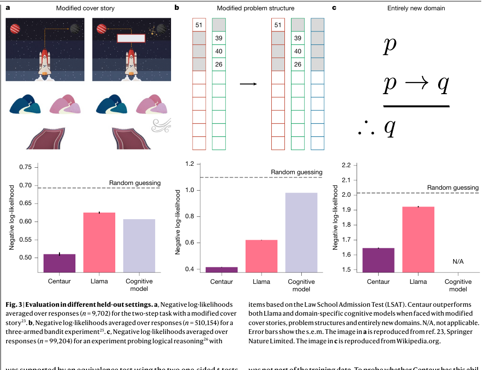<div><p>The authors change a task's cover story, alter its structure and test a logical-reasoning domain absent from Psych-101.</p><p>Lower negative log-likelihood indicates a better prediction. Centaur performs better than the base Llama model in all three panels.</p><p>These tests are broader than matching held-out participants within familiar tasks, but they still cover a small set of designed experiments.</p></div></div>

<p class="citation">Binz et al. (2025), Figure 3. Panels show a modified cover story, a modified problem structure and an entirely new domain.</p>

---

## Targets and validation data

<table class="closed-table comparison-table"><thead><tr><th>Reading</th><th>Target</th><th>Human comparison</th><th>Main question</th></tr></thead><tbody><tr><td>Lax & Phillips</td><td>State opinion</td><td>Direct estimates and election data</td><td>Do estimated preferences explain policy?</td></tr><tr><td>Kim & Lee</td><td>Answers and item-year means</td><td>Held-out GSS and Roper surveys</td><td>Can observed survey information recover missing opinions?</td></tr><tr><td>Xie et al.</td><td>Population structure</td><td>Observed social-science datasets</td><td>Which distributions and relationships survive?</td></tr><tr><td>Ashokkumar et al.</td><td>Treatment effects</td><td>Randomized human experiments</td><td>Can the model forecast the direction and size of effects?</td></tr></tbody></table>

---

## Validation by target

<div class="target-grid"><div><b>Individual answer</b><p>Compare with that person's held-out response.</p></div><div><b>Population</b><p>Compare distributions and relationships, not just one mean.</p></div><div><b>Treatment effect</b><p>Compare differences between randomized human conditions.</p></div><div><b>Cross-context claim</b><p>Test studies, populations and tasks absent from development data.</p></div></div>

<div class="big-question">A result for one target, population or task does not establish accuracy in another setting.</div>

---

## Coding exercise {.section-slide}

We will ask OpenRouter and Ollama to forecast effects in political participation, environmental behaviour and risky choice, then reveal the published human results.

---

## Classroom benchmark design

<div class="task-brief"><span>Input</span><p>The population, control, treatment and outcome from each experiment.</p><span>Model output</span><p>A predicted control rate and treatment rate.</p><span>Operation</span><p>Subtract the control rate from the treatment rate.</p><span>Check</span><p>Compare the predicted effect with the published human effect.</p></div>

<div class="plain-note">This exercise forecasts the two rates directly. Ashokkumar et al. instead simulate demographically varied participants. The exercise teaches the comparison with human results but does not reproduce their design.</div>

---

## Three published experiments

<div class="three-jobs"><div><b>Voter turnout</b><p>No mailing versus a mailing that publicizes the household's and neighbours' voting records.</p><small>29.7% → 37.8%</small></div><div><b>Towel reuse</b><p>An environmental appeal versus a message saying that almost 75% of guests reuse towels.</p><small>35.1% → 44.1%</small></div><div><b>Risky choice</b><p>The same disease outcomes described as lives saved or lives lost.</p><small>72% → 22% choosing the certain option</small></div></div>

<p class="citation">Gerber, Green & Larimer (2008); Goldstein, Cialdini & Griskevicius (2008); Tversky & Kahneman (1981). The published rates are visible in the research record but excluded from the model input.</p>

---

## The list contains three dictionaries

```python
experiments = [
    {"id": "turnout", "context": "Michigan registered voters",
     "control": "No mailing", "treatment": "Public voting-record mailing",
     "outcome": "Percent who voted",
     "human_control": 29.7, "human_treatment": 37.8},
    # towels and disease follow
]
```

<div class="io-grid"><div><b><code>experiments</code></b><p>A list holding three study records.</p></div><div><b><code>experiments[0]</code></b><p>The turnout dictionary.</p></div><div><b><code>experiments[0]["human_control"]</code></b><p>A float: <code>29.7</code>.</p></div></div>

---

## Constructing the model input

```python
experiment_for_model = {
    "context": experiment["context"],
    "control": experiment["control"],
    "treatment": experiment["treatment"],
    "outcome": experiment["outcome"],
}
```

<div class="before-after"><div><b>Research record</b><p>Study materials and published human rates.</p></div><i>→</i><div><b>Model input</b><p>Study materials only.</p></div></div>

<div class="plain-note">The code withholds the rates. These famous studies may still occur in a model's training data, which we must consider when interpreting a good result.</div>

---

## The loop handles one experiment at a time

```python
hosted_results = []
local_results = []

for experiment in experiments:
    print("Current experiment:", experiment["id"])
```

<div class="loop-trace"><div><b>Before the loop</b><p>Both result lists are empty.</p></div><div><b>First pass</b><p><code>experiment</code> means the turnout dictionary.</p></div><div><b>Third pass</b><p><code>experiment</code> means the disease-framing dictionary.</p></div></div>

---

## The prompt asks for two percentages

```python
prompt = (
    "Forecast the two outcome rates for this randomized "
    "experiment in the stated population. Return percentages.\n"
    + json.dumps(experiment_for_model, indent=2)
)
messages = [{"role": "user", "content": prompt}]
```

<div class="io-grid"><div><b>Input</b><p>One experiment dictionary.</p></div><div><b>Operation</b><p><code>json.dumps</code> turns it into readable text.</p></div><div><b>Output</b><p>A message list sent unchanged through both routes.</p></div></div>

---

## Both routes receive the same research material

<div class="route-compare"><div><b>OpenRouter</b><pre><code>hosted_response = client.chat.send(
    model=HOSTED_MODEL,
    messages=messages,
    temperature=temperature,
    response_format=...,
)</code></pre><p>The request goes to the hosted course model.</p></div><div><b>Ollama</b><pre><code>local_response = ollama.chat(
    model=LOCAL_MODEL,
    messages=messages,
    format=schema,
    options={"temperature": temperature},
)</code></pre><p>The request goes to the model running on this computer.</p></div></div>

---

## One local forecast for the towel experiment

<div class="demo-result"><div><span>Raw JSON from Ollama</span><pre><code>{
  "predicted_control_percent": 30,
  "predicted_treatment_percent": 75
}</code></pre><small><code>gemma4:e2b-it-qat</code> · temperature 0 · 26 October 2026</small></div><div><table class="closed-table demo-table"><thead><tr><th></th><th>Model</th><th>Human study</th></tr></thead><tbody><tr><td>Control</td><td>30.0%</td><td>35.1%</td></tr><tr><td>Treatment</td><td>75.0%</td><td>44.1%</td></tr><tr><td>Effect</td><td>+45.0 points</td><td>+9.0 points</td></tr><tr><td>Absolute error</td><td colspan="2">36.0 points</td></tr></tbody></table></div></div>

<div class="plain-note">The model predicts the direction correctly but greatly overstates the effect. This is one dated run using the same prompt and schema as the workbook, so a rerun may differ.</div>

---

## Repeated local forecasts at temperature 0.7

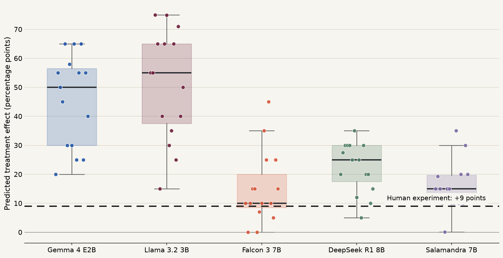

<div class="distribution-finding"><b>Five models, 15 seeded calls each.</b> Falcon's median forecast was +10 points and Salamandra's was +15. Gemma and Llama produced much larger median effects of +50 and +55 points. The spread within each model shows that a single call can be misleading.</div>

<p class="citation">Local Ollama run, 26 October 2026. Same towel-reuse input, prompt and JSON schema in all 75 calls. Seeds vary; temperature = 0.7. Published human effect: +9 points.</p>

---

## Raw returns and predicted effects

```python
parsed = json.loads(raw_json)
predicted_effect = (
    parsed["predicted_treatment_percent"]
    - parsed["predicted_control_percent"]
)
observed_effect = (
    experiment["human_treatment"]
    - experiment["human_control"]
)
```

<div class="plain-note">An effect is a difference in percentage points. If the treatment prediction is 42 and the control prediction is 35, the predicted effect is +7 points.</div>

---

## Absolute error

```python
absolute_error = abs(predicted_effect - observed_effect)

results.append({
    "id": experiment["id"],
    "predicted_effect": predicted_effect,
    "observed_effect": observed_effect,
    "absolute_error": absolute_error,
    "raw": raw_json,
})
```

<div class="io-grid"><div><b><code>abs(...)</code></b><p>Turns errors of −7 and +7 into the same seven-point distance.</p></div><div><b><code>.append(...)</code></b><p>Adds one complete audit record.</p></div><div><b><code>raw</code></b><p>Preserves exactly what the model returned.</p></div></div>

---

## Mean absolute error

```python
error_total = 0
for record in results:
    error_total = error_total + record["absolute_error"]

mae = error_total / len(results)
```

<div class="plain-note">MAE is the average distance, in percentage points, between the predicted and published effects in these three experiments.</div>

<div class="big-question compact-question">Compare the largest error with that study's population, treatment and outcome before offering an explanation.</div>

---

## Limitations of the classroom benchmark

<div class="target-grid"><div><b>Famous studies</b><p>The model may remember the results rather than generalize from the materials.</p></div><div><b>Only three cases</b><p>One mean cannot characterize performance across social science.</p></div><div><b>Direct forecast</b><p>We do not simulate a representative sample as Ashokkumar et al. do.</p></div><div><b>Better tests</b><p>Use unpublished experiments, changed contexts or entirely new tasks.</p></div></div>

---

## Take-home task

<div class="task-brief"><span>Run</span><p>Forecast all three effects through OpenRouter and Ollama.</p><span>Compare</span><p>Calculate each absolute error and the mean absolute error for each route.</p><span>Change one thing</span><p>Set <code>temperature</code> to <code>0.7</code> and rerun only the towel experiment.</p><span>Explain</span><p>Trace one iteration and say why recall remains an alternative explanation.</p></div>

<div class="citation">Submit the narrated screen recording by 5:00 p.m. Eastern on the Tuesday before the next class.</div>

---

## Summary

<div class="takeaways"><div><b>Specify the target</b><p>A person's answer, a population pattern and a treatment effect are different quantities.</p></div><div><b>Use human comparisons</b><p>Plausible model output is not evidence of predictive accuracy.</p></div><div><b>Evaluate new settings</b><p>Performance in a familiar experiment may not survive a new population, context or task.</p></div></div>

---

## Evidence for a new experiment

<div class="campaign-end"><div><b>Before the human study</b><p>A model forecast may help plan or prioritize materials.</p></div><div><b>After the human study</b><p>The randomized outcome supplies the benchmark.</p></div><div><b>Across studies</b><p>Held-out contexts show whether success travels beyond familiar examples.</p></div></div>

<div class="big-question compact-question">A forecast may help plan a study. The human experiment remains the test of the treatment effect.</div>
