## A consultant reviews an AI analysis of a prediction model

<div class="opening-case">
<div><span>Held-out test</span><b>Model accuracy · 80%</b><b>Always predict no mortgage · 60%</b></div>
<blockquote>“The model is 80% accurate, so it is ready to guide an investment strategy. Its score shows that increasing a couple’s score causes them to take out a mortgage.”</blockquote>
</div>

<p class="plain-note">The consultant must decide which claims follow from the evidence before advising the client.</p>
<p class="citation">Instructor-authored results and analysis, adapted from the statistical interpretation task in Wiles et al. (2026).</p>

---

## What the supplied results establish

<table class="closed-table"><thead><tr><th>Result</th><th>What we can say</th><th>What remains unresolved</th></tr></thead><tbody><tr><td>80% accuracy on 200 held-out cases</td><td>The model classified more cases correctly than the stated baseline.</td><td>Accuracy does not show how well the predicted probabilities correspond to observed frequencies.</td></tr><tr><td>60% accuracy from always predicting no mortgage</td><td>The model exceeds this simple comparison by 20 percentage points.</td><td>The baseline is not “chance,” and the comparison does not establish decision value.</td></tr><tr><td>20 false negatives among 80 mortgage cases</td><td>The model missed one quarter of the observed mortgage cases.</td><td>We still lack the number of false positives and their consequences.</td></tr></tbody></table>

<p class="plain-note">Held-out prediction does not show that changing the score would cause anyone to take out a mortgage.</p>

---

## The assistant receives the results, the analysis and an instruction

<div class="input-flow">
<div><span>1</span><b>Model results</b><p>The held-out figures supplied to the consultant</p></div>
<div><span>2</span><b>AI analysis</b><p>The claims that require review</p></div>
<div><span>3</span><b>Assistance mode</b><p>Draft the advice or coach the consultant</p></div>
</div>
<div class="flow-arrow">↓</div><div class="model-box">LLM request</div>

---

## The assistant sits inside an existing division of labour

<div class="workplace-map"><div><b>General consultant</b><p>Frames the client problem and remains responsible for the advice.</p></div><div><b>LLM assistant</b><p>Reviews the supplied analysis under a draft or coach instruction.</p></div><div><b>Data-science team</b><p>Handles technical questions that the available evidence cannot settle.</p></div><div><b>Interaction record</b><p>Stores the prompt, recommendation, edits and escalation.</p></div></div>

<p class="plain-note">The example concerns the organization of knowledge work as well as the quality of one answer.</p>

---

## Draft mode writes a proposed client note

<div class="mode-layout"><div><span class="mode-label">DRAFT</span><p>The model reviews the claims and writes text that the consultant could adapt for the client.</p></div><div class="output-card"><b>Assessment</b><p>The model exceeds the stated baseline, but the evidence is predictive rather than causal. Accuracy alone does not establish readiness for an investment decision.</p><b>Client note</b><p>“The initial result is promising, but we need error and calibration evidence before recommending use.”</p></div></div>

---

## Coach mode leaves the assessment to the consultant

<div class="mode-layout coach"><div><span class="mode-label">COACH</span><p>The model identifies questions and missing evidence. The consultant must evaluate the analysis and write the advice.</p></div><div class="output-card"><b>Questions for the consultant</b><p>What does the baseline represent? Which errors matter for the client? Are the probabilities calibrated? What would support a causal claim?</p><b>Client note</b><p><code>None</code></p></div></div>

---

## What has changed in the worker’s job?

<div class="three-question"><div><b>Performance</b><p>Does the consultant produce a more accurate assessment more quickly?</p></div><div><b>Knowledge</b><p>Can the consultant evaluate a new model without the assistant?</p></div><div><b>Organizational position</b><p>What happens to the consultant’s relation with the data-science team and management?</p></div></div>

<p class="plain-note">These require different evidence. A fluent answer from the model settles none of them.</p>

---

## Marx studied machinery as part of capitalist production

<div class="source-text-layout"><div class="historical-name">Karl Marx<br><small><em>Capital</em>, vol. 1, ch. 15</small></div><div><p>Marx’s object was not machinery in isolation. He asked how machinery was introduced and used within capitalist production.</p><p>The relevant questions concern control of the labour process, intensification, cooperation and the extraction of surplus value.</p></div></div>

<p class="citation">Marx (1867), <em>Capital</em>, vol. 1, ch. 15, “Machinery and Modern Industry.”</p>

---

## Braverman examined management’s control over workplace knowledge

<div class="cover-layout">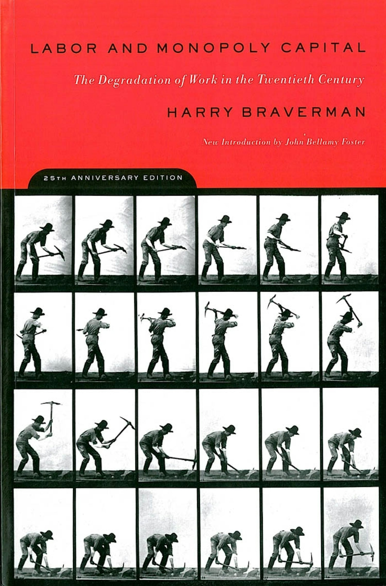<div><p>Braverman argued that scientific management sought to separate the conception of work from its execution.</p><p>Planning and knowledge could be concentrated in management while workers carried out increasingly specified operations.</p></div></div>

<p class="citation">Braverman (1974), <em>Labor and Monopoly Capital</em>.</p>

---

## Scientific management separates planning from execution

<div class="planning-execution"><div><b>Planning</b><p>Define the method, assemble knowledge, set the standard and decide how performance will be measured.</p></div><div class="division-line"></div><div><b>Execution</b><p>Carry out the prescribed operation under conditions designed elsewhere.</p></div></div>

<p class="plain-note">For an LLM assistant, the question is not only whether the worker can reject its suggestion. It is also where the substantive reasoning was performed.</p>

---

## A workplace assistant can return codified practice as an instruction

<div class="knowledge-pipeline"><div>Earlier technical analyses</div><i>→</i><div>Documentation, examples and model training</div><i>→</i><div>Advice during a new review</div></div>
<div class="compare-note"><b>Continuity</b><p>The organization collects and standardizes expert procedures.</p><b>Difference</b><p>The system can generate an assessment for a new case during the work itself.</p></div>

---

## Burawoy studied the production quota game known as “making out”

<div class="cover-layout">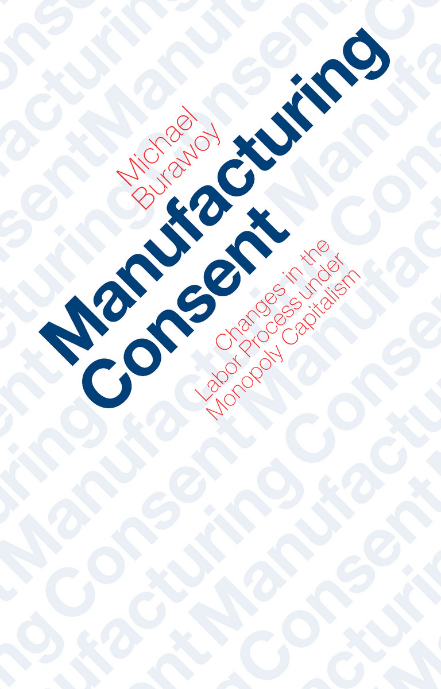<div><p>Machine-shop workers pursued output targets, managed effort and competed within a game organized around production quotas.</p><p>The game created room for initiative and satisfaction, while also helping reproduce the production system and its constraints.</p></div></div>

<p class="citation">Burawoy (1979), <em>Manufacturing Consent</em>.</p>

---

## Consent is produced inside the labour process

<div class="burawoy-layout"><div><b>Rules and quotas</b><p>Management sets the field of action.</p></div><div><b>Shop-floor practices</b><p>Workers develop strategies and incentives around the work.</p></div><div><b>Consent</b><p>Participation in the game can help reproduce the organization of production.</p></div></div>

<p class="plain-note">This is not simply a theory of why workers like technologies that benefit management.</p>

---

## Barley followed the same CT scanner into two hospitals

<div class="paper-layout barley-paper">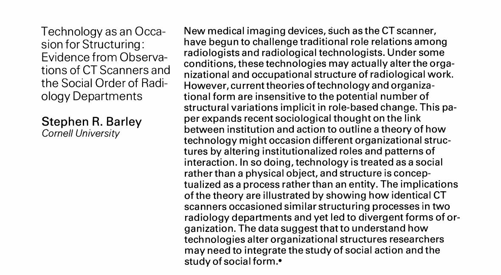<div><p><strong>Setting:</strong> radiology departments in two community hospitals introducing the same model of CT scanner.</p><p><strong>Evidence:</strong> longitudinal observation of examinations, interactions and occupational roles.</p><p><strong>Question:</strong> how can similar technologies become part of different organizational arrangements?</p></div></div>

<p class="citation">Barley (1986), “Technology as an Occasion for Structuring,” <em>Administrative Science Quarterly</em> 31(1): 78–108.</p>

---

## The two departments developed different interaction patterns

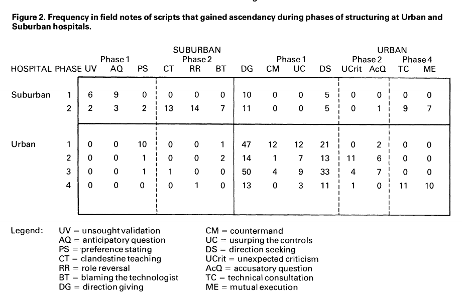
<p class="figure-note">Technical consultation and mutual execution eventually became common at Urban; role reversal and clandestine teaching were more prominent at Suburban.</p>
<p class="citation">Barley (1986), Figure 2, p. 101.</p>

---

## Operational authority changed differently in the two hospitals

<div class="figure-layout">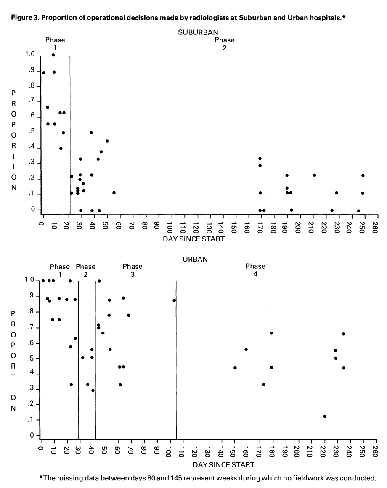<div><p>The proportion of operational decisions made by radiologists fell sharply at Suburban and remained higher at Urban.</p><p>The same scanner did not establish the same division of labour.</p></div></div>
<p class="citation">Barley (1986), Figure 3, p. 103.</p>

---

## The technology did not determine one occupational settlement

<div class="two-hospital"><div><span>SUBURBAN</span><p>Technologists gained practical control and sometimes taught radiologists how to use the system.</p></div><div><span>URBAN</span><p>Radiologists retained more operational authority and the occupational relation developed differently.</p></div></div>

<p class="plain-note">The organizational result emerged through existing roles and the interactions that formed around the scanner.</p>

---

## Zuboff observed computerization inside workplaces

<div class="cover-layout">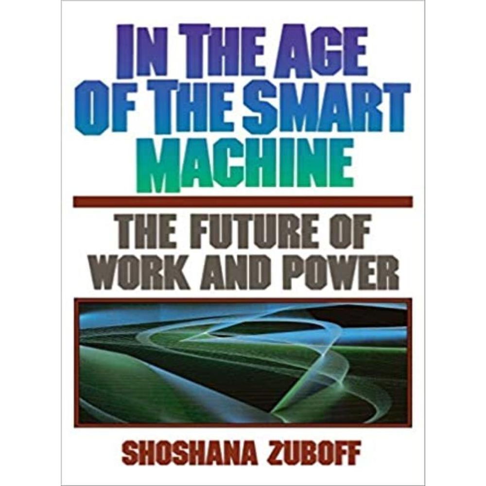<div><p>Zuboff studied how computerized systems changed industrial and office work.</p><p>Her distinction between automating and “informating” draws attention to systems that perform operations while also creating new information about the work.</p></div></div>

<p class="citation">Zuboff (1988), <em>In the Age of the Smart Machine</em>.</p>

---

## Computer systems perform tasks and produce information about them

<div class="z-two"><div><b>During the task</b><p>The system displays information, recommends actions or carries out part of the operation.</p></div><div><b>After the task</b><p>The organization may retain prompts, suggestions, edits, response times, acceptance decisions and outcomes.</p></div></div>

<p class="plain-note">The record can support learning, quality review or managerial control. Its consequences depend on who can see it and how it is used.</p>

---

## Expertise, discretion and authority describe different parts of the job

<table class="closed-table"><thead><tr><th>Dimension</th><th>Question</th><th>Draft mode</th><th>Coach mode</th></tr></thead><tbody><tr><td>Expertise</td><td>Who performs the substantive reasoning?</td><td>Much may be in the generated assessment</td><td>More may remain with the consultant</td></tr><tr><td>Discretion</td><td>Who chooses how the task is carried out?</td><td>The consultant may edit or reject</td><td>The consultant writes the assessment</td></tr><tr><td>Authority</td><td>Who can approve the client recommendation?</td><td colspan="2">The formal decision may remain with a manager</td></tr></tbody></table>

<p class="plain-note">Coach mode does not necessarily increase formal authority. Draft mode can preserve formal discretion while shifting reasoning to the system.</p>

---

## The recent studies measure different outcomes

<div class="three-study"><div><b>Barley</b><p>Occupational relations and operational decisions</p></div><div><b>Brynjolfsson, Li and Raymond</b><p>Performance while a customer-support assistant is available</p></div><div><b>Wiles and colleagues</b><p>Assisted performance and a later test without ChatGPT</p></div></div>

---

## Brynjolfsson, Li and Raymond studied an assistant used during customer chats

<div class="paper-layout">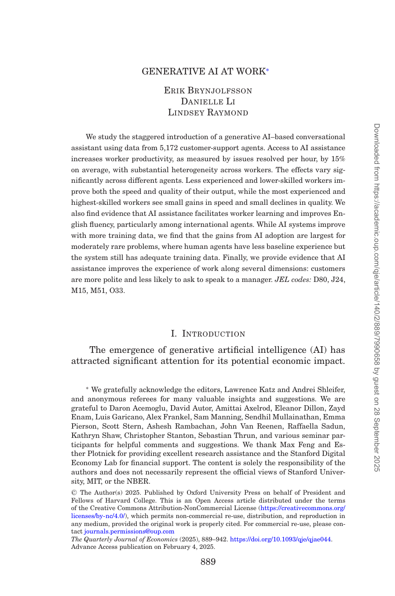<div><p><strong>Setting:</strong> 5,172 customer-support agents at one software company.</p><p><strong>System:</strong> a GPT-3-based assistant offered real-time response suggestions and links to internal documentation.</p><p><strong>Rollout:</strong> access was introduced at different times across workers.</p></div></div>

<p class="citation">Brynjolfsson, Li & Raymond (2025), <em>Quarterly Journal of Economics</em> 140(2): 889–942.</p>

---

## The rollout compared workers before and after access

<div class="rollout"><div><span>Before access</span><p>Agent-month performance without the assistant</p></div><i>→</i><div><span>After access</span><p>Agent-month performance with recommendations available</p></div></div>

<p class="plain-note">The preferred analysis includes agent fixed effects, calendar-time effects and controls for tenure. The rollout was not a simple individually randomized trial.</p>

---

## Issues resolved per hour increased by about 15 per cent

<div class="figure-layout wide">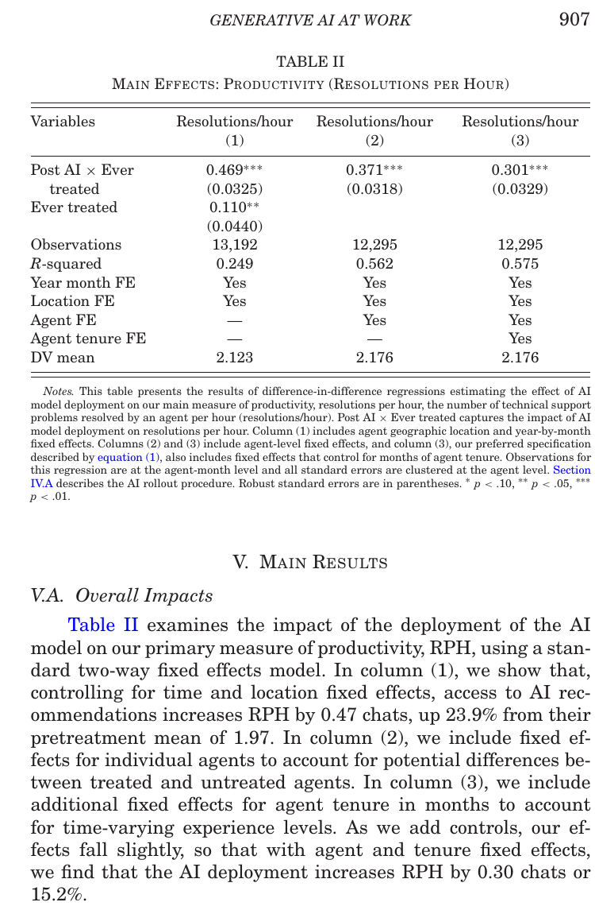<div><b class="big-number">15.2%</b><p>Estimated increase in resolutions per hour in the preferred specification.</p><p>The estimate concerns measured performance while the assistant was available.</p></div></div>

<p class="citation">Brynjolfsson, Li & Raymond (2025), Table II and p. 907.</p>

---

## Less experienced agents gained more

<div class="experience-contrast"><div><b>Lower tenure and lower prior performance</b><p>Larger improvements in the study’s productivity and quality measures.</p></div><div><b>More experienced and higher-performing agents</b><p>Smaller productivity gains and small declines on some quality measures.</p></div></div>

<p class="plain-note">Possible explanations include access to codified expertise, standardization towards the firm’s preferred style and a lower starting baseline.</p>

---

## The study measures performance while assistance is available

<div class="measurement-card"><b>Observed</b><p>Resolution speed, resolution rates, customer sentiment and other outcomes during assisted work.</p><b>Not directly tested</b><p>Whether the same workers could reproduce the assistant’s reasoning after access was removed.</p></div>

---

## Wiles and colleagues tested unfamiliar data-science work

<div class="paper-layout">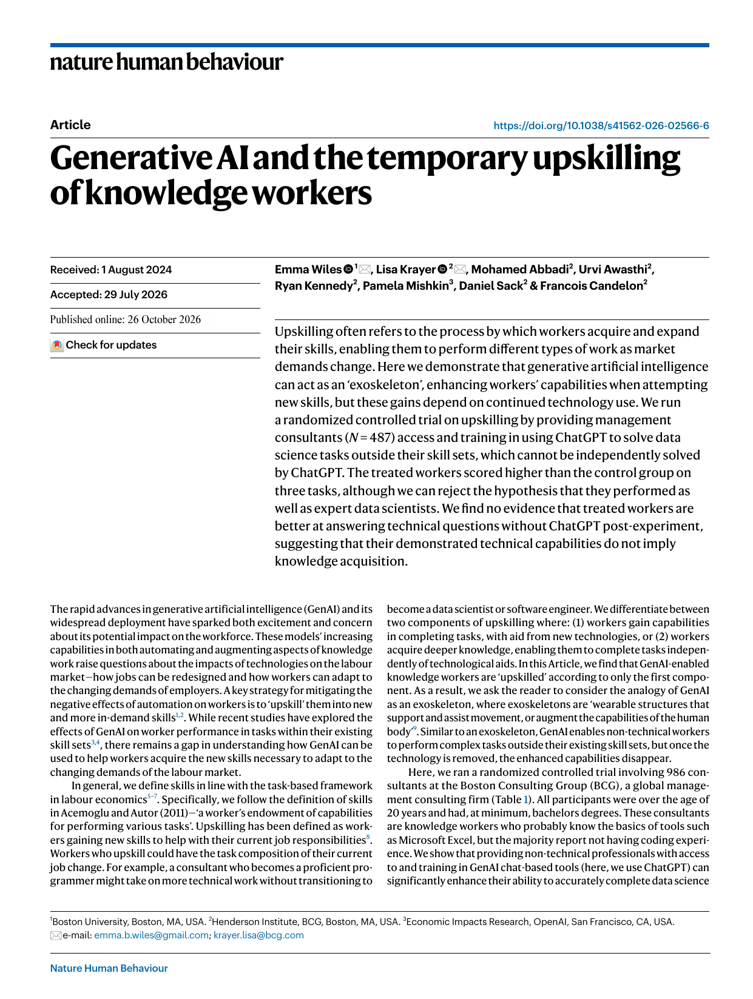<div><p><strong>Participants:</strong> 487 management consultants.</p><p><strong>Tasks:</strong> coding, statistics and prediction problems outside their usual skill set.</p><p><strong>Comparison:</strong> ChatGPT access and training versus conventional resources.</p></div></div>

<p class="citation">Wiles et al. (2026), “Generative AI and the Temporary Upskilling of Knowledge Workers,” <em>Nature Human Behaviour</em>.</p>

---

## One task involved reviewing a mortgage-prediction model

<div class="figure-layout">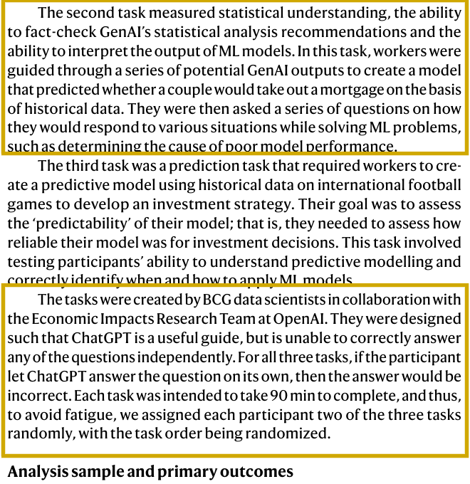<div><p>General consultants had to fact-check statistical recommendations and interpret machine-learning output.</p><p>The authors designed the tasks so that ChatGPT could help, but an answer produced by ChatGPT alone would be wrong.</p><p>Our opening example simplifies this task and uses instructor-authored results.</p></div></div>

<p class="citation">Wiles et al. (2026), Methods, “Task descriptions.”</p>

---

## ChatGPT improved performance on the assisted tasks

<div class="figure-layout">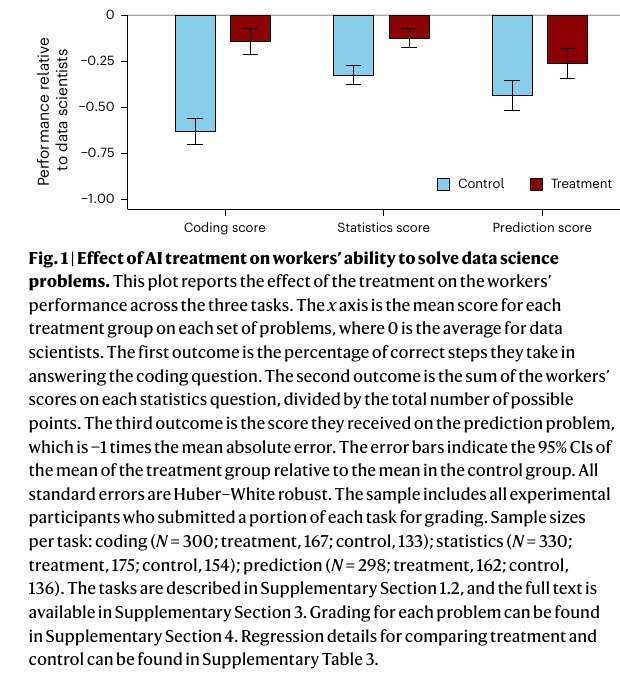<div><p>Treated participants performed better than controls on coding, statistics and prediction tasks.</p><p>They still remained below the data-scientist benchmark represented by zero.</p></div></div>

<p class="citation">Wiles et al. (2026), Figure 1.</p>

---

## The later test found no evidence of greater technical knowledge without ChatGPT

<div class="figure-layout">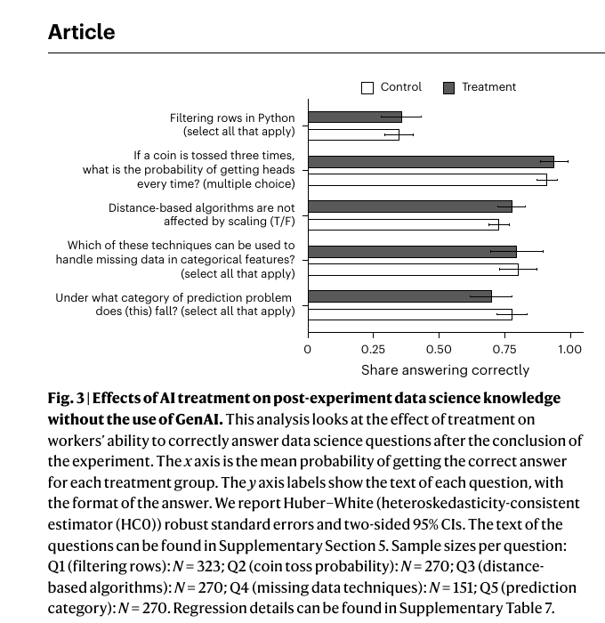<div><p>After the task, both groups answered technical questions without ChatGPT.</p><p>The authors report no statistically significant joint treatment effect across the five questions.</p></div></div>

<p class="citation">Wiles et al. (2026), Figure 3.</p>

---

## The two papers do not establish one general relationship between productivity and learning

<div class="study-boundary"><div><b>Brynjolfsson et al.</b><p>Different workers, firm, tasks and design. Measures workplace performance during assistance.</p></div><div><b>Wiles et al.</b><p>Different experiment and population. Includes a later knowledge test without assistance.</p></div></div>

<p class="plain-note">Together they show why the outcomes must be separated. They do not show whether the customer-support agents learned.</p>

---

## Break

<div class="break-time">10 minutes</div>

---

## The readings examine different aspects of skill at work

<table class="closed-table reading-comparison"><thead><tr><th>Study</th><th>Evidence</th><th>Question for discussion</th></tr></thead><tbody><tr><td><b>Barley</b></td><td>Technologists using the same scanners in two hospitals</td><td>Why did the division of labour develop differently?</td></tr><tr><td><b>Brynjolfsson et al.</b></td><td>Customer-support performance while an assistant was available</td><td>Why did less experienced workers gain more?</td></tr><tr><td><b>Wiles et al.</b></td><td>Assisted consulting tasks and a later test without ChatGPT</td><td>What did the consultants learn, if anything?</td></tr></tbody></table>

<p class="discussion-line">Which study gives us evidence about performance, retained knowledge or changes in the organization of work?</p>

---

## Possible explanations for the larger gains among less experienced workers

<div class="explanation-layout"><div class="finding-statement"><span>Finding</span><b>Workers with less tenure and lower prior performance gained more.</b><p>The study identifies a difference in measured performance. It cannot by itself tell us why that difference arose.</p></div><div class="explanation-list"><p><b>Access to earlier workers’ practical knowledge</b><br>The assistant may make useful responses available sooner.</p><p><b>Closer adherence to the firm’s preferred style</b><br>The assistant may standardize how workers handle a case.</p><p><b>A lower starting point</b><br>Workers with more room to improve may show larger gains.</p></div></div>

<p class="discussion-line">What additional evidence would distinguish these explanations?</p>

---

## The mortgage-model review involves four kinds of work

<div class="case-work"><div><span>Data-science team</span><p>Builds the prediction model and reports its test results.</p></div><div><span>AI assistant</span><p>Examines the results and the existing AI-written analysis.</p></div><div><span>Consultant</span><p>Interprets the evidence and decides what to tell the client.</p></div><div><span>Client organization</span><p>Decides whether and how to use the model.</p></div></div>

<div class="author-questions"><p><b>Barley:</b> Which part of the division of labour changes?</p><p><b>Zuboff:</b> What does the system allow the organization to record?</p><p><b>Wiles et al.:</b> What could the consultant do later without the assistant?</p></div>

---

## Draft and coach modes allocate the review differently

<table class="closed-table mode-comparison"><thead><tr><th>Part of the task</th><th>Draft mode</th><th>Coach mode</th></tr></thead><tbody><tr><td>Assess the claims</td><td>The assistant supplies an assessment.</td><td>The assistant identifies issues and asks the consultant questions.</td></tr><tr><td>Write the client note</td><td>The assistant writes a proposed note.</td><td>The consultant writes it.</td></tr><tr><td>Make the final decision</td><td>The consultant still has formal authority in our example.</td><td>The consultant still has formal authority in our example.</td></tr><tr><td>Test later knowledge</td><td>Not measured by the assisted task.</td><td>Not measured by the assisted task.</td></tr></tbody></table>

<p class="discussion-line">Which configuration would you use, and what outcome would you measure?</p>

---

## The coding exercise uses coach mode

<div class="mode-code-bridge"><div><pre><code class="python">assistant_instruction = (
    "Act as a coach. "
    "Do not write the final advice."
)</code></pre></div><div><p><b>The assistant performs an initial review</b><br>It checks the claims and proposes questions for the consultant.</p><p><b>The worker chooses what happens next</b><br>Ask the model again, consult the data-science team or begin writing the note.</p></div></div>

<p class="plain-note">The exercise now follows a short work process rather than comparing two completed model returns.</p>

---

## The complete program

<div class="program-map"><div><span>1</span><b>Initial review</b><p>Send the evidence and questionable analysis to the assistant.</p></div><div><span>2</span><b>Worker choice</b><p>Inspect the return and decide whether to ask again, escalate or start writing.</p></div><div><span>3</span><b>Optional follow-up</b><p>Add the worker's question to the conversation and call the model again.</p></div><div><span>4</span><b>Decision and reflection</b><p>Record the worker's final action and examine how the work was divided.</p></div></div>

---

## The program starts with a dictionary of results

```python
model_results = {
    "test_cases": 200,
    "model_accuracy": 0.80,
    "always_predict_no_mortgage_accuracy": 0.60,
    "false_negatives": 20,
}

print(model_results)
print(type(model_results))
```

<div class="io-line"><b>Input:</b> named values<i>→</i><b>Output:</b> one <code>dict</code> containing integers and floats</div>

---

## The AI analysis is stored as a string

```python
ai_analysis = (
    "The model is 80% accurate, so it is ready to guide "
    "an investment strategy. Its score shows that increasing "
    "a couple's score causes them to take out a mortgage."
)
```

<p class="code-meaning">The text includes a causal claim that the held-out predictive evidence cannot support.</p>

---

## The coaching instruction is another string

```python
assistant_instruction = (
    "Act as a coach. Check the analysis. "
    "Do not write the final client advice."
)

print(assistant_instruction)
print(type(assistant_instruction))
```

<p class="code-meaning">This value assigns an initial task to the model. The worker still decides what to do with the reply.</p>

---

## The results dictionary becomes prompt text

```python
results_text = json.dumps(model_results, indent=2)

prompt = f"""
Model results:
{results_text}

AI-written analysis:
{ai_analysis}

Instruction:
{assistant_instruction}
Return the six required fields as JSON.
"""
```

<p class="code-meaning"><code>json.dumps()</code> produces a string. The braces insert the current evidence, analysis and instruction into the prompt.</p>

---

## The message list is sent to the model

```python
messages = [
    {
        "role": "user",
        "content": prompt,
    }
]

print(messages[0]["content"])
```

<div class="io-line"><b>Input:</b> prompt · <code>str</code><i>→</i><b>Output:</b> one-item <code>list</code> containing a <code>dict</code></div>

---

## OpenRouter uses the same output schema {data-auto-stretch="false"}

<div class="schema-code">

```python
response_format = {
    "type": "json_schema",
    "json_schema": {
        "name": "work_review",
        "strict": True,
        "schema": output_schema,
    },
}
```

</div>

<p class="code-meaning">This dictionary tells OpenRouter to require the fields already defined in <code>output_schema</code>.</p>

---

## OpenRouter sends the request to a hosted model

```python
if ROUTE == "openrouter":
    api_key = os.getenv("OPENROUTER_API_KEY") or getpass(
        "OpenRouter course key (hidden): "
    )
    client = OpenRouter(api_key=api_key)
    response = client.chat.send(
        model=HOSTED_MODEL,
        messages=messages,
        temperature=0,
        response_format=response_format,
    )
    raw_output = response.choices[0].message.content
```

<p class="code-meaning">The prompt leaves the computer and is processed by the selected hosted provider.</p>

---

## Ollama sends the request to a model on the computer

```python
else:
    response = ollama.chat(
        think=False,
        model=LOCAL_MODEL,
        messages=messages,
        format=output_schema,
        options={"temperature": 0},
    )
    raw_output = response.message.content
```

<p class="code-meaning">The Python request goes to the Ollama server running locally. The model must already be downloaded.</p>

---

## The raw return is text

```python
print(raw_output)
print(type(raw_output))
```

<pre class="mini-output"><code>{"baseline_comparison":"model_outperforms_baseline",
 "causal_claim":"not_supported",
 "decision_status":"needs_more_information",
 "explanation":["Accuracy exceeds the stated baseline"],
 "questions_for_worker":["Which errors matter for the decision?"],
 "data_science_escalation":"Check calibration and error costs"}</code></pre>

---

## JSON parsing turns the text into a dictionary

```python
parsed_output = json.loads(raw_output)

print(parsed_output["baseline_comparison"])
print(parsed_output["causal_claim"])
print(type(parsed_output))
```

<div class="io-line"><b>Input:</b> JSON-formatted <code>str</code><i>→</i><b>Output:</b> Python <code>dict</code></div>

---

## Three checks compare the output with stated requirements

```python
baseline_ok = (
    parsed_output["baseline_comparison"]
    == "model_outperforms_baseline"
)
causal_ok = parsed_output["causal_claim"] == "not_supported"
decision_ok = parsed_output["decision_status"] == "needs_more_information"

print(baseline_ok, causal_ok, decision_ok)
```

<p class="code-meaning"><code>True</code> means the selected category matches the requirement written into the exercise. It does not validate the entire assessment.</p>

---

## The worker chooses the next step

```python
available_actions = [
    "ask_model_again",
    "escalate_to_data_science",
    "write_client_note",
]
worker_next_step = "ask_model_again"

print(worker_next_step)
```

<p class="code-meaning">The selected string controls the next branch of the program. It represents a worker decision, not a model output.</p>

---

## First replace the function parameters with literal values

```python
messages = [
    {"role": "user", "content": initial_prompt}
]
route = "ollama"
```

<p class="code-meaning">These two values will become the two arguments entering the function.</p>

---

## The first function sends the current conversation

```python
def call_review_assistant(messages, route):
    # Call the selected model route
    # Preserve the raw return
    # Parse and check the JSON
    return reply_record
```

<p class="code-meaning"><code>def</code> stores a reusable procedure. The indented lines run only when the function is called.</p>

---

## The worker receives the first reply

```python
first_reply = call_review_assistant(
    messages=messages,
    route=ROUTE,
)

print(first_reply["parsed_output"])
print(type(first_reply))
```

<div class="io-line"><b>Input:</b> message list and route<i>→</i><b>Output:</b> one reply-record <code>dict</code></div>

---

## A follow-up preserves the earlier exchange

```python
if worker_next_step == "ask_model_again":
    messages.append({
        "role": "assistant",
        "content": first_reply["raw_output"],
    })
    messages.append({
        "role": "user",
        "content": follow_up_question,
    })
    second_reply = call_review_assistant(messages, ROUTE)
```

<p class="code-meaning">The second call receives three messages: the original request, the first reply and the worker's question.</p>

---

## The worker can stop without making a second call

```python
elif worker_next_step in {
    "escalate_to_data_science",
    "write_client_note",
}:
    second_reply = None

print("Second call made:", second_reply is not None)
```

<p class="code-meaning">The branch makes the worker's choice consequential. <code>None</code> records that no second model return exists.</p>

---

## The worker records a final action and reason

```python
worker_final_action = "escalate_to_data_science"
worker_reason = (
    "The result omits calibration and the costs "
    "of different mistakes."
)
```

<p class="code-meaning">Both values are written by the worker after inspecting the available evidence and model replies.</p>

---

## The work record contains model and worker contributions

```python
work_record = {
    "first_model_reply": first_reply,
    "worker_next_step": worker_next_step,
    "worker_question": follow_up_question,
    "second_model_reply": second_reply,
    "worker_final_action": worker_final_action,
    "worker_reason": worker_reason,
}
```

<p class="code-meaning">The dictionary preserves the model's replies alongside the question and decision supplied by the worker.</p>

---

## What changed in the work?

<table class="closed-table"><thead><tr><th>Question</th><th>What to inspect</th></tr></thead><tbody><tr><td>What reasoning did the model perform?</td><td>The two parsed replies</td></tr><tr><td>What choice remained with the worker?</td><td><code>worker_next_step</code>, the follow-up and final action</td></tr><tr><td>Did the follow-up support understanding?</td><td>What the worker can explain without the assistant</td></tr><tr><td>What became visible to the organization?</td><td>The question, reply, action and recorded reason</td></tr></tbody></table>

---

## A short question without model assistance

<div class="discussion-question">Does 80% overall accuracy tell us what percentage of couples predicted to take out a mortgage actually did so? What additional numbers would you need?</div>

<p class="plain-note">Answer this yourself. The question separates completing the review with assistance from explaining the statistical issue without it.</p>

---

## The take-home task

<div class="task-brief"><span>Change</span><p>Select another <code>worker_next_step</code> or rewrite the follow-up question, then rerun.</p><span>Decide</span><p>Choose a final action and explain why the available evidence supports it.</p><span>Reflect</span><p>Explain what the assistant did, what you decided and what the interaction record reveals.</p><span>Answer</span><p>Complete the final accuracy question without model assistance.</p><span>Record</span><p>Show each input and output, then explain the function parameters and both calls.</p><span>Submit</span><p>Upload the narrated screen recording using your name and <code>Week09</code> in the filename.</p></div>

---

## What can we conclude?

<div class="closing"><p>An LLM can improve measured performance while it is available. That does not, by itself, show that workers gained knowledge or that their discretion and authority increased.</p><p>The organizational consequences depend on how the system is configured, what it records and how work is arranged around it.</p></div>

---

## Questions that remain open

<div class="open-questions"><div>Which forms of worker knowledge become training material, and who owns the resulting system?</div><div>When does assistance support learning rather than continued dependence?</div><div>Who can inspect the record of suggestions, edits and outcomes?</div><div>How do workers reshape the system in practice?</div></div>
