## A consultant reviews an AI analysis of a prediction model

<div class="opening-case">
<div><span>Held-out test</span><b>Model accuracy · 80%</b><b>Always predict no mortgage · 60%</b></div>
<blockquote>“The model is 80% accurate, so it is ready to guide an investment strategy. Its score shows that increasing a couple’s score causes them to take out a mortgage.”</blockquote>
</div>

<p class="plain-note">The consultant must decide which claims follow from the evidence before advising the client.</p>
<p class="citation">Instructor-authored results and analysis, adapted from the statistical interpretation task in Wiles et al. (2026).</p>

---

## What the supplied results establish

<table class="closed-table"><thead><tr><th>Result</th><th>What we can say</th><th>What remains unresolved</th></tr></thead><tbody><tr><td>80% accuracy on 200 held-out cases</td><td>The model classified more cases correctly than the stated baseline.</td><td>Accuracy does not show how well the predicted probabilities correspond to observed frequencies.</td></tr><tr><td>60% accuracy from always predicting no mortgage</td><td>The model exceeds this simple comparison by 20 percentage points.</td><td>The baseline is not “chance,” and the comparison does not establish decision value.</td></tr><tr><td>20 false negatives among 80 mortgage cases</td><td>The model missed one quarter of the observed mortgage cases.</td><td>We still lack the number of false positives and their consequences.</td></tr></tbody></table>

<p class="plain-note">Held-out prediction does not show that changing the score would cause anyone to take out a mortgage.</p>

---

## The assistant receives the results, the analysis and an instruction

<div class="input-flow">
<div><span>1</span><b>Model results</b><p>The held-out figures supplied to the consultant</p></div>
<div><span>2</span><b>AI analysis</b><p>The claims that require review</p></div>
<div><span>3</span><b>Assistance mode</b><p>Draft the advice or coach the consultant</p></div>
</div>
<div class="flow-arrow">↓</div><div class="model-box">LLM request</div>

---

## The assistant sits inside an existing division of labour

<div class="workplace-map"><div><b>General consultant</b><p>Frames the client problem and remains responsible for the advice.</p></div><div><b>LLM assistant</b><p>Reviews the supplied analysis under a draft or coach instruction.</p></div><div><b>Data-science team</b><p>Handles technical questions that the available evidence cannot settle.</p></div><div><b>Interaction record</b><p>Stores the prompt, recommendation, edits and escalation.</p></div></div>

<p class="plain-note">The example concerns the organization of knowledge work as well as the quality of one answer.</p>

---

## Draft mode writes a proposed client note

<div class="mode-layout"><div><span class="mode-label">DRAFT</span><p>The model reviews the claims and writes text that the consultant could adapt for the client.</p></div><div class="output-card"><b>Assessment</b><p>The model exceeds the stated baseline, but the evidence is predictive rather than causal. Accuracy alone does not establish readiness for an investment decision.</p><b>Client note</b><p>“The initial result is promising, but we need error and calibration evidence before recommending use.”</p></div></div>

---

## Coach mode leaves the assessment to the consultant

<div class="mode-layout coach"><div><span class="mode-label">COACH</span><p>The model identifies questions and missing evidence. The consultant must evaluate the analysis and write the advice.</p></div><div class="output-card"><b>Questions for the consultant</b><p>What does the baseline represent? Which errors matter for the client? Are the probabilities calibrated? What would support a causal claim?</p><b>Client note</b><p><code>None</code></p></div></div>

---

## What has changed in the worker’s job?

<div class="three-question"><div><b>Performance</b><p>Does the consultant produce a more accurate assessment more quickly?</p></div><div><b>Knowledge</b><p>Can the consultant evaluate a new model without the assistant?</p></div><div><b>Organizational position</b><p>What happens to the consultant’s relation with the data-science team and management?</p></div></div>

<p class="plain-note">These require different evidence. A fluent answer from the model settles none of them.</p>

---

## Marx studied machinery as part of capitalist production

<div class="source-text-layout"><div class="historical-name">Karl Marx<br><small><em>Capital</em>, vol. 1, ch. 15</small></div><div><p>Marx’s object was not machinery in isolation. He asked how machinery was introduced and used within capitalist production.</p><p>The relevant questions concern control of the labour process, intensification, cooperation and the extraction of surplus value.</p></div></div>

<p class="citation">Marx (1867), <em>Capital</em>, vol. 1, ch. 15, “Machinery and Modern Industry.”</p>

---

## Braverman examined management’s control over workplace knowledge

<div class="cover-layout">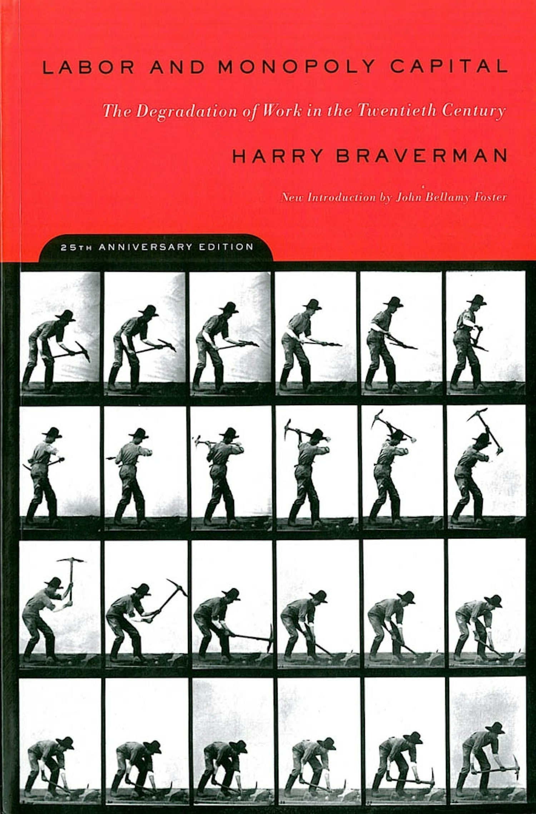<div><p>Braverman argued that scientific management sought to separate the conception of work from its execution.</p><p>Planning and knowledge could be concentrated in management while workers carried out increasingly specified operations.</p></div></div>

<p class="citation">Braverman (1974), <em>Labor and Monopoly Capital</em>.</p>

---

## Scientific management separates planning from execution

<div class="planning-execution"><div><b>Planning</b><p>Define the method, assemble knowledge, set the standard and decide how performance will be measured.</p></div><div class="division-line"></div><div><b>Execution</b><p>Carry out the prescribed operation under conditions designed elsewhere.</p></div></div>

<p class="plain-note">For an LLM assistant, the question is not only whether the worker can reject its suggestion. It is also where the substantive reasoning was performed.</p>

---

## A workplace assistant can return codified practice as an instruction

<div class="knowledge-pipeline"><div>Earlier technical analyses</div><i>→</i><div>Documentation, examples and model training</div><i>→</i><div>Advice during a new review</div></div>
<div class="compare-note"><b>Continuity</b><p>The organization collects and standardizes expert procedures.</p><b>Difference</b><p>The system can generate an assessment for a new case during the work itself.</p></div>

---

## Burawoy studied the production quota game known as “making out”

<div class="cover-layout">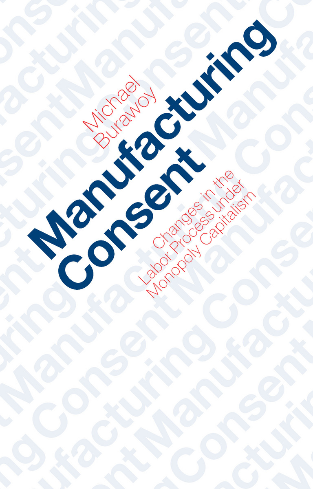<div><p>Machine-shop workers pursued output targets, managed effort and competed within a game organized around production quotas.</p><p>The game created room for initiative and satisfaction, while also helping reproduce the production system and its constraints.</p></div></div>

<p class="citation">Burawoy (1979), <em>Manufacturing Consent</em>.</p>

---

## Consent is produced inside the labour process

<div class="burawoy-layout"><div><b>Rules and quotas</b><p>Management sets the field of action.</p></div><div><b>Shop-floor practices</b><p>Workers develop strategies and incentives around the work.</p></div><div><b>Consent</b><p>Participation in the game can help reproduce the organization of production.</p></div></div>

<p class="plain-note">This is not simply a theory of why workers like technologies that benefit management.</p>

---

## Barley followed the same CT scanner into two hospitals

<div class="paper-layout barley-paper">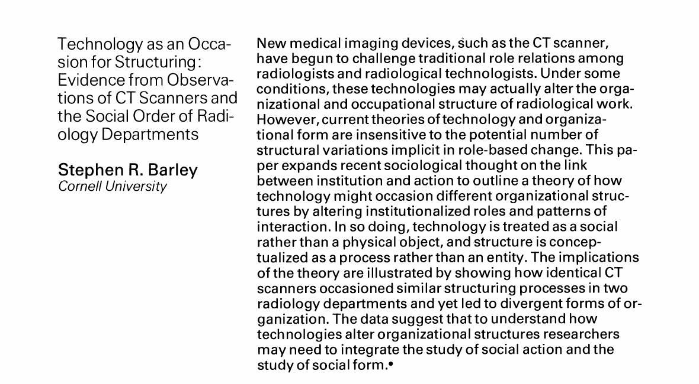<div><p><strong>Setting:</strong> radiology departments in two community hospitals introducing the same model of CT scanner.</p><p><strong>Evidence:</strong> longitudinal observation of examinations, interactions and occupational roles.</p><p><strong>Question:</strong> how can similar technologies become part of different organizational arrangements?</p></div></div>

<p class="citation">Barley (1986), “Technology as an Occasion for Structuring,” <em>Administrative Science Quarterly</em> 31(1): 78–108.</p>

---

## The two departments developed different interaction patterns

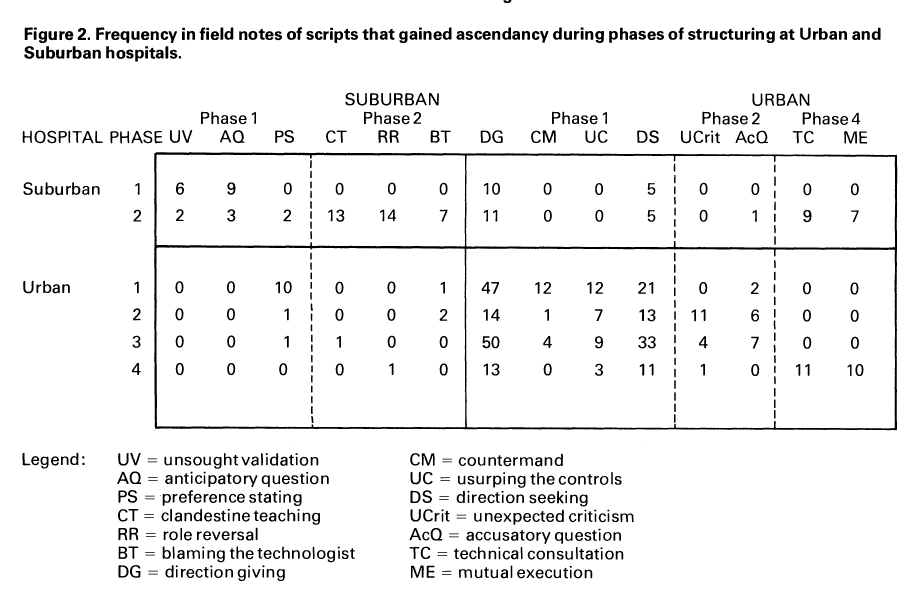
<p class="figure-note">Technical consultation and mutual execution eventually became common at Urban; role reversal and clandestine teaching were more prominent at Suburban.</p>
<p class="citation">Barley (1986), Figure 2, p. 101.</p>

---

## Operational authority changed differently in the two hospitals

<div class="figure-layout">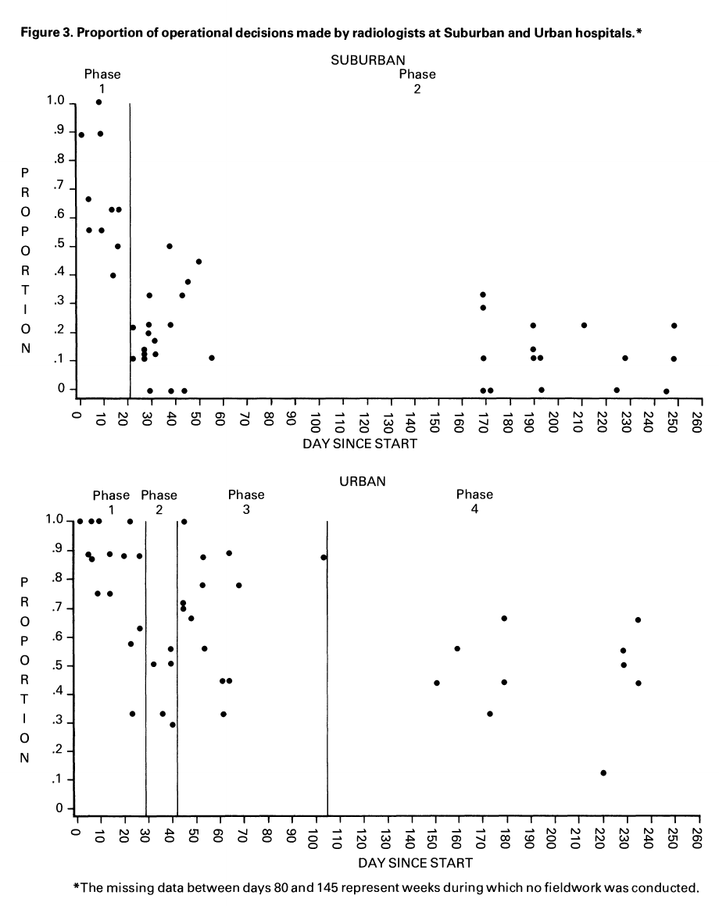<div><p>The proportion of operational decisions made by radiologists fell sharply at Suburban and remained higher at Urban.</p><p>The same scanner did not establish the same division of labour.</p></div></div>
<p class="citation">Barley (1986), Figure 3, p. 103.</p>

---

## The technology did not determine one occupational settlement

<div class="two-hospital"><div><span>SUBURBAN</span><p>Technologists gained practical control and sometimes taught radiologists how to use the system.</p></div><div><span>URBAN</span><p>Radiologists retained more operational authority and the occupational relation developed differently.</p></div></div>

<p class="plain-note">The organizational result emerged through existing roles and the interactions that formed around the scanner.</p>

---

## Zuboff observed computerization inside workplaces

<div class="cover-layout"><div><p>Zuboff studied how computerized systems changed industrial and office work.</p><p>Her distinction between automating and “informating” draws attention to systems that perform operations while also creating new information about the work.</p></div></div>

<p class="citation">Zuboff (1988), <em>In the Age of the Smart Machine</em>.</p>

---

## Computer systems perform tasks and produce information about them

<div class="z-two"><div><b>During the task</b><p>The system displays information, recommends actions or carries out part of the operation.</p></div><div><b>After the task</b><p>The organization may retain prompts, suggestions, edits, response times, acceptance decisions and outcomes.</p></div></div>

<p class="plain-note">The record can support learning, quality review or managerial control. Its consequences depend on who can see it and how it is used.</p>

---

## Expertise, discretion and authority describe different parts of the job

<table class="closed-table"><thead><tr><th>Dimension</th><th>Question</th><th>Draft mode</th><th>Coach mode</th></tr></thead><tbody><tr><td>Expertise</td><td>Who performs the substantive reasoning?</td><td>Much may be in the generated assessment</td><td>More may remain with the consultant</td></tr><tr><td>Discretion</td><td>Who chooses how the task is carried out?</td><td>The consultant may edit or reject</td><td>The consultant writes the assessment</td></tr><tr><td>Authority</td><td>Who can approve the client recommendation?</td><td colspan="2">The formal decision may remain with a manager</td></tr></tbody></table>

<p class="plain-note">Coach mode does not necessarily increase formal authority. Draft mode can preserve formal discretion while shifting reasoning to the system.</p>

---

## The recent studies measure different outcomes

<div class="three-study"><div><b>Barley</b><p>Occupational relations and operational decisions</p></div><div><b>Brynjolfsson, Li and Raymond</b><p>Performance while a customer-support assistant is available</p></div><div><b>Wiles and colleagues</b><p>Assisted performance and a later test without ChatGPT</p></div></div>

---

## Brynjolfsson, Li and Raymond studied an assistant used during customer chats

<div class="paper-layout">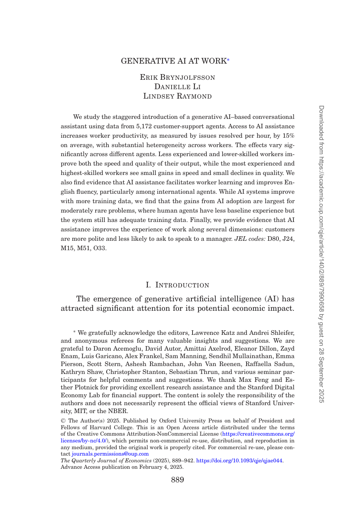<div><p><strong>Setting:</strong> 5,172 customer-support agents at one software company.</p><p><strong>System:</strong> a GPT-3-based assistant offered real-time response suggestions and links to internal documentation.</p><p><strong>Rollout:</strong> access was introduced at different times across workers.</p></div></div>

<p class="citation">Brynjolfsson, Li & Raymond (2025), <em>Quarterly Journal of Economics</em> 140(2): 889–942.</p>

---

## The rollout compared workers before and after access

<div class="rollout"><div><span>Before access</span><p>Agent-month performance without the assistant</p></div><i>→</i><div><span>After access</span><p>Agent-month performance with recommendations available</p></div></div>

<p class="plain-note">The preferred analysis includes agent fixed effects, calendar-time effects and controls for tenure. The rollout was not a simple individually randomized trial.</p>

---

## Issues resolved per hour increased by about 15 per cent

<div class="figure-layout wide">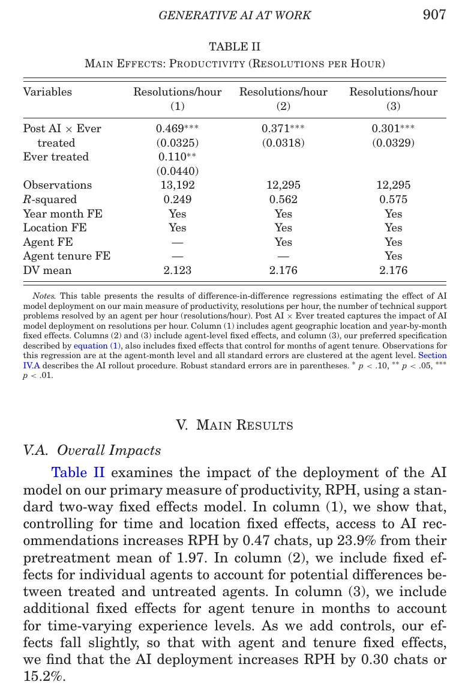<div><b class="big-number">15.2%</b><p>Estimated increase in resolutions per hour in the preferred specification.</p><p>The estimate concerns measured performance while the assistant was available.</p></div></div>

<p class="citation">Brynjolfsson, Li & Raymond (2025), Table II and p. 907.</p>

---

## Less experienced agents gained more

<div class="experience-contrast"><div><b>Lower tenure and lower prior performance</b><p>Larger improvements in the study’s productivity and quality measures.</p></div><div><b>More experienced and higher-performing agents</b><p>Smaller productivity gains and small declines on some quality measures.</p></div></div>

<p class="plain-note">Possible explanations include access to codified expertise, standardization towards the firm’s preferred style and a lower starting baseline.</p>

---

## The highest-skilled agents followed the assistant more despite a small decline in conversation quality

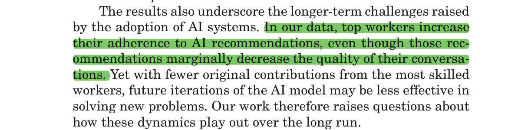

<p class="plain-note">The paper measures adherence to the assistant’s recommendations. It does not show that these workers believed the recommendations were better.</p>

<p class="citation">Brynjolfsson, Li & Raymond (2025), p. 893.</p>

---

## The study measures performance while assistance is available

<div class="measurement-card"><b>Observed</b><p>Resolution speed, resolution rates, customer sentiment and other outcomes during assisted work.</p><b>Not directly tested</b><p>Whether the same workers could reproduce the assistant’s reasoning after access was removed.</p></div>

---

## Wiles and colleagues tested unfamiliar data-science work

<div class="paper-layout">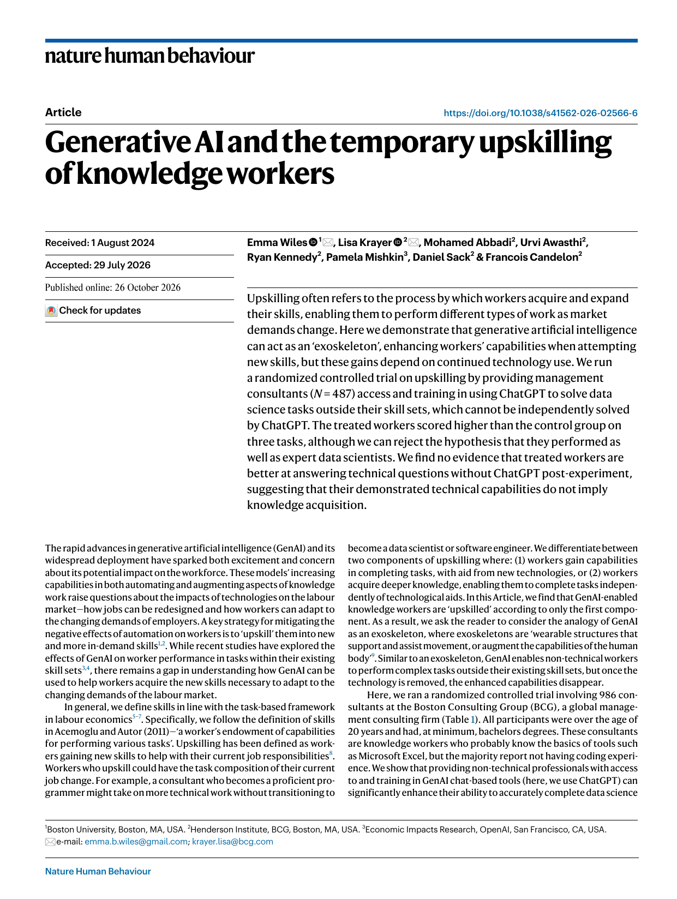<div><p><strong>Participants:</strong> 487 management consultants.</p><p><strong>Tasks:</strong> coding, statistics and prediction problems outside their usual skill set.</p><p><strong>Comparison:</strong> ChatGPT access and training versus conventional resources.</p></div></div>

<p class="citation">Wiles et al. (2026), “Generative AI and the Temporary Upskilling of Knowledge Workers,” <em>Nature Human Behaviour</em>.</p>

---

## One task involved reviewing a mortgage-prediction model

<div class="figure-layout">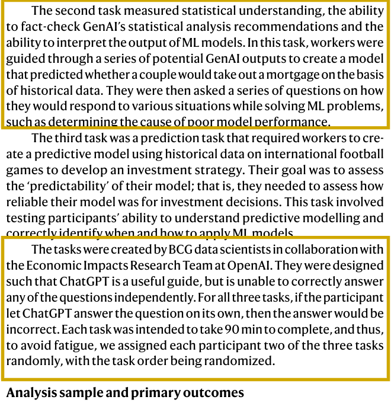<div><p>General consultants had to fact-check statistical recommendations and interpret machine-learning output.</p><p>The authors designed the tasks so that ChatGPT could help, but an answer produced by ChatGPT alone would be wrong.</p><p>Our opening example simplifies this task and uses instructor-authored results.</p></div></div>

<p class="citation">Wiles et al. (2026), Methods, “Task descriptions.”</p>

---

## ChatGPT improved performance on the assisted tasks

<div class="figure-layout">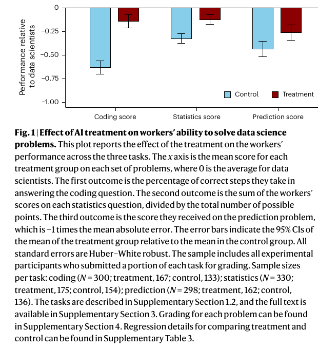<div><p>Treated participants performed better than controls on coding, statistics and prediction tasks.</p><p>They still remained below the data-scientist benchmark represented by zero.</p></div></div>

<p class="citation">Wiles et al. (2026), Figure 1.</p>

---

## The later test found no evidence of greater technical knowledge without ChatGPT

<div class="figure-layout">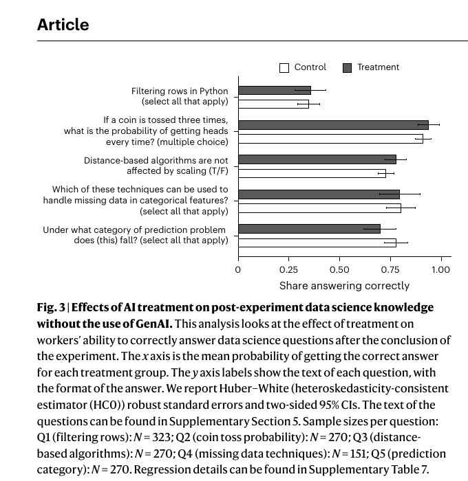<div><p>After the task, both groups answered technical questions without ChatGPT.</p><p>The authors report no statistically significant joint treatment effect across the five questions.</p></div></div>

<p class="citation">Wiles et al. (2026), Figure 3.</p>

---

## The two papers do not establish one general relationship between productivity and learning

<div class="study-boundary"><div><b>Brynjolfsson et al.</b><p>Different workers, firm, tasks and design. Measures workplace performance during assistance.</p></div><div><b>Wiles et al.</b><p>Different experiment and population. Includes a later knowledge test without assistance.</p></div></div>

<p class="plain-note">Together they show why the outcomes must be separated. They do not show whether the customer-support agents learned.</p>

---

## Break

<div class="break-time">10 minutes</div>

---

## The readings examine different aspects of skill at work

<table class="closed-table reading-comparison"><thead><tr><th>Study</th><th>Evidence</th><th>Question for discussion</th></tr></thead><tbody><tr><td><b>Barley</b></td><td>Technologists using the same scanners in two hospitals</td><td>Why did the division of labour develop differently?</td></tr><tr><td><b>Brynjolfsson et al.</b></td><td>Customer-support performance while an assistant was available</td><td>Why did less experienced workers gain more?</td></tr><tr><td><b>Wiles et al.</b></td><td>Assisted consulting tasks and a later test without ChatGPT</td><td>What did the consultants learn, if anything?</td></tr></tbody></table>

<p class="discussion-line">Which study gives us evidence about performance, retained knowledge or changes in the organization of work?</p>

---

## Possible explanations for the larger gains among less experienced workers

<div class="explanation-layout"><div class="finding-statement"><span>Finding</span><b>Workers with less tenure and lower prior performance gained more.</b><p>The study identifies a difference in measured performance. It cannot by itself tell us why that difference arose.</p></div><div class="explanation-list"><p><b>Access to earlier workers’ practical knowledge</b><br>The assistant may make useful responses available sooner.</p><p><b>Closer adherence to the firm’s preferred style</b><br>The assistant may standardize how workers handle a case.</p><p><b>A lower starting point</b><br>Workers with more room to improve may show larger gains.</p></div></div>

<p class="discussion-line">What additional evidence would distinguish these explanations?</p>

---

## The mortgage-model review involves four kinds of work

<div class="case-work"><div><span>Data-science team</span><p>Builds the prediction model and reports its test results.</p></div><div><span>AI assistant</span><p>Examines the results and the existing AI-written analysis.</p></div><div><span>Consultant</span><p>Interprets the evidence and decides what to tell the client.</p></div><div><span>Client organization</span><p>Decides whether and how to use the model.</p></div></div>

<div class="author-questions"><p><b>Barley:</b> Which part of the division of labour changes?</p><p><b>Zuboff:</b> What does the system allow the organization to record?</p><p><b>Wiles et al.:</b> What could the consultant do later without the assistant?</p></div>

---

## Draft and coach modes allocate the review differently

<table class="closed-table mode-comparison"><thead><tr><th>Part of the task</th><th>Draft mode</th><th>Coach mode</th></tr></thead><tbody><tr><td>Assess the claims</td><td>The assistant supplies an assessment.</td><td>The assistant identifies issues and asks the consultant questions.</td></tr><tr><td>Write the client note</td><td>The assistant writes a proposed note.</td><td>The consultant writes it.</td></tr><tr><td>Make the final decision</td><td>The consultant still has formal authority in our example.</td><td>The consultant still has formal authority in our example.</td></tr><tr><td>Test later knowledge</td><td>Not measured by the assisted task.</td><td>Not measured by the assisted task.</td></tr></tbody></table>

<p class="discussion-line">Which configuration would you use, and what outcome would you measure?</p>

<p class="plain-note">The coding exercise now holds the model's recommendation fixed and asks whether displaying different levels of certainty changes what the worker decides to do.</p>

---

## Coding exercise: model certainty and human judgment

<div class="mode-code-bridge"><div><pre><code class="python">certainty_levels = [
    0.55,
    0.75,
    0.95,
]</code></pre></div><div><p><b>The evidence stays fixed</b><br>The model sees the same test results once.</p><p><b>The recommendation stays fixed</b><br>Only the displayed certainty changes.</p><p><b>The worker decides</b><br>Students record what they would do and why.</p></div></div>

<p class="plain-note">A displayed certainty value is not necessarily a calibrated probability.</p>

---

## The complete program

<div class="program-map"><div><span>1</span><b>One recommendation</b><p>Send the fixed evidence to the model and preserve the raw return.</p></div><div><span>2</span><b>Three displays</b><p>Show the same advice with certainty values of 0.55, 0.75 and 0.95.</p></div><div><span>3</span><b>Human decisions</b><p>Record an action and reason for each display.</p></div><div><span>4</span><b>Comparison</b><p>Check whether judgment changed when the evidence did not.</p></div></div>

---

## The evidence is stored in a dictionary

```python
model_evidence = {
    "held_out_cases": 200,
    "model_accuracy": 0.80,
    "baseline_accuracy": 0.60,
    "calibration_reported": False,
    "subgroup_performance_reported": False,
    "error_costs_reported": False,
}
```

<p class="code-meaning">The three Boolean values identify evidence that has not been reported.</p>

---

## The model produces one recommendation

```python
print(raw_output)
model_advice = json.loads(raw_output)

print(model_advice["recommendation"])
print(model_advice["missing_information"])
```

<pre class="mini-output"><code>{"recommendation":"request_more_evidence",
 "missing_information":["calibration",
 "subgroup performance","error costs"]}</code></pre>

---

## The certainty display changes

```python
certainty_levels = [0.55, 0.75, 0.95]

print("Evidence:", model_evidence)
print("Recommendation:", model_advice["recommendation"])
print("Certainty displays:", certainty_levels)
```

<p class="code-meaning">The list contains three <code>float</code> values. Neither the evidence nor the recommendation changes.</p>

---

## Students record their decisions

```python
human_actions = [
    "ask_for_more_information",
    "escalate_to_specialist",
    "accept_recommendation",
]
human_reasons = [
    "...",
    "...",
    "...",
]
```

<p class="code-meaning">These values come from the student. They are not generated by the model.</p>

---

## The first student-defined function

```python
def record_human_judgment(
    recommendation,
    stated_certainty,
    human_action,
    human_reason,
):
    if human_action == "accept_recommendation":
        next_step = "Proceed with the recommendation."
    elif human_action == "escalate_to_specialist":
        next_step = "Send the case to a specialist."
    # other permitted actions follow
```

<p class="code-meaning">The first comparison that evaluates to <code>True</code> determines the next step.</p>

---

## The function returns one judgment record

```python
return {
    "recommendation": recommendation,
    "stated_certainty": stated_certainty,
    "human_action": human_action,
    "human_reason": human_reason,
    "next_step": next_step,
}
```

<div class="io-line"><b>Input:</b> four function arguments<i>→</i><b>Output:</b> one human-judgment <code>dict</code></div>

---

## One record for each certainty display

```python
judgment_records = []

for position, certainty in enumerate(certainty_levels):
    record = record_human_judgment(
        recommendation=model_advice["recommendation"],
        stated_certainty=certainty,
        human_action=human_actions[position],
        human_reason=human_reasons[position],
    )
    judgment_records.append(record)
```

<p class="code-meaning">On the first iteration, <code>position</code> is <code>0</code> and <code>certainty</code> is <code>0.55</code>.</p>

---

## What changed?

```python
evidence_changed = False
recommendation_changed = False
human_action_changed = not (
    human_actions[0] == human_actions[1] == human_actions[2]
)

print(evidence_changed)
print(recommendation_changed)
print(human_action_changed)
```

<p class="code-meaning">A change in human action requires explanation because the underlying evidence remained the same.</p>

---

## Questions about the decision

<table class="closed-table"><thead><tr><th>Question</th><th>What to inspect</th></tr></thead><tbody><tr><td>Did confidence language alter the decision?</td><td>The three human-action fields</td></tr><tr><td>Did the evidence justify that change?</td><td>The unchanged evidence dictionary</td></tr><tr><td>What would validate the certainty value?</td><td>Its relationship with outcomes in comparable cases</td></tr><tr><td>What can the organization observe?</td><td>The display, decision and worker's stated reason</td></tr></tbody></table>

---

## A question without model assistance

<div class="discussion-question">Does a displayed certainty of 0.95 mean that this recommendation is correct 95% of the time? What evidence would make that interpretation defensible?</div>

<p class="plain-note">The number has no frequency interpretation unless someone has validated how similar certainty values correspond to outcomes.</p>

---

## The take-home task

<div class="task-brief"><span>Decide</span><p>Edit the action and reason attached to each certainty display.</p><span>Trace</span><p>Explain the function parameters, the branch taken and the returned dictionary.</p><span>Compare</span><p>State whether your judgment changed while the evidence remained fixed.</p><span>Reflect</span><p>Explain what the organization could learn from the stored decision record.</p><span>Answer</span><p>Complete the certainty question without model assistance.</p><span>Submit</span><p>Upload the narrated recording using your name and <code>Week09</code>.</p></div>

---

## What can we conclude?

<div class="closing"><p>An LLM can improve measured performance while it is available. That does not, by itself, show that workers gained knowledge or that their discretion and authority increased.</p><p>The organizational consequences depend on how the system is configured, what it records and how work is arranged around it.</p></div>

---

## Questions that remain open

<div class="open-questions"><div>Which forms of worker knowledge become training material, and who owns the resulting system?</div><div>When does assistance support learning rather than continued dependence?</div><div>Who can inspect the record of suggestions, edits and outcomes?</div><div>How do workers reshape the system in practice?</div></div>
