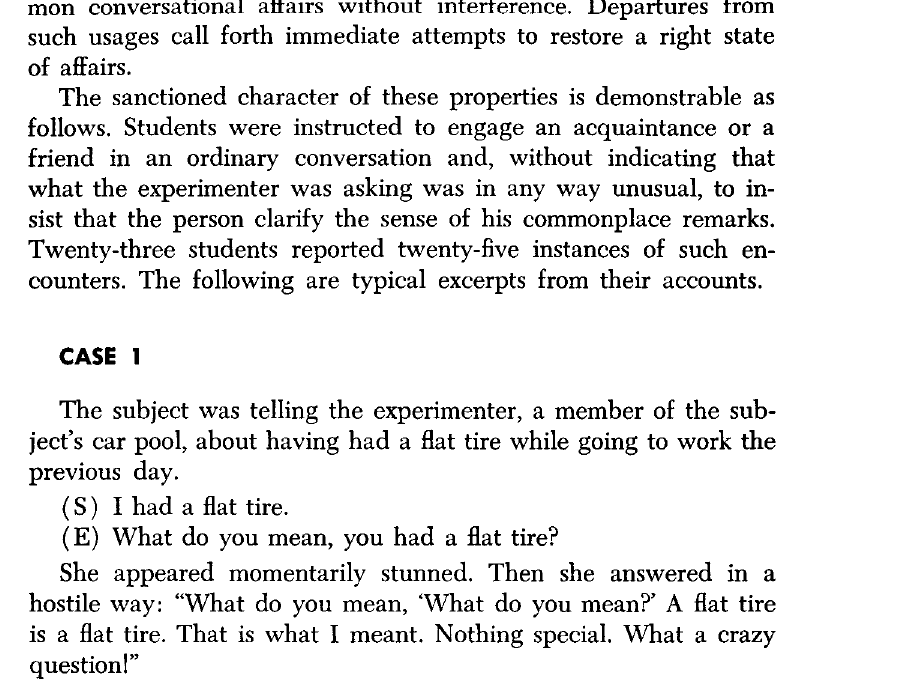
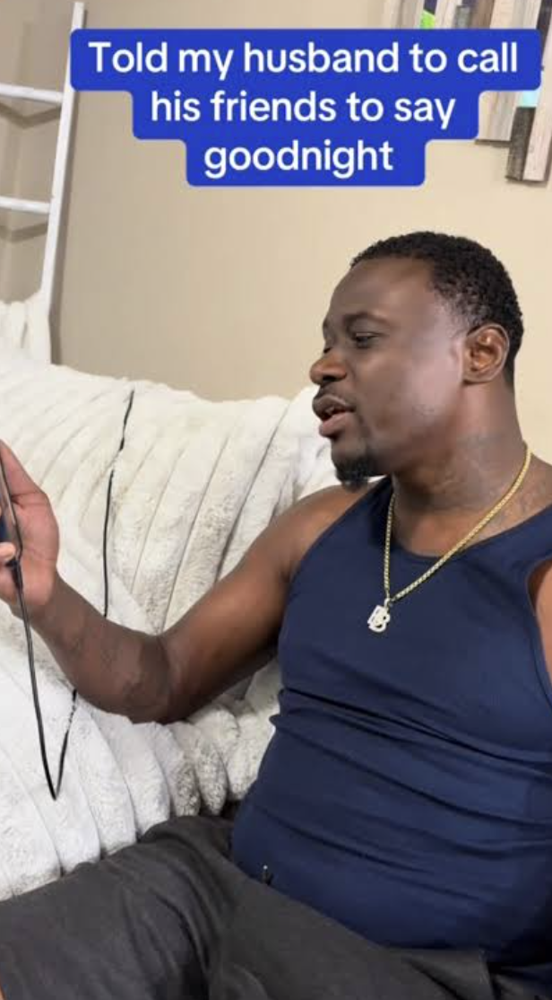
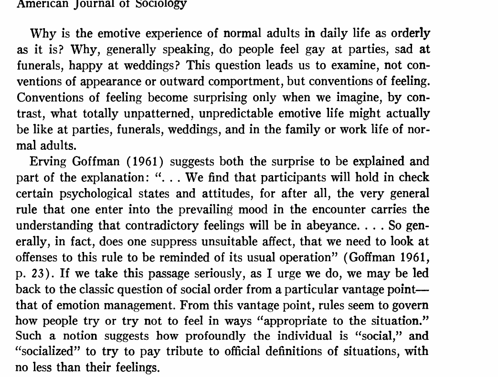
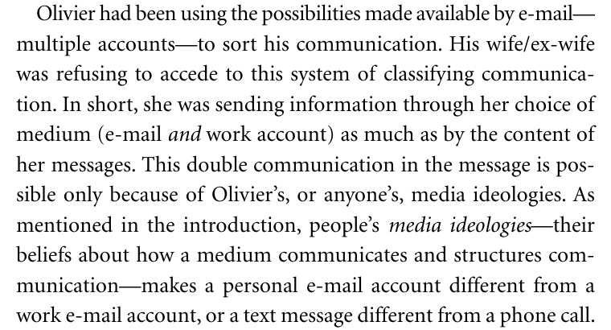

## AI assistance in interpersonal communication

<div class="opening-question">What happens to a social relationship when someone uses an LLM to formulate an interpersonal message?</div>

---

## A condolence message

<div class="scenario">
<p>A close colleague's mother has died after a short illness.</p>
<p>You knew that she had been ill, but you never met her.</p>
<p>You want to send a private message before the funeral. You are unsure what to write.</p>
</div>

---

## An LLM writes the message

<div class="prompt-box">Write a short condolence message to a close colleague whose mother has died. I knew she had been ill but never met her. Do not invent memories or feelings. Offer to take the seminar notes this week. Make clear that no reply is required.</div>

<div class="message-example compact">“I’m so sorry to hear about your mother. I’m thinking of you and your family. There is no need to reply. I can take care of the seminar notes this week if that would help.”</div>

---

## The same words can be produced in different ways

<div class="production-list">
<p><strong>Written by the sender</strong><span>The sender chooses every word.</span></p>
<p><strong>Suggested by the model</strong><span>The sender rewrites the draft.</span></p>
<p><strong>Copied from the model</strong><span>The sender checks it and presses send.</span></p>
<p><strong>Sent automatically</strong><span>A system trained on the sender's writing produces and sends it.</span></p>
</div>

<p class="plain-question">The recipient could receive exactly the same text in all four cases.</p>

---

## Three different outcomes

<div class="outcome-columns">
<div><h3>The message</h3><p>What language did the system produce?</p><p class="evidence">Evidence: prompt and output</p></div>
<div><h3>The sender</h3><p>What did the writer think, feel, select or revise?</p><p class="evidence">Evidence: the writer's process and outcomes</p></div>
<div><h3>The recipient</h3><p>How was the message understood, and what happened next?</p><p class="evidence">Evidence: recipient and interactional data</p></div>
</div>

---

## Goffman on face-work

<div class="source-layout">

<div><p>Participants interpret verbal and non-verbal acts as a <strong>line</strong>: an expressed view of the situation and the people in it.</p><p><strong>Face</strong> is the positive social value effectively claimed through that line.</p></div>
</div>

<p class="citation">Goffman, “On Face-Work” (1955), pp. 213–214.</p>

---

## Condolence as an interactional obligation

<div class="two-col-text">
<div><h3>The expected act</h3><p>The sender recognizes the loss and displays an appropriate orientation towards the bereaved person.</p></div>
<div><h3>Possible breaches</h3><p>No message, a very late message or a conspicuously generic message may be interpreted as evidence about the relationship.</p></div>
</div>

<p>Goffman helps us examine public conduct in the encounter. Evidence about the sender’s private feelings would have to come from elsewhere.</p>

---

## Garfinkel's breaching demonstrations

<div class="breach-examples">
<p><strong>At home</strong><span>Behave like a polite lodger rather than a family member.</span></p>
<p><strong>In conversation</strong><span>Demand precise definitions of ordinary remarks.</span></p>
<p><strong>In a shop</strong><span>Bargain over merchandise marked with a fixed price.</span></p>
</div>

<p>The awkward response reveals an expectation that ordinarily remains unstated.</p>
<p class="citation">Garfinkel, <em>Studies in Ethnomethodology</em> (1967), ch. 2.</p>

---

## “What do you mean, you had a flat tire?”

<div class="source-layout">

<div><p>The experimenter treats an ordinary remark as if its meaning were unclear.</p><p>The other speaker responds with confusion and hostility because the request violates the ordinary terms of conversation.</p></div>
</div>

<p class="citation">Garfinkel (1967), pp. 42–43.</p>

---

## Calling a friend just to say good night

<div class="trend-slide">
<div class="trend-video"><a href="https://www.facebook.com/TheJRECompanion/posts/dudes-calling-friends-to-say-good-night-just-may-be-the-best-social-media-trend-/711260041408367/" target="_blank"><span class="play-badge">▶</span></a></div>
<div class="trend-copy"><div><h3>The call</h3><p>“I’m about to go to sleep. I just wanted to call and say good night.”</p></div><div><h3>The recurring reaction</h3><p>Friends laugh, ask what is wrong or call back to check that the caller is all right.</p></div><p class="click-note">Click the thumbnail to open the video.</p></div>
</div>

<p class="citation">Video posted by The JRE Companion on Facebook.</p>

---

## Hochschild on feeling rules and emotion work

<div class="source-layout">

<div><p>Hochschild starts with a question about social order: why are feelings at funerals, weddings and parties as patterned as they are?</p><p>She takes Goffman's account of conduct in encounters into the study of what people think they should feel.</p></div>
</div>

<p class="citation">Hochschild, “Emotion Work, Feeling Rules, and Social Structure” (1979), p. 552.</p>

---

## The evidence

<div class="method-box"><div class="big-number">261</div><div><p>written protocols from students in two Berkeley classes in 1974</p><p>Respondents described attempts to change a situation to fit feeling or to change feeling to fit a situation.</p></div></div>

<p class="citation">Hochschild (1979), p. 561 and n. 9.</p>

---

## Feeling rules

<div class="source-layout">

<div><p>Rules concern the direction, intensity and duration of feeling treated as appropriate to a situation.</p><p>A condolence carries expectations about sympathy, seriousness and attention to another person's loss.</p></div>
</div>

<p class="citation">Hochschild (1979), pp. 563–564.</p>

---

## Emotion work

<div class="source-layout">

<div><p>Emotion work is the attempt to change the degree or quality of emotion. The attempt may succeed or fail.</p></div>
</div>

<p class="citation">Hochschild (1979), p. 561.</p>

---

## Goffman and Hochschild

<div class="theory-comparison">
<div><h3>Goffman</h3><p>How does a person sustain an appropriate line before others?</p><p>The evidence is visible conduct within an encounter.</p></div>
<div><h3>Hochschild</h3><p>How do social expectations reach into what a person thinks they should feel?</p><p>The evidence must include the person's effort to manage feeling.</p></div>
</div>

---

## Surface acting and deep acting

<div class="acting-comparison">
<div><h3>Surface acting</h3><p>Change the outward expression while leaving the current feeling unchanged.</p></div>
<div><h3>Deep acting</h3><p>Try to produce or intensify the feeling that the situation calls for.</p></div>
</div>

<p>An appropriate condolence can result from either process. Distinguishing them requires evidence about the sender.</p>
<p class="citation">Hochschild, <em>The Managed Heart</em> (1983), ch. 3.</p>

---

## What might the sender offload?

<div class="offload-list">
<p><strong>Formulation</strong><span>The sender feels sympathy but cannot find the words.</span></p>
<p><strong>Reflection</strong><span>The prompt asks the sender to consider the loss and what practical help is appropriate.</span></p>
<p><strong>Expression</strong><span>The model supplies the conventional language of sympathy.</span></p>
<p><strong>The act itself</strong><span>The sender delegates the message without reading or revising it.</span></p>
</div>

<p>These processes require different evidence about the sender.</p>

---

## What the recipient can observe

<div class="outcome-columns"><div><h3>Expression</h3><p>The words and medium are observable.</p></div><div><h3>Production</h3><p>Authorship, revision and disclosure may be hidden.</p></div><div><h3>Interpretation</h3><p>The recipient decides what the act says about the relationship.</p></div></div>

---

## Zelizer's concrete problem

<div class="transaction-examples">
<p><strong>£50 sent to a colleague</strong><span>Reimbursement for expenses</span></p>
<p><strong>£50 sent to a sibling</strong><span>A birthday gift</span></p>
<p><strong>£50 sent to a friend</strong><span>Repayment of a loan</span></p>
</div>

<p>The amount alone does not tell us what happened. The relationship, the payment medium and the shared understanding give the transfer its meaning.</p>
<p class="citation">Zelizer, <em>The Purchase of Intimacy</em> (2005); Zelizer (2012).</p>

---

## Connected lives

<div class="source-layout">

<div><p>Zelizer rejects the idea that intimacy and calculation occupy separate social worlds.</p><p>People routinely negotiate the meaning of transfers within particular relationships.</p></div>
</div>

<p class="citation">Zelizer (2005), pp. 28–30.</p>

---

## Applying Zelizer to the condolence message

<p>Zelizer studies economic exchanges. The condolence example extends her question to a communicative act:</p>

<div class="observation-list">
<p><strong>Relationship:</strong> close friend, colleague or distant acquaintance</p>
<p><strong>Act:</strong> recognizing a loss and offering support</p>
<p><strong>Medium:</strong> card, call, text or AI-assisted message</p>
<p><strong>Meaning:</strong> what the recipient understands the act to express</p>
</div>

---

## Gershon on media ideologies

<div class="source-layout">

<div><p>A medium supplies information about how the recipient should interpret the words.</p><p>People learn these meanings socially, and the meanings attached to texts and calls vary across groups.</p></div>
</div>

<p class="citation">Gershon, <em>The Breakup 2.0</em> (2010), p. 18.</p>

---

## AI assistance and media ideologies

<div class="media-comparison">
<p><strong>What arrived?</strong><span>A text, email, card or voice message</span></p>
<p><strong>How was it produced?</strong><span>Written, suggested, copied or automated</span></p>
<p><strong>What does the recipient believe?</strong><span>The production process may be known, suspected or concealed</span></p>
</div>

<p>Gershon gives us the clearer bridge from relational norms to AI-assisted communication.</p>

---

## What if the model sounds exactly like you?

<div class="voice-case">
<p>The recipient can no longer identify assistance from the style of the message.</p>
<p>Questions about effort, authorship and responsibility remain.</p>
<p>The effect of disclosure becomes an empirical question.</p>
</div>

---

## Questions raised by the condolence example

<div class="five-questions"><p><strong>Goffman:</strong> What response does the situation call for?</p><p><strong>Garfinkel sidebar:</strong> What expectation did the good-night call reveal?</p><p><strong>Hochschild:</strong> Did the sender manage feeling, expression or both?</p><p><strong>Zelizer:</strong> How does the relationship change the meaning of the act?</p><p><strong>Gershon:</strong> What does the production medium communicate?</p></div>

---

## Break

<div class="break-slide">10 minutes</div>

---

## Two studies of AI-assisted communication

<div class="two-col-text">
<div><h3>Hohenstein et al.</h3><p>Do smart replies change language and partners' immediate ratings during a conversation?</p></div>
<div><h3>Williams-Ceci et al.</h3><p>Can biased autocomplete suggestions influence the person using them to write?</p></div>
</div>

<p>These experiments examine bounded interactions and writing tasks. A sociological study of established relationships would need additional outcomes and a longer time frame.</p>

---

## Hohenstein et al.: AI suggestions in conversation

<div class="source-layout paper-title"><div><p><strong>Question:</strong> Does smart-reply assistance change language and partners’ judgments during an interaction?</p><p>The paper distinguishes access to suggestions, recorded use, suspected use and the language of the conversation.</p></div></div>

<p class="citation">Hohenstein et al., <em>Scientific Reports</em> 13, 5487 (2023).</p>

---

## Study 1: randomized access to smart replies

<div class="source-layout figure-source"><div><p><strong>219 pairs</strong> discussed a policy issue.</p><p>Each participant was independently assigned smart replies available or unavailable, producing four pair combinations.</p><p>Availability encouraged use; some participants with access chose to type their own response.</p></div></div>

<p class="citation">Hohenstein et al. (2023), Fig. 1.</p>

---

## Actual use and suspected use

<div class="two-col-text"><div><h3>Actual use</h3><p>The system recorded use. The authors used randomized availability as an instrument when estimating its effects.</p></div><div><h3>Suspected use</h3><p>Partners reported suspected use after the exchange. Disclosure of AI assistance was not randomized.</p></div></div>

<p class="plain-question">The suspected-use comparison is correlational.</p>

---

## Partner ratings in Study 1

<div class="source-layout figure-source"><div><p>Instrumented partner use was associated with higher ratings of cooperation and affiliation.</p><p>Greater <em>suspected</em> use was associated with lower cooperation and affiliation and greater dominance, after controlling for actual use.</p></div></div>

<p class="citation">Hohenstein et al. (2023), Fig. 2. Suspected-use estimates are correlational.</p>

---

## Study 2: positive and negative suggestions

<div class="source-layout figure-source"><div><p><strong>291 pairs</strong> received Google, positive, negative or no smart replies.</p><p>Changing the suggestions changed the emotional language participants used in the conversation.</p></div></div>

<p class="citation">Hohenstein et al. (2023), Fig. 3.</p>

---

## What the study measured

<div class="evidence-boundary"><p><strong>Measured in the study:</strong> smart-reply availability and use, conversational language and partner ratings after the conversation.</p><p><strong>Requires further evidence:</strong> sincerity, durable trust, repair of an existing relationship and effects over time.</p></div>

---

## Williams-Ceci et al.: influence on the writer

<div class="source-layout paper-title"><div><p>Participants wrote about contested social issues with or without autocomplete suggestions.</p><p>The principal outcome was the writer’s own reported attitude after composing the text.</p></div></div>

<p class="citation">Williams-Ceci et al., <em>Science Advances</em> 12, eadw5578 (2026), Fig. 1.</p>

---

## Experimental conditions

<div class="source-layout design-source"><div><p><strong>Experiment 1:</strong> no assistance, biased autocomplete or the same arguments shown as static text.</p><p><strong>Experiment 2:</strong> no assistance, biased autocomplete, a warning, a debrief or an instruction to write in favour.</p></div></div>

<p class="citation">Williams-Ceci et al. (2026), Fig. 2, stages 2–3.</p>

---

## Outcome measures

<div class="source-layout design-source"><div><p>Across the two experiments, <strong>N = 2,582</strong> participants reported their attitudes after writing.</p><p>Experiment 2 also measured the same participants' attitudes several weeks before the task. The AI conditions ended with an awareness check.</p></div></div>

<p class="citation">Williams-Ceci et al. (2026), Fig. 2, stages 4–6.</p>

---

## Reported attitudes after biased autocomplete

<div class="figure-full"></div>

<p>The outcome is the writer’s reported attitude after composition. Recipient persuasion was outside the study.</p>
<p class="citation">Williams-Ceci et al. (2026), Fig. 3.</p>

---

## Experiment 2: attitudes before and after writing

<div class="figure-full"></div>

<p>The suggestions were followed by changes in participants’ reported attitudes. The experiment leaves open how durable those changes were.</p>
<p class="citation">Williams-Ceci et al. (2026), Fig. 4.</p>

---

## Comparing the two experiments

<table class="comparison-table"><thead><tr><th>Study</th><th>Observed outcome</th><th>What remains open?</th></tr></thead><tbody><tr><td>Hohenstein et al.</td><td>Language and partner ratings immediately after a bounded conversation</td><td>Meaning within an established relationship and consequences over time</td></tr><tr><td>Williams-Ceci et al.</td><td>The writer's reported attitude after assisted composition</td><td>Recipient response, emotion work and relationship outcomes</td></tr></tbody></table>

<p class="comparison-note">The experiments measure language, writers and immediate judgments. Research on established relationships would also need relationship-specific obligations and consequences over time.</p>

---

## Discussion: delegation and disclosure

<div class="discussion-evidence">
<div><h3>The sender</h3><p>In the condolence case, is the sender delegating formulation, reflection, emotional expression or the interpersonal act itself?</p></div>
<div><h3>The recipient</h3><p>Would disclosure change the meaning of the message? Specify what evidence would answer the question.</p></div>
</div>

---

## Discussion: what do the experiments establish?

<div class="discussion-evidence with-images">
<div><p>Why is instrumented use treated differently from suspected use? Which estimates are causal and which are correlational?</p></div>
<div><p>How would the interpretation change if the outcome were a recipient's attitude? What additional design would be required?</p></div>
</div>

---

## Coding exercise: auditing social advice

<div class="code-task-map"><span>social situation</span><span>student response</span><span>model advice</span><span>comparison</span><span>audit record</span></div>

<p>Students decide what they would do before seeing the model output. The exercise then compares that judgment with the model’s advice. There is no prescribed correct response.</p>

---

## Three social situations

<table class="closed-table"><thead><tr><th>Relationship</th><th>Situation</th><th>Question for the audit</th></tr></thead><tbody><tr><td>Close colleague</td><td>Their mother has died</td><td>Does the advice recognize the loss without inventing intimacy?</td></tr><tr><td>Project colleague</td><td>Joint work was presented without credit</td><td>How does the model handle correction and escalation?</td></tr><tr><td>Adult sibling</td><td>Private information conflicts with a parent's question</td><td>Which obligation does the model prioritize?</td></tr></tbody></table>

---

## Each situation is a dictionary

```python
{
    "id": "condolence_message",
    "relationship": "a close colleague",
    "facts": (
        "Their mother has died after a short illness..."
    ),
}
```

<p>The full <code>situations</code> object is a list containing three dictionaries.</p>

---

## Record your response before the model call

```python
student_responses_before = [
    {
        "action": "Write a private message and offer practical help.",
        "reason": "The message should recognize the loss without requiring a reply.",
    },
    # two more responses
]
```

<p class="code-meaning">This order lets us see whether reading the model suggestion changes the student's judgment.</p>

---

## The model receives the relationship and facts

```python
prompt = f"""
Relationship: {situation['relationship']}
Facts: {situation['facts']}

Propose one action and one possible message.
Explain which obligation or expectation matters.
Identify important missing information.
"""
```

<p>The prompt prohibits invented feelings, motives and relationship history.</p>

---

## Print the raw model return

```python
print(raw_output)
parsed_output = json.loads(raw_output)

model_record = {
    "situation_id": situation["id"],
    "raw_output": raw_output,
    "parsed_output": parsed_output,
}
```

<p class="code-meaning"><b>Input:</b> one situation dictionary. <b>Output:</b> one model-record dictionary containing the raw and parsed return.</p>

---

## Generate advice for all three situations

```python
model_records = []

for position, situation in enumerate(situations, start=1):
    model_record = ask_social_adviser(
        situation=situation,
        route=ROUTE,
    )
    model_records.append(model_record)
```

<p>On the first iteration, <code>position</code> is <code>1</code> and <code>situation</code> is the condolence dictionary.</p>

---

## Students review the model advice

```python
audit_answers = [
    {
        "would_follow_model": True,
        "important_difference": "...",
        "student_response_after": {...},
    },
    # two more audit answers
]
```

<p>The student completes these fields after reading the model outputs.</p>

---

## A default Boolean

```python
def record_audit(
    situation,
    student_response_before,
    model_record,
    audit_answer,
    would_follow_model=False,
):
```

<p>If the call omits the final argument, Python records <code>False</code>. The student supplies this Boolean after reviewing the advice.</p>

---

## Keyword arguments in the function call

```python
audit_record = record_audit(
    situation=situation,
    student_response_before=student_responses_before[position],
    model_record=model_records[position],
    audit_answer=audit_answer,
    would_follow_model=audit_answer["would_follow_model"],
)
```

<p>Each name shows exactly which object enters the function parameter.</p>

---

## One audit dictionary per situation

```python
return {
    "situation_id": situation["id"],
    "student_response_before": student_response_before,
    "model_response": model_record["parsed_output"],
    "would_follow_model": would_follow_model,
    "important_difference": audit_answer["important_difference"],
    "student_response_after": audit_answer["student_response_after"],
    "student_changed_response": (
        audit_answer["student_response_after"]
        != student_response_before
    ),
}
```

---

## What to inspect

<table class="closed-table"><thead><tr><th>Audit question</th><th>Evidence</th></tr></thead><tbody><tr><td>Did the model identify the relevant obligation?</td><td>Its reasoning and proposed action</td></tr><tr><td>Did it understand the relationship?</td><td>The advice and possible message</td></tr><tr><td>Did it invent context?</td><td>Compare every claim with the situation dictionary</td></tr><tr><td>Would you behave this way?</td><td>Your before and after responses</td></tr></tbody></table>

---

## The take-home task

<ol class="task-list"><li>Replace at least one initial response with what you would do.</li><li>Run the three social situations and preserve every raw return.</li><li>Complete an audit answer after reading each response.</li><li>Explain the first <code>enumerate()</code> iteration and the default Boolean.</li><li>Trace one case into its final audit dictionary.</li><li>Identify one useful interpretation and one disagreement or omission.</li><li>State whether the suggestion changed your response.</li></ol>

---

## What to explain in the recording

<div class="submission-box">Show one situation dictionary, your response before the model call, the raw return, the parsed output and the completed audit record. Explain why students may reasonably reach different judgments.</div>

<p>Submit a 6–8 minute narrated recording to the course Coding Videos folder using the required week-and-name filename.</p>

---

## Scope of the exercise

<div class="evidence-boundary"><p><strong>Observed here:</strong> how the model interprets three supplied situations and where one student agrees or disagrees.</p><p><strong>Requires additional evidence:</strong> how people generally behave and how recipients interpret advice-based messages.</p></div>

---

## Evidence we would still need

<div class="final-questions"><p>How do people revise their initial judgment after seeing a suggestion?</p><p>Which disagreements recur across participants and models?</p><p>How do recipients interpret messages produced from this advice?</p><p>Which contextual omissions matter outside these three cases?</p></div>

---

## Social advice as an object of study

<div class="closing-answer">An LLM can propose an action and message for a social situation. The audit records how it interpreted the relationship and how one student responded to its advice.</div>

::: {.notes}
[Sources]
- Zelizer (2012), https://doi.org/10.1177/0032329212441591
- Goffman (1955), https://doi.org/10.1080/00332747.1955.11023008
- Garfinkel (1967), Studies in Ethnomethodology, chapter 2
- “Calling Friends to Say Goodnight Prank” (2025), https://knowyourmeme.com/memes/calling-friends-to-say-goodnight-prank
- “TikTok men wishing friends goodnight” (2025), https://www.fastcompany.com/91342944/men-wishing-friends-good-night-tiktok-trend-male-loneliness-epidemic
- Hochschild (1979), https://doi.org/10.1086/227049
- Hochschild (1983), The Managed Heart, chapter 3
- Gershon (2010), https://doi.org/10.7591/9780801458002
- Hohenstein et al. (2023), https://doi.org/10.1038/s41598-023-30938-9
- Williams-Ceci et al. (2026), https://doi.org/10.1126/sciadv.adw5578
[/Sources]
:::
