## LLM-assisted interpersonal communication

<div class="opening-question">People now use language models to draft apologies, explain decisions and prepare for difficult exchanges. This class asks how that assistance changes the message, the writer and the relationship.</div>

---

## A broken commitment

<div class="scenario">
<p>You promised to help someone move at <strong>8 a.m. on Saturday</strong>.</p>
<p>At noon on Friday, your employer required you to work from 8 a.m. to 4 p.m. You waited until <strong>9 p.m.</strong> to tell them.</p>
<p>They had declined paid help because they expected you to come.</p>
</div>

---

## What happened

<div class="facts-repairs">
<div><h3>Facts</h3><ul><li>The work requirement arrived at noon.</li><li>The message is being sent nine hours later.</li><li>The other person relied on the promise.</li><li>No feelings or motives have been supplied.</li></ul></div>
<div><h3>Possible repairs</h3><ul><li>Pay half the cost of a last-minute mover.</li><li>Help on Sunday instead.</li><li>The recipient can accept, refuse or renegotiate either offer.</li></ul></div>
</div>

---

## A minimal instruction

<div class="prompt-box">Write a message telling a close friend that I cannot help them move tomorrow. Use the facts supplied below and do not invent facts.</div>

<p class="plain-question">What does the model have to infer about the relationship and the obligation?</p>

---

## An instruction that specifies the broken obligation

<div class="prompt-box accent">Write the message to a close friend. State the commitment that was broken, acknowledge the late notice and the plan they made in reliance on the promise, explain only the facts supplied, and offer the two available forms of repair. Do not invent feelings, relationship history or motives.</div>

---

## Writing, writer attitudes and relationship outcomes

<div class="outcome-columns">
<div><h3>Generated writing</h3><p>What wording, explanation and repair did the system produce?</p><p class="evidence">Evidence: prompt and output</p></div>
<div><h3>Influence on the writer</h3><p>Did assistance change what the writer thought, selected or reported?</p><p class="evidence">Evidence: human outcomes and a comparison</p></div>
<div><h3>Interpersonal consequence</h3><p>How did the recipient interpret the act, and what happened next?</p><p class="evidence">Evidence: recipient and interactional data</p></div>
</div>

---

## Zelizer on intimacy and economic exchange

<div class="two-col-text">
<div><h3>Separate spheres</h3><p>This view treats intimate relations as a realm of sentiment and economic activity as a realm of rational calculation.</p></div>
<div><h3>The empirical problem</h3><p>Families, partners and carers routinely exchange money, labour and gifts. The exchanges do not all mean the same thing.</p></div>
</div>

<p class="citation">Zelizer, <em>The Purchase of Intimacy</em> (2005), ch. 1.</p>

---

## The “hostile worlds” argument

<div class="source-layout">
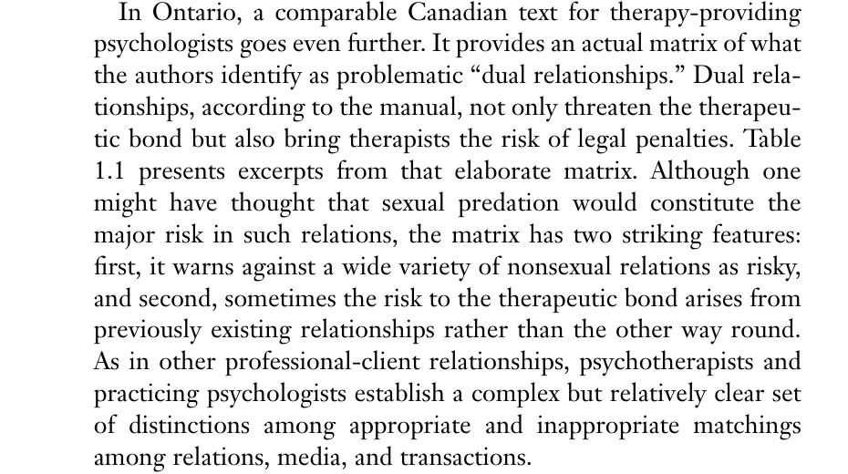
<div><p>On this account, money corrupts intimacy and intimacy compromises rational exchange.</p><p>Zelizer instead asks how people combine the two while distinguishing one relationship from another.</p></div>
</div>

<p class="citation">Zelizer (2005), pp. 20–22.</p>

---

## Cole v. Lucas

<div class="source-layout wide-source">
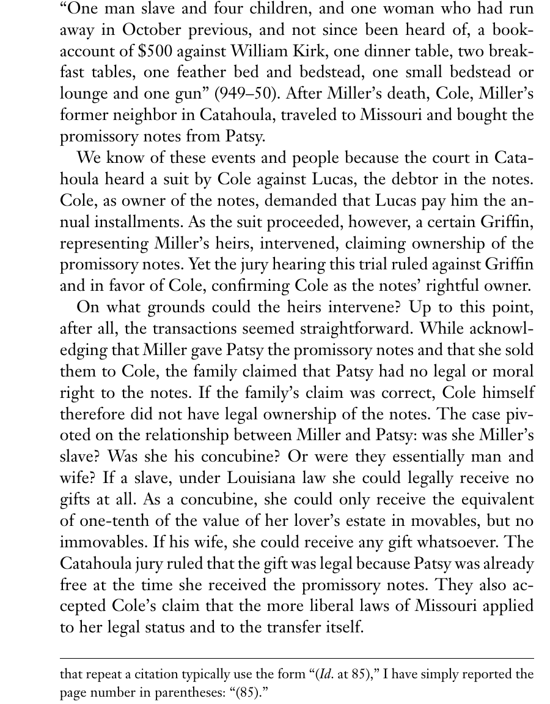
<div><p>Josiah Miller gave promissory notes to Patsy, an enslaved woman with whom he had an intimate relationship.</p><p>After his death, the court had to decide what kind of obligation those notes represented.</p></div>
</div>

<p class="citation">Zelizer (2005), pp. 7–8.</p>

---

## The legal meaning depended on the relationship

<div class="source-layout wide-source">
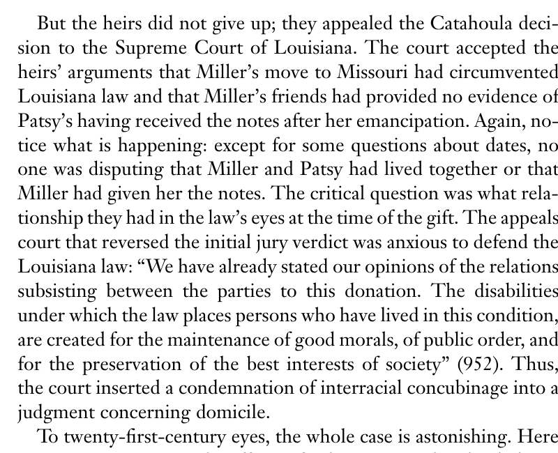
<div><p>The same transfer acquired a different legal meaning if the relationship was classified as master–slave, concubinage or marriage.</p><p>The court could not interpret the transfer until it classified the relationship.</p></div>
</div>

<p class="citation">Zelizer (2005), pp. 8–9.</p>

---

## How Zelizer defines relational work

<div class="relation-map"><div class="node">relationship</div><div class="arrow">↔</div><div class="node">transaction</div><div class="arrow">↔</div><div class="node">medium</div><div class="arrow">↔</div><div class="node">meaning</div></div>

<p>People differentiate social ties, mark their boundaries and match them with transactions and media they regard as appropriate. The four terms above summarize Zelizer's published definition.</p>

---

## Connected lives

<div class="source-layout">
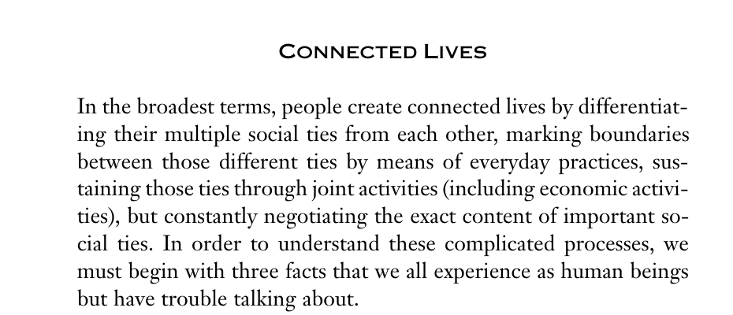
<div><p>People combine intimacy and economic activity while negotiating what particular exchanges mean.</p></div>
</div>

<p class="citation">Zelizer (2005), pp. 28–30; Zelizer (2012).</p>

---

## The apology as a relational act

<p>Zelizer studies ties, economic transactions, media and meanings. Our example applies the same relational question to a communicative act:</p>

<div class="observation-list">
<p><strong>Tie:</strong> What kind of relationship is this?</p>
<p><strong>Act:</strong> What obligation is being performed?</p>
<p><strong>Medium:</strong> How is it being performed, and with whose assistance?</p>
<p><strong>Meaning:</strong> What do participants understand the act to express?</p>
</div>

---

## Different ways to use AI assistance

<div class="comparison-strip">
<div><strong>Model drafts</strong><span>Sender revises substantially</span></div><div><strong>Model drafts</strong><span>Sender copies without review</span></div><div><strong>Assistance disclosed</strong><span>Recipient knows how it was made</span></div><div><strong>Assistance concealed</strong><span>Recipient attributes the words to the sender</span></div>
</div>

<p>Two senders could use the same words while making different choices about effort, revision and disclosure.</p>

---

## Goffman on face-work

<div class="source-layout">
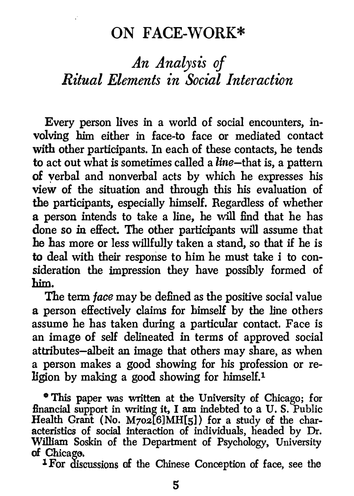
<div><p>Participants interpret verbal and non-verbal acts as a <strong>line</strong>: an expressed view of the situation and the people in it.</p><p><strong>Face</strong> is the positive social value effectively claimed through that line.</p></div>
</div>

<p class="citation">Goffman, “On Face-Work” (1955), pp. 213–214.</p>

---

## The broken promise as an incident

<div class="incident"><div>Earlier line<br><strong>“You can rely on me.”</strong></div><div class="break-mark">≠</div><div>Observed conduct<br><strong>Late cancellation after reliance</strong></div></div>

<p>Saturday’s plan changes, but the interactional problem is broader. The conduct conflicts with the earlier claim that the friend could rely on the promise.</p>

---

## Recognizing the offence

<div class="source-layout">
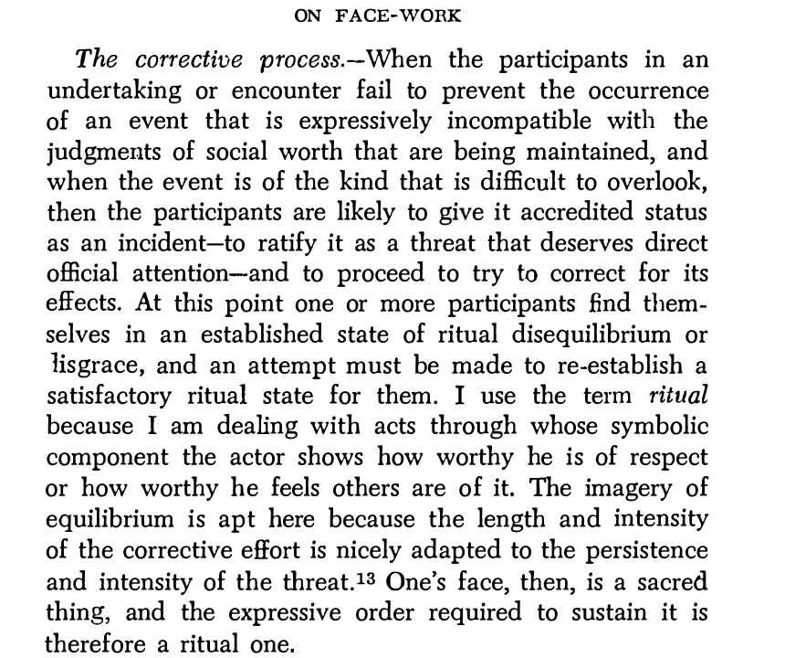
<div><p>A participant may challenge the event, or the offender may recognize it without being prompted.</p><p>The opening establishes that something requires repair.</p></div>
</div>

<p class="citation">Goffman (1955), pp. 219–220.</p>

---

## Accounts and excuses

<div class="source-layout">
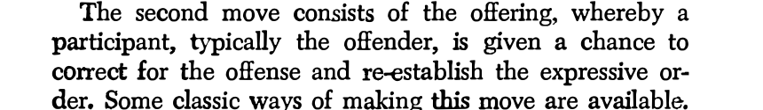
<div><p>“My employer required me to work” explains the conflict.</p><p>It does not acknowledge the nine-hour delay, the reliance on the promise or the cost imposed on the other person.</p></div>
</div>

<p class="citation">Goffman (1955), pp. 220–221.</p>

---

## The stages of a corrective exchange

<div class="process-line"><div>offence<br>recognized</div><div>account</div><div>responsibility<br>acknowledged</div><div>repair<br>offered</div><div>recipient<br>responds</div></div>

<p>The model can draft an account and an offer. It cannot make the recipient accept either.</p>

---

## Acceptance is the recipient’s decision

<div class="source-layout">
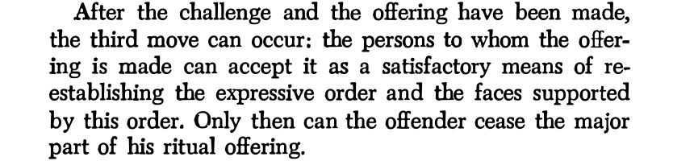
<div><p>Compensation or expiation forms part of the exchange. The recipient then decides whether to accept the account and the proposed repair.</p></div>
</div>

<p class="citation">Goffman (1955), pp. 221–222.</p>

---

## Authorship and responsibility in an AI-assisted message

<div class="ownership-questions"><p>Who selected the explanation?</p><p>Who decided what responsibility to acknowledge?</p><p>Who chose the repair?</p><p>What does the recipient believe about authorship?</p></div>

<p>The sender remains responsible for sending the message. A recipient may interpret it differently if they later learn how it was written.</p>

---

## Hochschild on feeling rules and emotion work

<div class="source-layout">
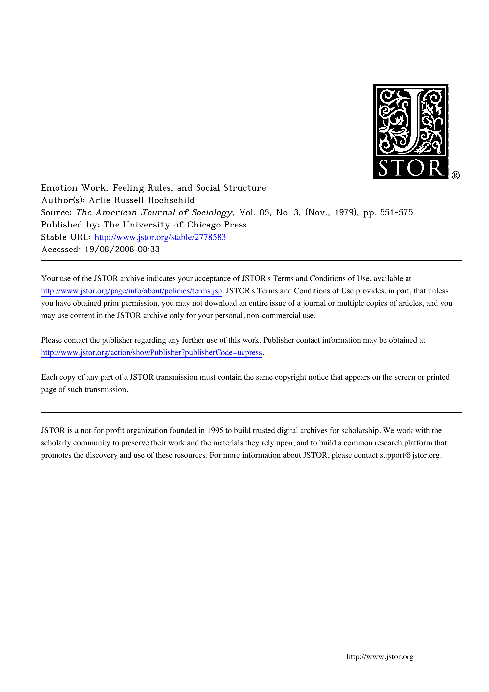
<div><p>Hochschild asks how people try to manage feeling in relation to social expectations, rather than studying emotional display alone.</p></div>
</div>

<p class="citation">Hochschild, “Emotion Work, Feeling Rules, and Social Structure” (1979).</p>

---

## The evidence

<div class="method-box"><div class="big-number">261</div><div><p>written protocols from students in two Berkeley classes in 1974</p><p>Respondents described attempts to change a situation to fit feeling or to change feeling to fit a situation.</p></div></div>

<p class="citation">Hochschild (1979), p. 561 and n. 9.</p>

---

## Feeling rules

<div class="source-layout">
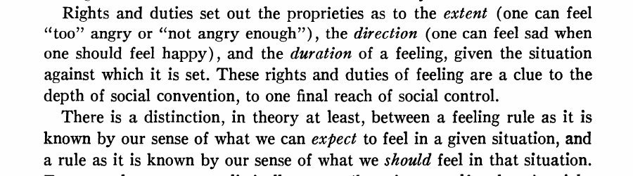
<div><p>Rules concern the direction, intensity and duration of feeling treated as appropriate to a situation.</p><p>An apology carries expectations about remorse, concern and responsibility.</p></div>
</div>

<p class="citation">Hochschild (1979), pp. 563–564.</p>

---

## Emotion work

<div class="source-layout">
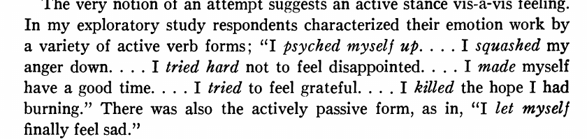
<div><p>Emotion work is the attempt to change the degree or quality of emotion. The term describes the effort, not a guaranteed result.</p></div>
</div>

<p class="citation">Hochschild (1979), p. 561.</p>

---

## Expression, feeling and interpretation

<div class="outcome-columns"><div><h3>Expression</h3><p>The words and display produced in the message</p></div><div><h3>Emotion work</h3><p>The sender’s attempt to change or clarify feeling</p></div><div><h3>Interpretation</h3><p>What the recipient understands the expression to mean</p></div></div>

---

## What the model can generate

<div class="message-example">“I’m really sorry. I know you were counting on me, and I should have told you sooner.”</div>

<p>The model can produce recognizable language of remorse. The words alone provide no evidence about the sender’s feeling or effort.</p>

---

## Prompts that ask the writer to reflect

<div class="reflection-prompts"><p>What commitment did you make?</p><p>What did the other person do in reliance on it?</p><p>What resulted from your delayed notice?</p><p>Which repair can you actually carry out?</p></div>

<p>These questions could facilitate emotion work. Whether they do so requires evidence about the writer’s process.</p>

---

## What we do not observe

<div class="unobserved"><span>generated text ✓</span><span>sender’s feeling ?</span><span>recipient’s interpretation ?</span><span>relationship after the exchange ?</span></div>

---

## Gershon on media choice

<div class="supporting-theory"><h3>Ilana Gershon: media ideologies</h3><p>Interviews about relationship dissolution showed that people hold socially learned beliefs about what a text, call or face-to-face exchange communicates about seriousness, effort and obligation.</p><p>AI assistance adds another production choice whose meaning may depend on local norms and disclosure.</p></div>

<p class="citation">Gershon, <em>The Breakup 2.0</em> (2010).</p>

---

## Illouz on therapeutic language

<div class="supporting-theory"><h3>Eva Illouz: therapeutic culture</h3><p>Psychological language supplies widely available ways to describe selves, injuries, needs and relationships.</p><p>Words such as “boundaries,” “validation” and “emotional availability” may organize a generated explanation. One output cannot show cultural standardization.</p></div>

<p class="citation">Illouz, <em>Saving the Modern Soul</em> (2008).</p>

---

## Questions for the opening example

<div class="five-questions"><p><strong>Zelizer:</strong> What tie, act, medium and meaning are being matched?</p><p><strong>Goffman:</strong> What offence and corrective moves organize the exchange?</p><p><strong>Hochschild:</strong> Are we observing expression, emotion work or interpretation?</p><p><strong>Gershon:</strong> What does choosing this medium communicate?</p><p><strong>Illouz:</strong> Which cultural vocabulary defines the injury and repair?</p></div>

---

## Break

<div class="break-slide">10 minutes</div>

---

## Hohenstein et al.: AI suggestions in conversation

<div class="source-layout paper-title">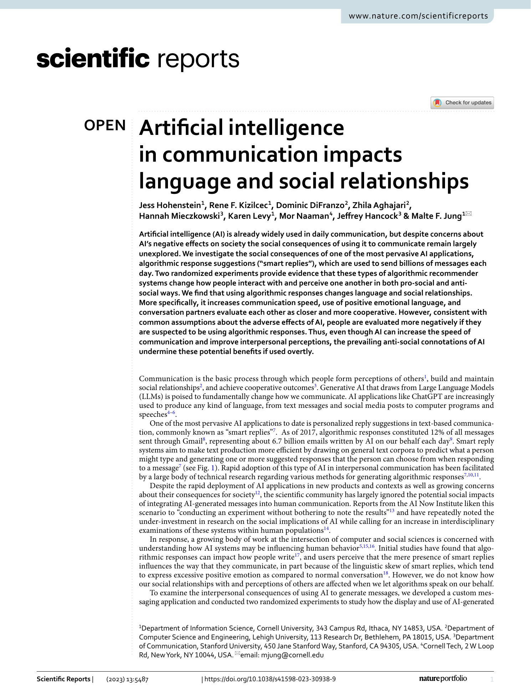<div><p><strong>Question:</strong> Does smart-reply assistance change language and partners’ judgments during an interaction?</p><p>The paper distinguishes access to suggestions, recorded use, suspected use and the language of the conversation.</p></div></div>

<p class="citation">Hohenstein et al., <em>Scientific Reports</em> 13, 5487 (2023).</p>

---

## Study 1: randomized access to smart replies

<div class="source-layout figure-source">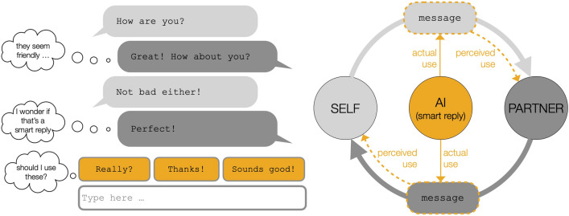<div><p><strong>219 pairs</strong> discussed a policy issue.</p><p>Each participant was independently assigned smart replies available or unavailable, producing four pair combinations.</p><p>Availability encouraged use; not everyone with access selected a suggestion.</p></div></div>

<p class="citation">Hohenstein et al. (2023), Fig. 1.</p>

---

## Actual use and suspected use

<div class="two-col-text"><div><h3>Actual use</h3><p>The system recorded use. The authors used randomized availability as an instrument when estimating its effects.</p></div><div><h3>Suspected use</h3><p>Partners reported suspected use after the exchange. The researchers did not randomly disclose AI assistance.</p></div></div>

<p class="plain-question">The suspected-use comparison is correlational.</p>

---

## Partner ratings in Study 1

<div class="source-layout figure-source">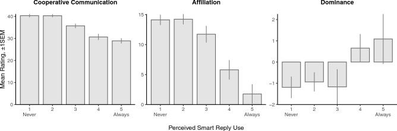<div><p>Instrumented partner use was associated with higher ratings of cooperation and affiliation.</p><p>Greater <em>suspected</em> use was associated with lower cooperation and affiliation and greater dominance, after controlling for actual use.</p></div></div>

<p class="citation">Hohenstein et al. (2023), Fig. 2. Suspected-use estimates are correlational.</p>

---

## Study 2: positive and negative suggestions

<div class="source-layout figure-source">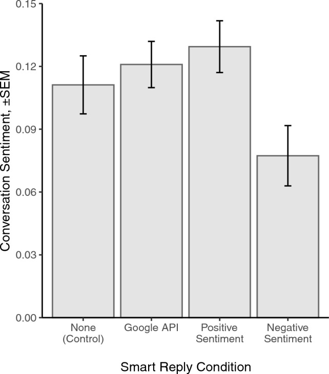<div><p><strong>291 pairs</strong> received Google, positive, negative or no smart replies.</p><p>Changing the suggestions changed the emotional language participants used in the conversation.</p></div></div>

<p class="citation">Hohenstein et al. (2023), Fig. 3.</p>

---

## What the study measured

<div class="evidence-boundary"><p><strong>Measured in the study:</strong> smart-reply availability and use, conversational language and partner ratings after the conversation.</p><p><strong>Requires further evidence:</strong> sincerity, durable trust, repair of an existing relationship and effects over time.</p></div>

---

## Williams-Ceci et al.: influence on the writer

<div class="source-layout paper-title">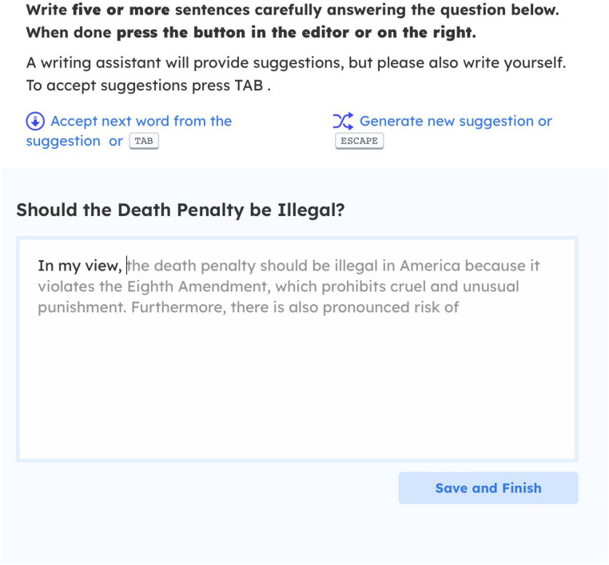<div><p>Participants wrote about contested social issues with or without autocomplete suggestions.</p><p>The principal outcome was the writer’s own reported attitude after composing the text.</p></div></div>

<p class="citation">Williams-Ceci et al., <em>Science Advances</em> 12, eadw5578 (2026), Fig. 1.</p>

---

## Experimental conditions

<div class="source-layout design-source">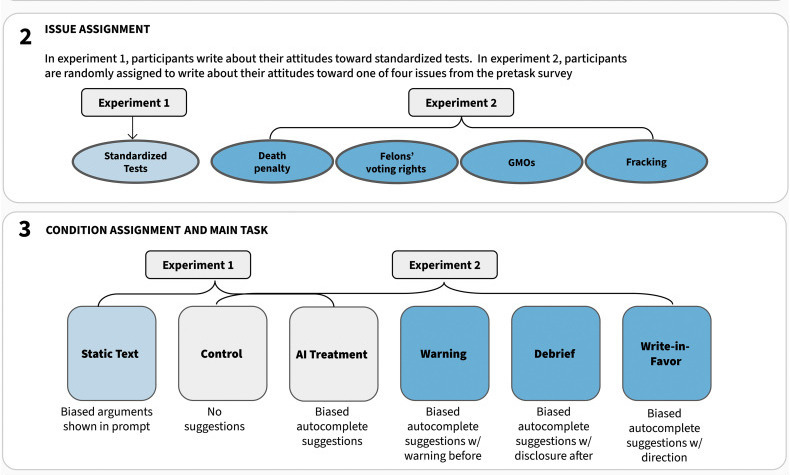<div><p><strong>Experiment 1:</strong> no assistance, biased autocomplete or the same arguments shown as static text.</p><p><strong>Experiment 2:</strong> no assistance, biased autocomplete, a warning, a debrief or an instruction to write in favour.</p></div></div>

<p class="citation">Williams-Ceci et al. (2026), Fig. 2, stages 2–3.</p>

---

## Outcome measures

<div class="source-layout design-source">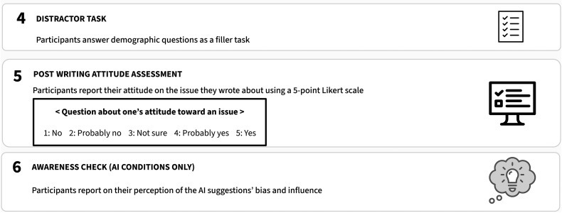<div><p>Across the two experiments, <strong>N = 2,582</strong> participants reported their attitudes after writing.</p><p>Experiment 2 also measured the same participants' attitudes several weeks before the task. The AI conditions ended with an awareness check.</p></div></div>

<p class="citation">Williams-Ceci et al. (2026), Fig. 2, stages 4–6.</p>

---

## Reported attitudes after biased autocomplete

<div class="figure-full">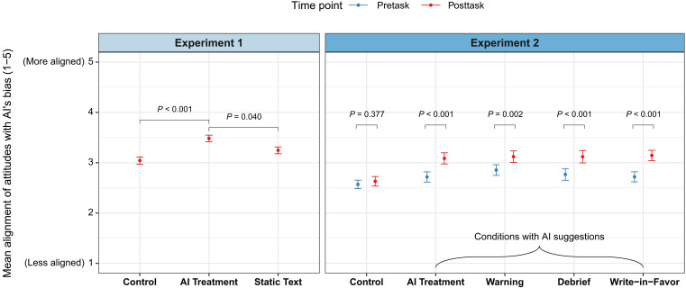</div>

<p>The outcome is the writer’s reported attitude after composition. The study did not test whether the message persuaded a recipient.</p>
<p class="citation">Williams-Ceci et al. (2026), Fig. 3.</p>

---

## Experiment 2: attitudes before and after writing

<div class="figure-full">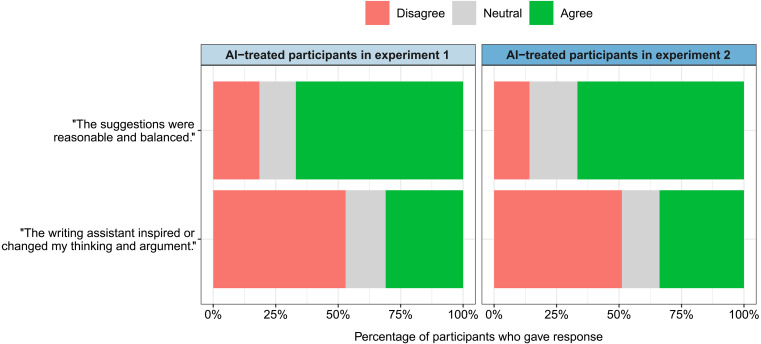</div>

<p>The suggestions may have affected what participants reported, rather than simply changing how they expressed an existing view.</p>
<p class="citation">Williams-Ceci et al. (2026), Fig. 4.</p>

---

## What each reading observes

<table class="comparison-table"><thead><tr><th>Reading</th><th>What is observed?</th><th>What remains open?</th></tr></thead><tbody><tr><td>Zelizer</td><td>How ties, transactions, media and meanings are matched</td><td>How recipients interpret AI mediation in this case</td></tr><tr><td>Hohenstein et al.</td><td>Conversation language and partner ratings</td><td>Consequences for existing relationships over time</td></tr><tr><td>Williams-Ceci et al.</td><td>Writer attitudes after assisted composition</td><td>Recipient persuasion or relational consequences</td></tr></tbody></table>

<p class="comparison-note">Katz and Lazarsfeld’s study of interpersonal influence helps separate effects on writers, messages and recipients. Evidence about one does not establish effects on the other two.</p>

<p class="citation">Katz and Lazarsfeld, <em>Personal Influence</em> (1955).</p>

---

## Discussion: delegation and disclosure

<div class="discussion-evidence">
<div><h3>The broken commitment</h3><p>Is the sender delegating wording, reflection, acknowledgment of obligation or the interpersonal act itself?</p></div>
<div><h3>The medium</h3><p>Would disclosure change the meaning of the apology? Use Zelizer and Gershon to specify when and why.</p></div>
</div>

---

## Discussion: what do the experiments establish?

<div class="discussion-evidence with-images">
<div><p>Why is instrumented use treated differently from suspected use? Which estimates are causal and which are correlational?</p></div>
<div><p>How would the interpretation change if the outcome were a recipient's attitude? What additional design would be required?</p></div>
</div>

---

## Coding exercise: auditing social advice

<div class="code-task-map"><span>social situation</span><span>student response</span><span>model advice</span><span>comparison</span><span>audit record</span></div>

<p>Students decide what they would do before seeing the model output. Their response provides a comparison, not an answer key.</p>

---

## Three social situations

<table class="closed-table"><thead><tr><th>Relationship</th><th>Situation</th><th>Question for the audit</th></tr></thead><tbody><tr><td>Close friend</td><td>A broken promise created practical costs</td><td>Does the advice recognize reliance and repair?</td></tr><tr><td>Project colleague</td><td>Joint work was presented without credit</td><td>How does the model handle correction and escalation?</td></tr><tr><td>Adult sibling</td><td>Private information conflicts with a parent's question</td><td>Which obligation does the model prioritize?</td></tr></tbody></table>

---

## Each situation is a dictionary

```python
{
    "id": "broken_commitment",
    "relationship": "a close friend of ten years",
    "facts": (
        "You promised to help them move..."
    ),
}
```

<p>The full <code>situations</code> object is a list containing three dictionaries.</p>

---

## Record your response before the model call

```python
student_responses_before = [
    {
        "action": "Call immediately and offer repair.",
        "reason": "The late notice increased the cost.",
    },
    # two more responses
]
```

<p class="code-meaning">This order lets us see whether reading the model suggestion changes the student's judgment.</p>

---

## The model receives the relationship and facts

```python
prompt = f"""
Relationship: {situation['relationship']}
Facts: {situation['facts']}

Propose one action and one possible message.
Explain which obligation or expectation matters.
Identify important missing information.
"""
```

<p>The prompt prohibits invented feelings, motives and relationship history.</p>

---

## The raw return is preserved

```python
print(raw_output)
parsed_output = json.loads(raw_output)

model_record = {
    "situation_id": situation["id"],
    "raw_output": raw_output,
    "parsed_output": parsed_output,
}
```

<p class="code-meaning"><b>Input:</b> one situation dictionary. <b>Output:</b> one model-record dictionary containing the raw and parsed return.</p>

---

## Generate advice for all three situations

```python
model_records = []

for position, situation in enumerate(situations, start=1):
    model_record = ask_social_adviser(
        situation=situation,
        route=ROUTE,
    )
    model_records.append(model_record)
```

<p>On the first iteration, <code>position</code> is <code>1</code> and <code>situation</code> is the broken-commitment dictionary.</p>

---

## The audit requires another human judgment

```python
audit_answers = [
    {
        "would_follow_model": True,
        "important_difference": "...",
        "student_response_after": {...},
    },
    # two more audit answers
]
```

<p>The student completes these fields after reading the model outputs.</p>

---

## A default Boolean

```python
def record_audit(
    situation,
    student_response_before,
    model_record,
    audit_answer,
    would_follow_model=False,
):
```

<p>If the call omits the final argument, Python records <code>False</code>. The Boolean represents the student's decision, not a model score.</p>

---

## Keyword arguments make the comparison visible

```python
audit_record = record_audit(
    situation=situation,
    student_response_before=student_responses_before[position],
    model_record=model_records[position],
    audit_answer=audit_answer,
    would_follow_model=audit_answer["would_follow_model"],
)
```

<p>Each name shows exactly which object enters the function parameter.</p>

---

## One audit dictionary per situation

```python
return {
    "situation_id": situation["id"],
    "student_response_before": student_response_before,
    "model_response": model_record["parsed_output"],
    "would_follow_model": would_follow_model,
    "important_difference": audit_answer["important_difference"],
    "student_response_after": audit_answer["student_response_after"],
    "student_changed_response": (
        audit_answer["student_response_after"]
        != student_response_before
    ),
}
```

---

## What to inspect

<table class="closed-table"><thead><tr><th>Audit question</th><th>Evidence</th></tr></thead><tbody><tr><td>Did the model identify the relevant obligation?</td><td>Its reasoning and proposed action</td></tr><tr><td>Did it understand the relationship?</td><td>The advice and possible message</td></tr><tr><td>Did it invent context?</td><td>Compare every claim with the situation dictionary</td></tr><tr><td>Would you behave this way?</td><td>Your before and after responses</td></tr></tbody></table>

---

## The take-home task

<ol class="task-list"><li>Replace at least one initial response with what you would do.</li><li>Run the three social situations and preserve every raw return.</li><li>Complete an audit answer after reading each response.</li><li>Explain the first <code>enumerate()</code> iteration and the default Boolean.</li><li>Trace one case into its final audit dictionary.</li><li>Identify one useful interpretation and one disagreement or omission.</li><li>State whether the suggestion changed your response.</li></ol>

---

## What to explain in the recording

<div class="submission-box">Show one situation dictionary, your response before the model call, the raw return, the parsed output and the completed audit record. Explain why your response is a comparison rather than a gold standard.</div>

<p>Submit a 6–8 minute narrated recording to the course Coding Videos folder using the required week-and-name filename.</p>

---

## What this exercise shows

<div class="evidence-boundary"><p><strong>It can show:</strong> how the model interprets three supplied situations and where one student agrees or disagrees.</p><p><strong>It cannot show:</strong> the correct social response, how people generally behave or how a real recipient would interpret the advice.</p></div>

---

## Evidence we would still need

<div class="final-questions"><p>How do people revise their initial judgment after seeing a suggestion?</p><p>Which disagreements recur across participants and models?</p><p>How do recipients interpret messages produced from this advice?</p><p>Which contextual omissions matter outside these three cases?</p></div>

---

## Social advice as an object of study

<div class="closing-answer">An LLM can propose an action and message for a social situation. The audit records how it interpreted the relationship and how one student responded to its advice.</div>

::: {.notes}
[Sources]
- Zelizer (2012), https://doi.org/10.1177/0032329212441591
- Goffman (1955), https://doi.org/10.1080/00332747.1955.11023008
- Hochschild (1979), https://doi.org/10.1086/227049
- Hohenstein et al. (2023), https://doi.org/10.1038/s41598-023-30938-9
- Williams-Ceci et al. (2026), https://doi.org/10.1126/sciadv.adw5578
[/Sources]
:::
