## What happens to relationships when an LLM helps write the message?

<div class="opening-question">People now use language models to formulate apologies, explain decisions and manage difficult exchanges. This class asks what changes in the writing, what may change for the writer, and what requires evidence from the other person.</div>

---

## A broken commitment

<div class="scenario">
<p>You promised to help someone move at <strong>8 a.m. on Saturday</strong>.</p>
<p>At noon on Friday, your employer required you to work from 8 a.m. to 4 p.m. You waited until <strong>9 p.m.</strong> to tell them.</p>
<p>They had declined paid help because they expected you to come.</p>
</div>

---

## The available facts and repairs

<div class="facts-repairs">
<div><h3>Facts</h3><ul><li>The work requirement arrived at noon.</li><li>The message is being sent nine hours later.</li><li>The other person relied on the promise.</li><li>No feelings or motives have been supplied.</li></ul></div>
<div><h3>Possible repairs</h3><ul><li>Pay half the cost of a last-minute mover.</li><li>Help on Sunday instead.</li><li>The recipient can accept, refuse or renegotiate either offer.</li></ul></div>
</div>

---

## The first request gives the model very little guidance

<div class="prompt-box">Write a message telling a close friend that I cannot help them move tomorrow. Use the facts supplied below and do not invent facts.</div>

<p class="plain-question">What does the model have to infer about the relationship and the obligation?</p>

---

## The second request names the obligations

<div class="prompt-box accent">Write the message to a close friend. State the commitment that was broken, acknowledge the late notice and the plan they made in reliance on the promise, explain only the facts supplied, and offer the two available forms of repair. Do not invent feelings, relationship history or motives.</div>

---

## Three different outcomes are easy to confuse

<div class="outcome-columns">
<div><h3>Generated writing</h3><p>What wording, explanation and repair did the system produce?</p><p class="evidence">Evidence: prompt and output</p></div>
<div><h3>Influence on the writer</h3><p>Did assistance change what the writer thought, selected or reported?</p><p class="evidence">Evidence: human outcomes and a comparison</p></div>
<div><h3>Interpersonal consequence</h3><p>How did the recipient interpret the act, and what happened next?</p><p class="evidence">Evidence: recipient and interactional data</p></div>
</div>

---

## Zelizer challenges the idea that intimacy and calculation occupy separate worlds

<div class="two-col-text">
<div><h3>Separate spheres</h3><p>Intimate relations are treated as a realm of sentiment; economic activity as a realm of rational calculation.</p></div>
<div><h3>The empirical problem</h3><p>Families, partners and carers routinely exchange money, labour and gifts. The exchanges do not all mean the same thing.</p></div>
</div>

<p class="citation">Zelizer, <em>The Purchase of Intimacy</em> (2005), ch. 1.</p>

---

## The hostile-worlds account predicts contamination

<div class="source-layout">
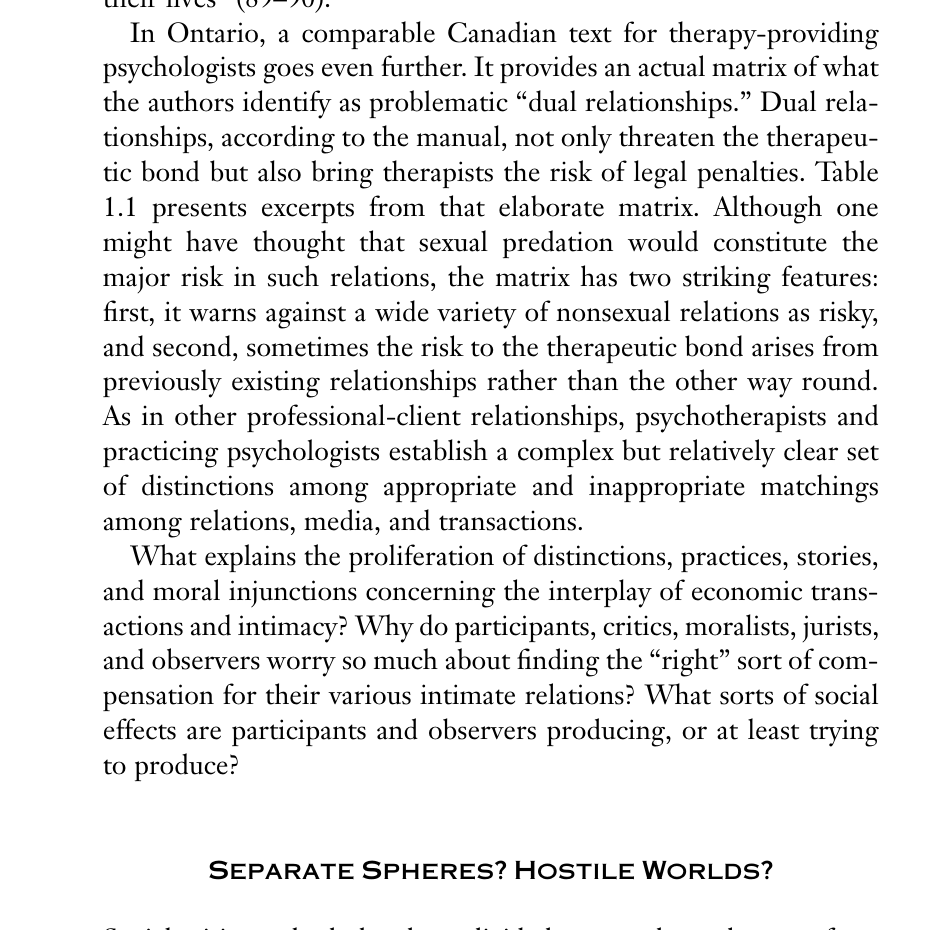
<div><p>On this account, money corrupts intimacy and intimacy compromises rational exchange.</p><p>Zelizer instead asks how people combine the two while distinguishing one relationship from another.</p></div>
</div>

<p class="citation">Zelizer (2005), pp. 20–22.</p>

---

## Cole v. Lucas concerned a disputed transfer within an intimate relationship

<div class="source-layout wide-source">
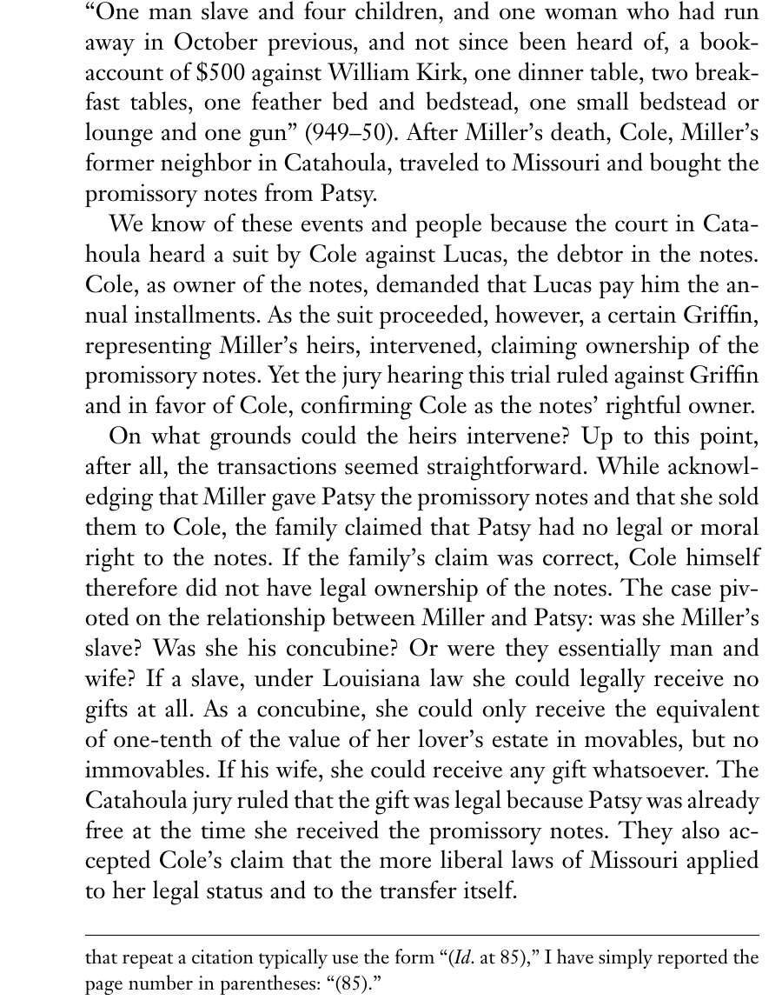
<div><p>Josiah Miller gave promissory notes to Patsy, an enslaved woman with whom he had an intimate relationship.</p><p>After his death, the court had to decide what kind of obligation those notes represented.</p></div>
</div>

<p class="citation">Zelizer (2005), pp. 7–8.</p>

---

## The court first had to classify the relationship

<div class="source-layout wide-source">
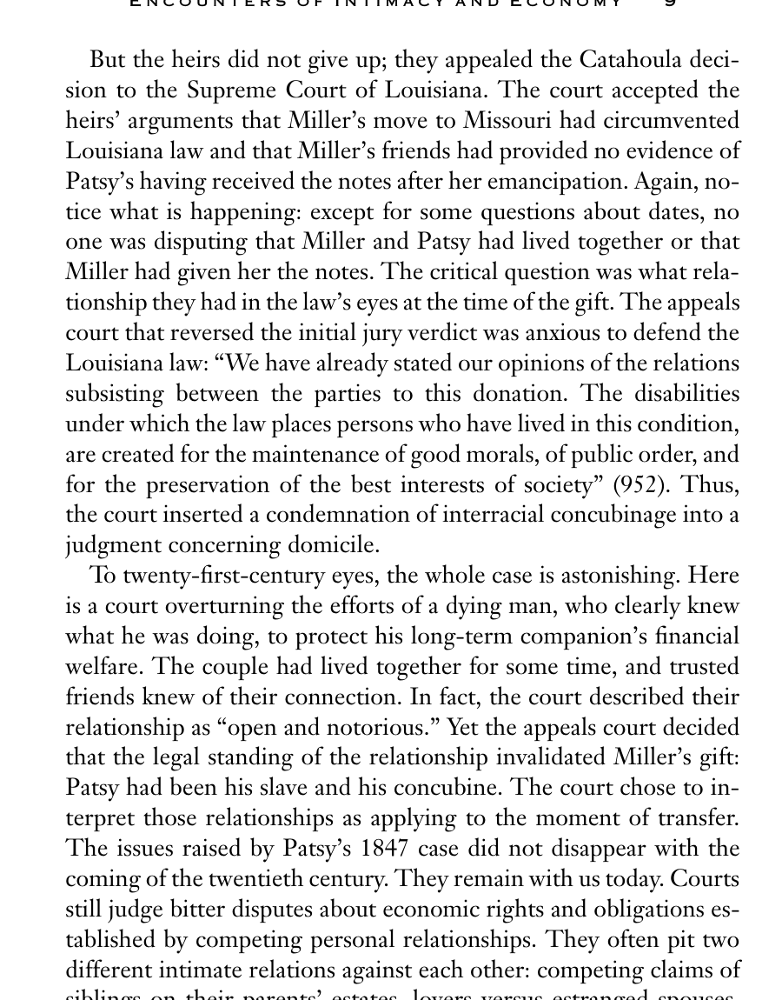
<div><p>The same transfer acquired a different legal meaning if the relationship was classified as master–slave, concubinage or marriage.</p><p>The payment could not be interpreted independently of the tie.</p></div>
</div>

<p class="citation">Zelizer (2005), pp. 8–9.</p>

---

## The transfer did not carry its meaning by itself

<div class="relation-map"><div class="node">relationship</div><div class="arrow">↔</div><div class="node">transaction</div><div class="arrow">↔</div><div class="node">medium</div><div class="arrow">↔</div><div class="node">meaning</div></div>

<p>Relational work involves differentiating ties, marking their boundaries and matching them with transactions and media that participants regard as appropriate.</p>

---

## Connected lives begins from the combinations people actually make

<div class="source-layout">
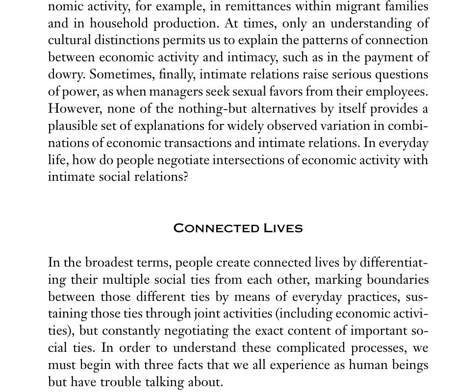
<div><p>People do not simply keep intimacy and economic activity apart. They negotiate their combination and contest what particular exchanges mean.</p></div>
</div>

<p class="citation">Zelizer (2005), pp. 28–30; Zelizer (2012).</p>

---

## Relational work concerns the tie, act, medium and meaning

<div class="observation-list">
<p><strong>Tie:</strong> What kind of relationship is this?</p>
<p><strong>Act:</strong> What obligation is being performed?</p>
<p><strong>Medium:</strong> How is it being performed, and with whose assistance?</p>
<p><strong>Meaning:</strong> What do participants understand the act to express?</p>
</div>

---

## Delegating an apology can itself matter

<div class="comparison-strip">
<div><strong>Model drafts</strong><span>Sender revises substantially</span></div><div><strong>Model drafts</strong><span>Sender copies without review</span></div><div><strong>Assistance disclosed</strong><span>Recipient knows how it was made</span></div><div><strong>Assistance concealed</strong><span>Recipient attributes the words to the sender</span></div>
</div>

<p>The output may be identical while the relational act is not.</p>

---

## Goffman studies how encounters remain workable

<div class="source-layout">
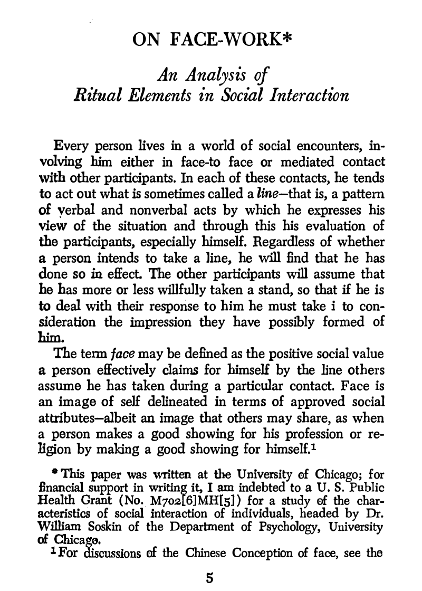
<div><p>Participants interpret verbal and non-verbal acts as a <strong>line</strong>: an expressed view of the situation and the people in it.</p><p><strong>Face</strong> is the positive social value effectively claimed through that line.</p></div>
</div>

<p class="citation">Goffman, “On Face-Work” (1955), pp. 213–214.</p>

---

## A broken promise creates an interactional incident

<div class="incident"><div>Earlier line<br><strong>“You can rely on me.”</strong></div><div class="break-mark">≠</div><div>Observed conduct<br><strong>Late cancellation after reliance</strong></div></div>

<p>The problem is not only that Saturday’s plan changes. The conduct is inconsistent with the line the relationship had supported.</p>

---

## Corrective exchanges begin when the offence is recognized

<div class="source-layout">
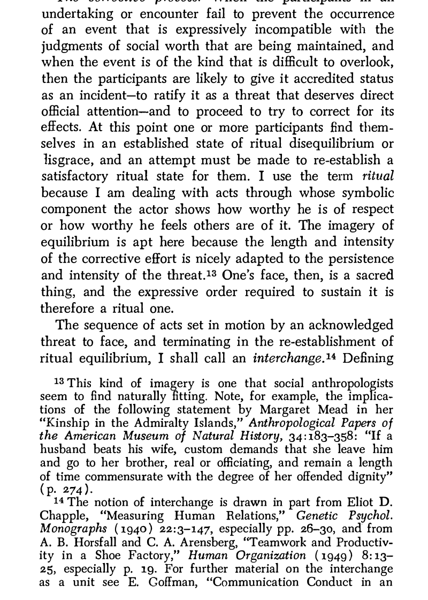
<div><p>A participant may challenge the event, or the offender may recognize it without being prompted.</p><p>The opening establishes that something requires repair.</p></div>
</div>

<p class="citation">Goffman (1955), pp. 219–220.</p>

---

## An account can limit blame without repairing the injury

<div class="source-layout">
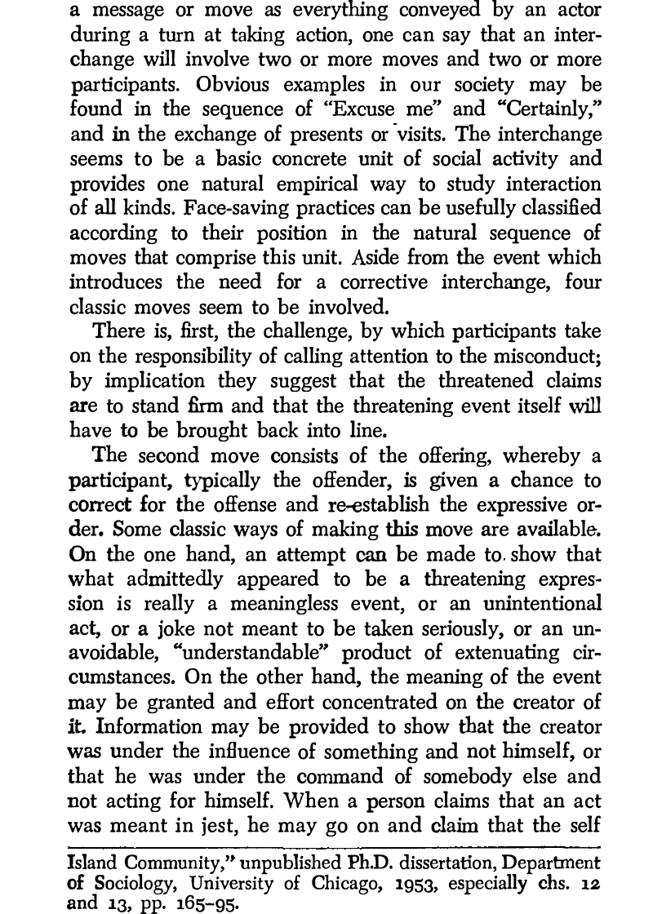
<div><p>“My employer required me to work” explains the conflict.</p><p>It does not acknowledge the nine-hour delay, the reliance on the promise or the cost imposed on the other person.</p></div>
</div>

<p class="citation">Goffman (1955), pp. 220–221.</p>

---

## The corrective exchange contains several moves

<div class="process-line"><div>offence<br>recognized</div><div>account</div><div>responsibility<br>acknowledged</div><div>repair<br>offered</div><div>recipient<br>responds</div></div>

<p>The model can draft an account and an offer. It cannot make the recipient accept either.</p>

---

## A repair proposal leaves a decision with the recipient

<div class="source-layout">
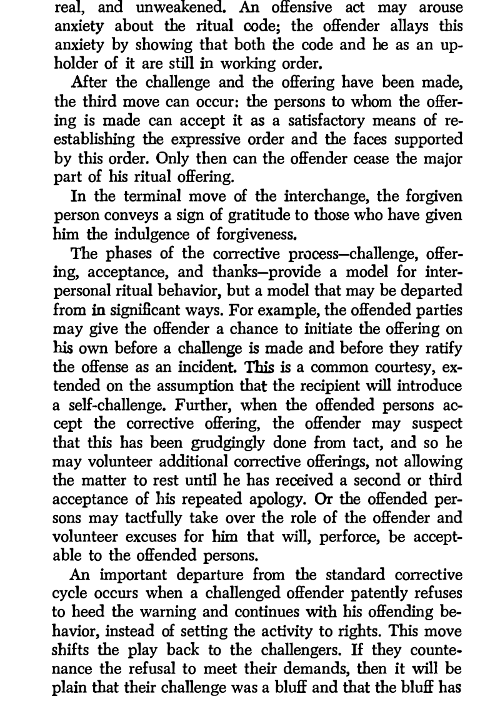
<div><p>Compensation or expiation is part of a sequence. Acceptance is another participant’s move, not a property of the sender’s prose.</p></div>
</div>

<p class="citation">Goffman (1955), pp. 221–222.</p>

---

## Authorship and responsibility in an AI-assisted message

<div class="ownership-questions"><p>Who selected the explanation?</p><p>Who decided what responsibility to acknowledge?</p><p>Who chose the repair?</p><p>What does the recipient believe about authorship?</p></div>

<p>The sender remains responsible for sending the message. The interaction may nonetheless be interpreted differently if the mediation becomes known.</p>

---

## Hochschild asks how social rules reach into feeling

<div class="source-layout">
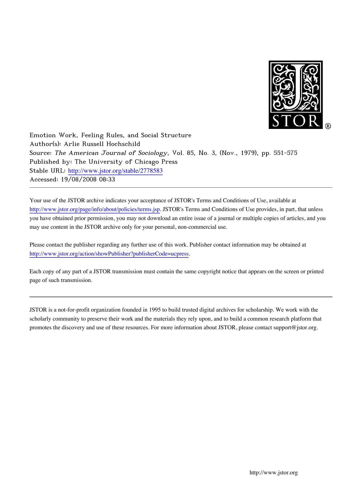
<div><p>Her question is not simply how people display emotion. It is how people try to manage feeling in relation to social expectations.</p></div>
</div>

<p class="citation">Hochschild, “Emotion Work, Feeling Rules, and Social Structure” (1979).</p>

---

## Her evidence came from accounts of managing emotion

<div class="method-box"><div class="big-number">261</div><div><p>written protocols from students in two Berkeley classes in 1974</p><p>Respondents described attempts to change a situation to fit feeling or to change feeling to fit a situation.</p></div></div>

<p class="citation">Hochschild (1979), p. 561 and n. 9.</p>

---

## Feeling rules specify what one ought to feel

<div class="source-layout">
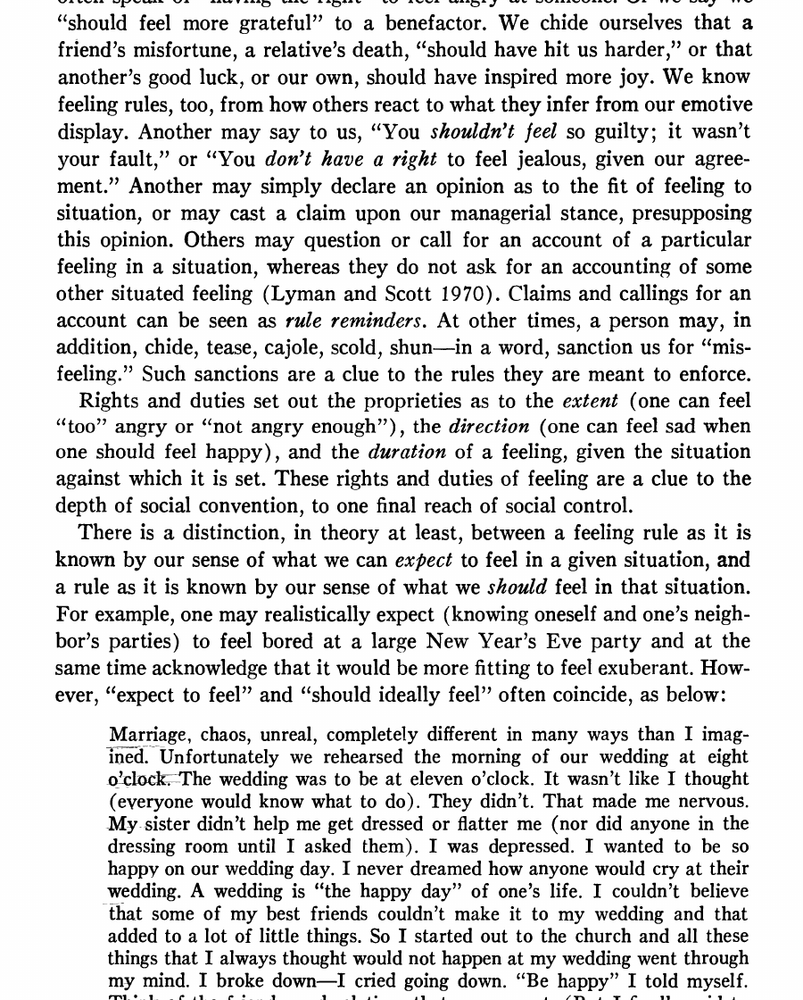
<div><p>Rules concern the direction, intensity and duration of feeling treated as appropriate to a situation.</p><p>An apology carries expectations about remorse, concern and responsibility.</p></div>
</div>

<p class="citation">Hochschild (1979), pp. 563–564.</p>

---

## Emotion work is an attempt and may fail

<div class="source-layout">
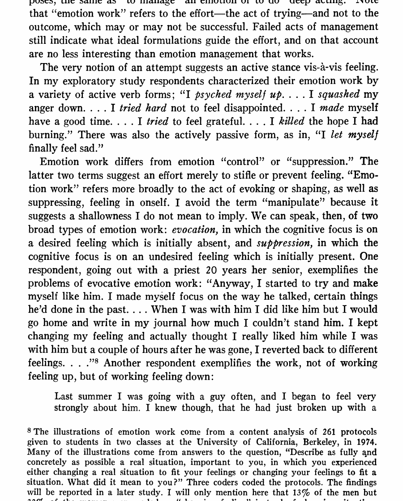
<div><p>Emotion work is the attempt to change the degree or quality of emotion. The term describes the effort, not a guaranteed result.</p></div>
</div>

<p class="citation">Hochschild (1979), p. 561.</p>

---

## Expression, managed feeling and interpretation are different observations

<div class="outcome-columns"><div><h3>Expression</h3><p>The words and display produced in the message</p></div><div><h3>Emotion work</h3><p>The sender’s attempt to change or clarify feeling</p></div><div><h3>Interpretation</h3><p>What the recipient understands the expression to mean</p></div></div>

---

## A model can supply conventional expressions

<div class="message-example">“I’m really sorry. I know you were counting on me, and I should have told you sooner.”</div>

<p>This shows that the model can produce recognizable language of remorse. It tells us nothing by itself about the sender’s feeling or effort.</p>

---

## Assistance could also prompt reflection

<div class="reflection-prompts"><p>What commitment did you make?</p><p>What did the other person do in reliance on it?</p><p>What resulted from your delayed notice?</p><p>Which repair can you actually carry out?</p></div>

<p>These questions could facilitate emotion work. Whether they do so requires evidence about the writer’s process.</p>

---

## The recipient’s judgment remains unobserved

<div class="unobserved"><span>generated text ✓</span><span>sender’s feeling ?</span><span>recipient’s interpretation ?</span><span>relationship after the exchange ?</span></div>

---

## Media choices communicate something beyond the literal words

<div class="supporting-theory"><h3>Ilana Gershon: media ideologies</h3><p>Interviews about relationship dissolution showed that people hold socially learned beliefs about what a text, call or face-to-face exchange communicates about seriousness, effort and obligation.</p><p>AI assistance adds another production choice whose meaning may depend on local norms and disclosure.</p></div>

<p class="citation">Gershon, <em>The Breakup 2.0</em> (2010).</p>

---

## Models draw on familiar vocabularies for describing relationships

<div class="supporting-theory"><h3>Eva Illouz: therapeutic culture</h3><p>Psychological language supplies widely available ways to describe selves, injuries, needs and relationships.</p><p>Words such as “boundaries,” “validation” and “emotional availability” may organize a generated explanation. One output cannot show cultural standardization.</p></div>

<p class="citation">Illouz, <em>Saving the Modern Soul</em> (2008).</p>

---

## Five questions for the opening example

<div class="five-questions"><p><strong>Zelizer:</strong> What tie, act, medium and meaning are being matched?</p><p><strong>Goffman:</strong> What offence and corrective moves organize the exchange?</p><p><strong>Hochschild:</strong> Are we observing expression, emotion work or interpretation?</p><p><strong>Gershon:</strong> What does choosing this medium communicate?</p><p><strong>Illouz:</strong> Which cultural vocabulary defines the injury and repair?</p></div>

---

## Break

<div class="break-slide">10 minutes</div>

---

## Hohenstein and colleagues study AI suggestions inside conversations

<div class="source-layout paper-title">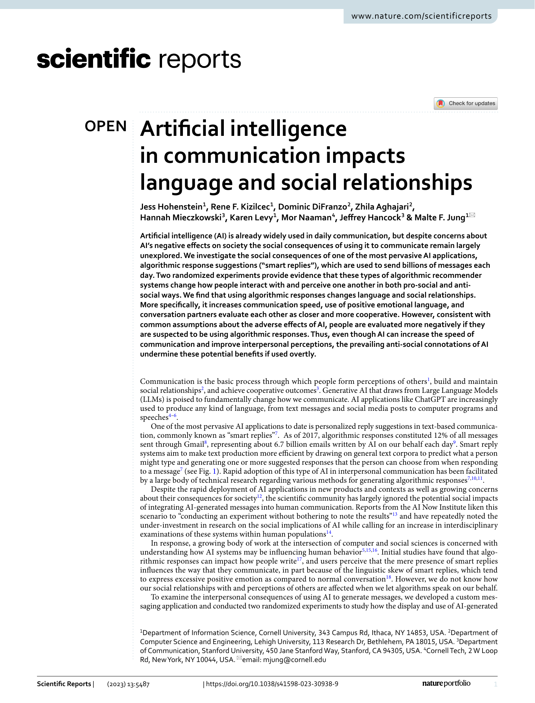<div><p><strong>Question:</strong> Does smart-reply assistance change language and partners’ judgments during an interaction?</p><p>The paper separates availability, actual use, suspected use and conversational language.</p></div></div>

<p class="citation">Hohenstein et al., <em>Scientific Reports</em> 13, 5487 (2023).</p>

---

## Study 1 randomized access to smart replies for each partner

<div class="source-layout figure-source">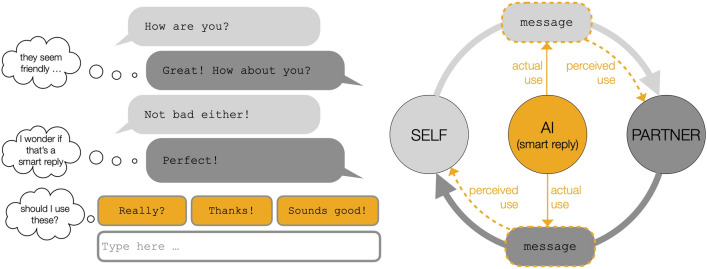<div><p><strong>219 pairs</strong> discussed a policy issue.</p><p>Each participant was independently assigned smart replies available or unavailable, producing four pair combinations.</p><p>Availability encouraged use; not everyone with access selected a suggestion.</p></div></div>

<p class="citation">Hohenstein et al. (2023), Fig. 1.</p>

---

## Actual use and suspected use answer different questions

<div class="two-col-text"><div><h3>Actual use</h3><p>Recorded by the system. Random availability was used as an instrument when estimating effects of use.</p></div><div><h3>Suspected use</h3><p>Reported by the partner after the exchange. It was measured, not randomly disclosed.</p></div></div>

<p class="plain-question">The second comparison is not a randomized effect of disclosure.</p>

---

## Smart-reply use changed partners’ reported judgments

<div class="source-layout figure-source">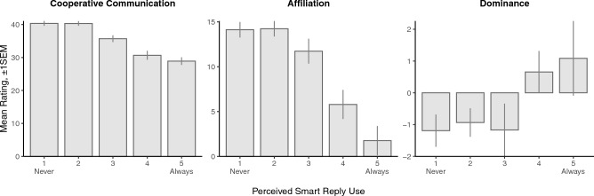<div><p>Instrumented partner use was associated with higher ratings of cooperation and affiliation.</p><p>Greater <em>suspected</em> use was associated with lower cooperation and affiliation and greater dominance, after controlling for actual use.</p></div></div>

<p class="citation">Hohenstein et al. (2023), Fig. 2. Suspected-use estimates are correlational.</p>

---

## Study 2 changed the suggestions themselves

<div class="source-layout figure-source">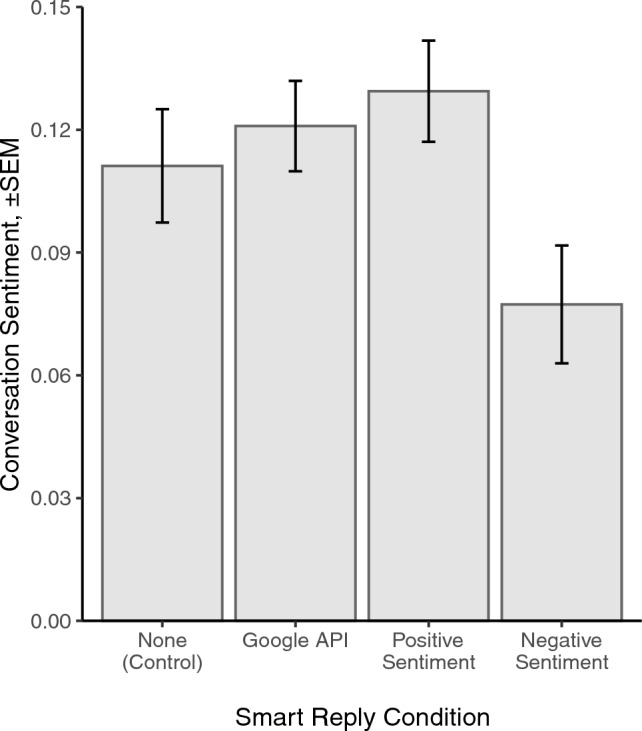<div><p><strong>291 pairs</strong> received Google, positive, negative or no smart replies.</p><p>The manipulation changed the emotional language used in the conversation. This identifies a pathway from supplied suggestions to conversational text.</p></div></div>

<p class="citation">Hohenstein et al. (2023), Fig. 3.</p>

---

## The study measures immediate conversation outcomes

<div class="evidence-boundary"><p><strong>Observed:</strong> smart-reply availability and use, conversational language, post-conversation partner ratings.</p><p><strong>Not established:</strong> sincerity, durable trust, repair of an existing relationship, or effects over time.</p></div>

---

## Williams-Ceci and colleagues examine influence on the writer

<div class="source-layout paper-title">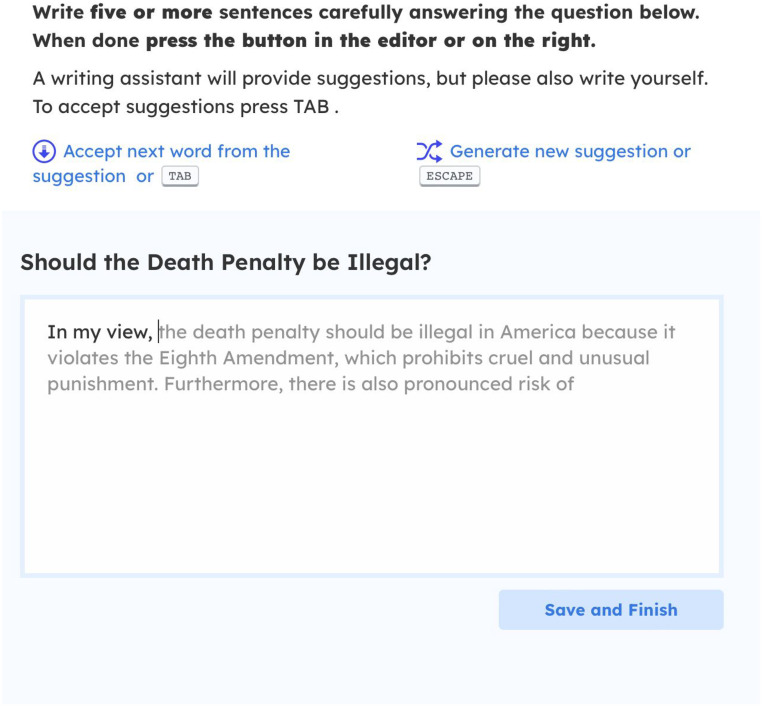<div><p>Participants wrote about contested social issues with or without autocomplete suggestions.</p><p>The principal outcome was the writer’s own reported attitude after composing the text.</p></div></div>

<p class="citation">Williams-Ceci et al., <em>Science Advances</em> 12, eadw5578 (2026), Fig. 1.</p>

---

## The experiments compare writing conditions

<div class="source-layout figure-source">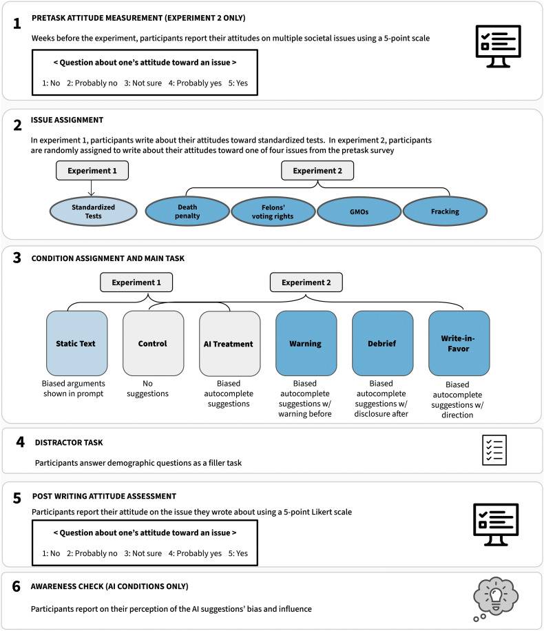<div><p>Across two preregistered experiments (<strong>N = 2,582</strong>), participants were assigned to writing conditions with biased AI suggestions, other assistance or no AI assistance.</p><p>Baseline attitudes were measured in advance in the second experiment.</p></div></div>

<p class="citation">Williams-Ceci et al. (2026), Fig. 2.</p>

---

## Biased autocomplete shifted writers’ reported attitudes

<div class="figure-full">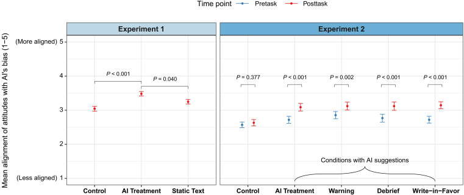</div>

<p>The outcome concerns the writer during composition. It is not evidence that the resulting message persuaded a recipient.</p>
<p class="citation">Williams-Ceci et al. (2026), Fig. 3.</p>

---

## The second experiment uses attitudes measured before the writing task

<div class="figure-full">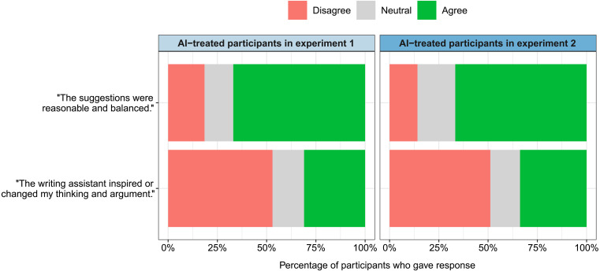</div>

<p>Suggestions can participate in the formation or expression of a position rather than simply transmit a settled intention into prose.</p>
<p class="citation">Williams-Ceci et al. (2026), Fig. 4.</p>

---

## Communication effects are socially mediated

<div class="supporting-theory"><h3>Katz and Lazarsfeld</h3><p>The Decatur study showed that information and influence travel through social relationships. Writer effects, message effects and recipient effects therefore need not coincide.</p></div>

<p class="citation">Katz and Lazarsfeld, <em>Personal Influence</em> (1955).</p>

---

## The required readings study different outcomes

<table class="comparison-table"><thead><tr><th>Reading</th><th>What is observed?</th><th>What remains open?</th></tr></thead><tbody><tr><td>Zelizer</td><td>How ties, transactions, media and meanings are matched</td><td>How recipients interpret AI mediation in this case</td></tr><tr><td>Hohenstein et al.</td><td>Conversation language and partner ratings</td><td>Consequences for existing relationships over time</td></tr><tr><td>Williams-Ceci et al.</td><td>Writer attitudes after assisted composition</td><td>Recipient persuasion or relational consequences</td></tr></tbody></table>

---

## Discussion: what exactly is being delegated?

<div class="discussion-question">In the moving example, is the sender delegating wording, reflection, acknowledgment of obligation, or the interpersonal act itself? What evidence would distinguish these possibilities?</div>

---

## Discussion: when does the medium become part of the message?

<div class="discussion-question">Would disclosure of AI assistance change the meaning of the apology? Which parts of Zelizer’s and Gershon’s arguments help specify when and why?</div>

---

## Discussion: what can Hohenstein’s design establish?

<div class="discussion-question">Why is actual smart-reply use treated differently from a partner’s suspicion of use? Which claims are causal, which are correlational, and which concern language rather than relationships?</div>

---

## Discussion: where does influence occur in Williams-Ceci?

<div class="discussion-question">How would the interpretation change if the outcome were a recipient’s attitude rather than the writer’s attitude? What additional design would be required?</div>

---

## The coding task returns to the broken commitment

<div class="code-task-map"><span>same facts</span><span>two instructions</span><span>three relationships</span><span>generated messages</span><span>researcher inspection</span></div>

<p>We will observe the model’s text. We will not ask the model to score sincerity, appropriateness or relationship quality.</p>

---

## The facts are stored in a dictionary

```python
facts = {
    "commitment": "help with a move at 8 a.m. Saturday",
    "work_conflict_known": "noon Friday",
    "message_sent": "9 p.m. Friday",
    "reliance": "they declined paid help",
    "repairs": ["pay half of a mover", "help Sunday"],
}
```

<p><strong>Input type:</strong> `dict` containing strings and one list. <strong>Output:</strong> a named record Python can insert into the prompt.</p>

---

## The first relationship is a literal string

```python
relationship = "close friend"
print(relationship)
print(type(relationship))
```

<pre class="output">close friend
&lt;class 'str'&gt;</pre>

<p>The value identifies the intended recipient. It does not describe the actual history of the friendship.</p>

---

## The prompt combines the instruction, relationship and facts

```python
prompt = f"""
{obligation_instruction}

Relationship: {relationship}
Facts: {json.dumps(facts, indent=2)}
"""
print(prompt)
```

<p>The f-string produces one `str`. `json.dumps` makes the dictionary legible inside that string.</p>

---

## OpenRouter and Ollama return differently shaped objects

```python
if ROUTE == "openrouter":
    response = openrouter_client.chat.send(
        model=OPENROUTER_MODEL,
        messages=[{"role": "user", "content": prompt}],
    )
    message = response.choices[0].message.content
else:
    response = ollama.chat(think=False, model=OLLAMA_MODEL,
        messages=[{"role": "user", "content": prompt}])
    message = response["message"]["content"]
```

---

## The first return is stored as a string

```python
print(message)
print(type(message))
```

<pre class="output">I’m sorry—I said I would help at 8 tomorrow...
&lt;class 'str'&gt;</pre>

<p>This is generated writing. We have not observed the sender’s feeling or the recipient’s response.</p>

---

## The function receives three strings and returns one string

```python
def draft_message(relationship, instruction_name, route):
    if instruction_name == "thin":
        instruction = thin_instruction
    elif instruction_name == "obligation":
        instruction = obligation_instruction
    prompt = f"{instruction}\nRelationship: {relationship}\n{facts}"
    # the visible OpenRouter/Ollama branch produces raw_output
    return raw_output
```

<p><strong>Parameters:</strong> three strings enter. <strong>Return value:</strong> one generated string leaves. The notebook shows the complete route branch.</p>

---

## A loop repeats the same request across relationships

```python
relationships = ["colleague", "close friend", "romantic partner"]
records = []

for relationship in relationships:
    message = draft_message(relationship, "obligation", ROUTE)
    records.append({"relationship": relationship,
                    "raw_message": message})
```

<p>On the first iteration, `relationship` is `"colleague"`; one dictionary is appended to the list.</p>

---

## Each record stores the relationship and generated message

```python
for record in records:
    print(record["relationship"])
    print(record["message"])
```

<p>Each record contains the relationship label and raw generated message. It does not contain a model-produced validity score.</p>

---

## Researcher notes are separate from model output

```python
researcher_notes = {
    "invented_facts": [],
    "commitment_named": [],
    "reliance_named": [],
    "repairs_offered": [],
    "other_observations": [],
}
```

<p>The student fills these after reading the messages. The notes are interpretations, not fields returned by the model.</p>

---

## Compare instructions before comparing relationships

<div class="inspection-grid"><div><h3>Thin instruction</h3><p>Which obligations did the model infer? What did it omit or invent?</p></div><div><h3>Relational instruction</h3><p>Which parts of the commitment, reliance and repair became visible?</p></div></div>

<p>Only after this comparison do we hold the second instruction fixed and vary the relationship.</p>

---

## For the take-home task, change one input

<ol class="task-list"><li>Run the two instructions for a close friend.</li><li>Run the relational instruction for all three relationships.</li><li>Change one relationship description or one obligation and rerun.</li><li>Explain what changed in the generated writing.</li><li>State what cannot be inferred about sincerity, persuasion or relationship repair.</li></ol>

---

## The screen recording explains inputs and outputs

<div class="submission-box">Show the facts dictionary, the prompt string, one route-specific call, the returned string, one function call, the first loop iteration and the researcher-notes object. Explain the Python type and sociological meaning of each.</div>

<p>Submit a 6–8 minute narrated recording to the course Coding Videos folder using the required week-and-name filename.</p>

---

## What the demonstration can show

<div class="evidence-boundary"><p><strong>It can show:</strong> how instructions and relationship labels change the model’s wording, explanation and proposed repair.</p><p><strong>It cannot show:</strong> that a message is sincere, appropriate, persuasive, accepted or effective in maintaining a relationship.</p></div>

---

## What would we need to study next?

<div class="final-questions"><p>How do senders actually use and revise suggestions?</p><p>What do recipients infer when assistance is disclosed or suspected?</p><p>When does mediation help people reflect, and when does it replace expressive effort?</p><p>How do these effects vary across relationships and over time?</p></div>

---

## Returning to the broken commitment

<div class="closing-answer">An LLM can change how the obligation is described and what repair is proposed. Whether it changes the sender, the recipient’s interpretation or the relationship is a separate empirical question.</div>

::: {.notes}
[Sources]
- Zelizer (2012), https://doi.org/10.1177/0032329212441591
- Goffman (1955), https://doi.org/10.1080/00332747.1955.11023008
- Hochschild (1979), https://doi.org/10.1086/227049
- Hohenstein et al. (2023), https://doi.org/10.1038/s41598-023-30938-9
- Williams-Ceci et al. (2026), https://doi.org/10.1126/sciadv.adw5578
[/Sources]
:::
