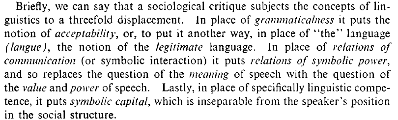
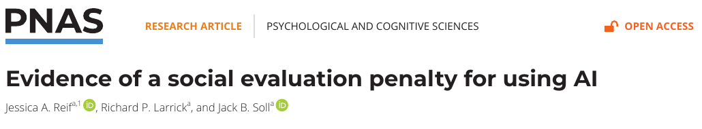
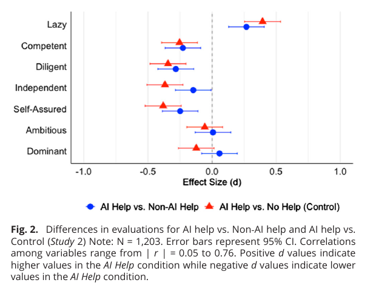
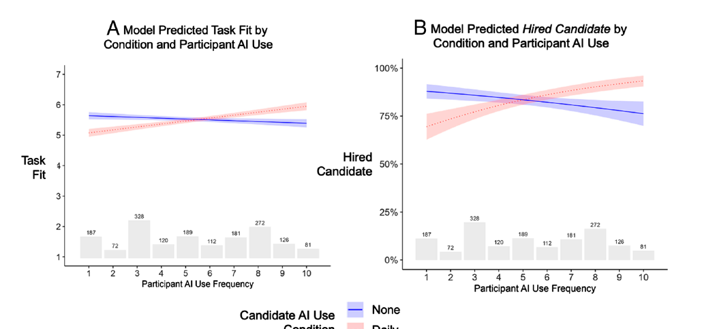
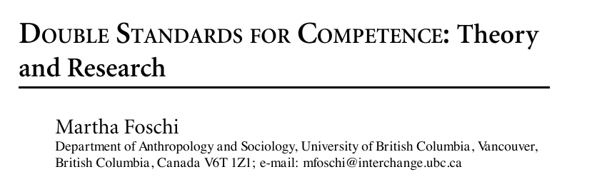
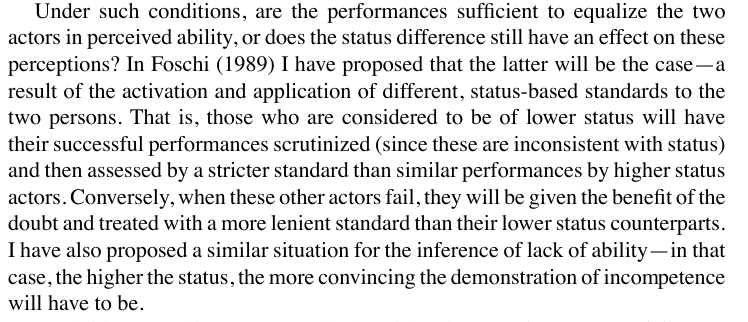
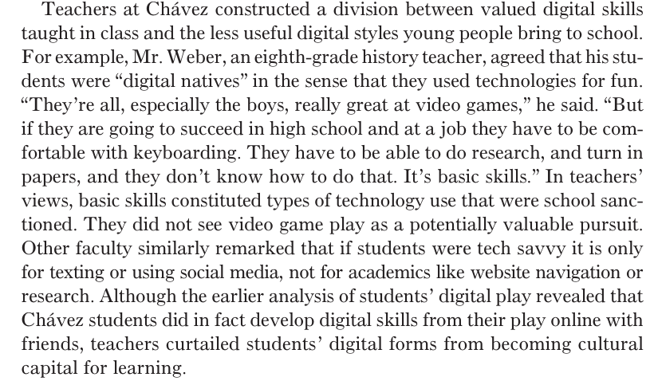
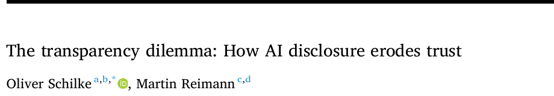
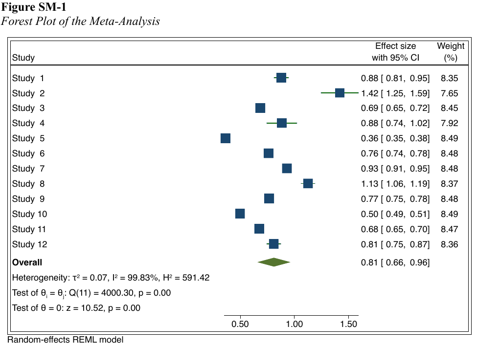

## Does class background change how AI use is judged?

<p class="large-question">Two people do the same job and submit the same report. Would readers judge their AI use differently if they knew about each person’s family background?</p>

---

## The same report, two class backgrounds

<div class="report-page"><div class="report-heading">Monthly competitor report · fictional teaching example</div><p>RivalCo launched a monthly subscription in April at $18. Our comparable plan costs $20. RivalCo advertises a free trial. We do not yet have data on customer switching after the launch.</p></div>

<div class="role-pair"><div><strong>Working-class upbringing</strong><span>Alex was the first in the family to attend university. Both parents held hourly-paid jobs.</span></div><div><strong>Professional-class upbringing</strong><span>Both of Alex’s parents had university degrees and worked in professional jobs.</span></div></div>

<p class="small-note">Alex has the same degree, job and three years of experience in both descriptions. The report is identical. We also vary whether Alex discloses using ChatGPT to edit it. These proposed background cues need pretesting.</p>

---

## Bourdieu: the value of writing depends on its setting

<div class="market-visual"><div><strong>Writer</strong><span>What does the reader infer from Alex’s family background?</span></div><div><strong>Report</strong><span>The text and the job are held fixed.</span></div><div><strong>Evaluator</strong><span>What counts as competent work in this workplace?</span></div></div>

<p>Bourdieu’s “linguistic market” directs attention to who is speaking and who has the power to judge the writing. It does not predict a particular verdict on ChatGPT.</p>

<p class="citation">Bourdieu (1977), “The Economics of Linguistic Exchanges,” <em>Social Science Information</em> 16(6): 645–668. <a href="https://doi.org/10.1177/053901847701600601">doi:10.1177/053901847701600601</a>.</p>

---

## Acceptable writing is more than correct grammar



<p>A reader may find the report clear while making a different judgment about its author once the author’s background or use of AI is disclosed.</p>

<p class="citation">Bourdieu (1977), p. 646. The application to AI-assisted reports is ours.</p>

---

## What the reader knows about Alex

<div class="profile-sheet"><div><small>HELD FIXED</small><strong>Market research analyst</strong><span>Same degree · three years in the role · identical report</span></div><div><small>VARIED</small><strong>Family background</strong><span>First-generation graduate from an hourly-paid household, or graduate from a professional household</span></div><div><small>VARIED</small><strong>AI disclosure</strong><span>Alex either states that ChatGPT edited the wording or makes no statement about AI.</span></div></div>

<p>Lamont and Lareau ask which cultural signals institutions recognize and reward. Here we ask whether a family-background cue changes what an evaluator infers from the same use of a writing tool.</p>

<p class="citation">Lamont and Lareau (1988), “Cultural Capital: Allusions, Gaps and Glissandos in Recent Theoretical Developments,” <em>Sociological Theory</em> 6(2): 153–168. <a href="https://doi.org/10.2307/202113">doi:10.2307/202113</a>. The AI question is an application, not their finding.</p>

---

## Judgments about the report’s author

<div class="judgment-list"><div><strong>Competence</strong><span>Can this employee do the work?</span></div><div><strong>Laziness</strong><span>Did they avoid effort expected of them?</span></div><div><strong>Trust</strong><span>Would I rely on this person?</span></div><div><strong>Legitimacy</strong><span>Was this an acceptable way to complete the task?</span></div></div>

<p>The report and job stay the same. We want to know whether family-background information and AI disclosure change these judgments.</p>

---

## Reif and colleagues asked how people judge AI users



<p class="article-intro">Across four preregistered experiments, participants evaluated people who used AI to help with work. The question is how observers judge the <em>person</em> using the tool.</p>

<p class="citation">Reif, Larrick and Soll (2025), <em>Proceedings of the National Academy of Sciences</em> 122, e2426766122. <a href="https://doi.org/10.1073/pnas.2426766122">doi:10.1073/pnas.2426766122</a>.</p>

---

## Comparing AI help with other kinds of help

<div class="three-row"><div><strong>AI help</strong><span>A professional uses generative AI for part of a task.</span></div><div><strong>Human help</strong><span>A professional receives comparable assistance from another person.</span></div><div><strong>No help</strong><span>A professional completes the task without described assistance.</span></div></div>

<p>In Study 2, participants rated workers described in occupational vignettes. The help source changed; the work context was specified in the vignette.</p>

<p class="citation">Reif et al. (2025), Study 2. The experiment included 384 vignettes and 1,203 participants in its final sample.</p>

---

## Study 2: ratings of workers who received AI help

<div class="figure-explain"><div><p>Positive values mean a higher rating for AI help; negative values mean a lower one.</p><p>AI users were rated as lazier and less competent, diligent, independent and self-assured. These are observers’ judgments, not tests of the workers’ skills.</p></div></div>

<p class="citation">Reif, Larrick and Soll (2025), published article, Fig. 2, Study 2. Blue circles compare AI with non-AI help; red triangles compare AI with no described help. Error bars are 95% confidence intervals.</p>

---

## Evaluators’ own AI use also mattered

<div class="figure-explain reif-figure"><div><p>In Study 3, participants who used AI more often evaluated an AI-using candidate more favorably than participants who used AI less often.</p><p>Study 2 found no significant moderation by worker age, gender or occupation. Neither study tested the family-background comparison proposed here.</p></div></div>

<p class="citation">Reif et al. (2025), Fig. 3, Study 3 (<em>N</em> = 1,667), and Study 2 supplementary analyses. Figure 3 shows model-predicted outcomes, not a class comparison.</p>

---

## Foschi: competence is judged against expectations



<p class="article-intro">Foschi reviews experiments on how status affects judgments of competence. The same performance can be read differently when the performer carries a different status cue.</p>

<p class="citation">Foschi (2000), “Double Standards for Competence,” <em>Annual Review of Sociology</em> 26: 21–42. <a href="https://doi.org/10.1146/annurev.soc.26.1.21">doi:10.1146/annurev.soc.26.1.21</a>.</p>

---

## Foschi on judging the same performance



<p>Foschi’s question is how a performance becomes evidence of competence. A status cue can change the standard applied to it.</p>

<p class="citation">Foschi (2000), p. 25, from the published article.</p>

---

## Foschi’s example: the same score, two standards

<div class="foschi-example"><div class="foschi-observed"><small>OBSERVED PERFORMANCE</small><strong>14 / 20</strong><span>Correct answers on a task</span></div><div class="foschi-standard"><small>LENIENT STANDARD</small><strong>12 or more</strong><span>14 meets the standard: evidence of ability.</span></div><div class="foschi-standard strict"><small>STRICT STANDARD</small><strong>17 or more</strong><span>14 falls short: ability remains unproven.</span></div></div>

<p>Foschi argues that status can affect the standard observers apply to the same performance. Our question is whether family background changes the standard applied to Alex’s report and AI use.</p>

<p class="citation">Foschi (2000), p. 25. The score of 14 and standards of 12 and 17 are her example; the application to Alex is ours.</p>

---

## Two possible readings of the same AI disclosure

<div class="margin-comments"><div><small>POSSIBILITY 1</small><strong>“Alex used a useful writing tool.”</strong><span>A reader gives credit for using an available resource.</span></div><div><small>POSSIBILITY 2</small><strong>“Alex needed help with basic writing.”</strong><span>A reader treats the same disclosure as evidence of weak skill.</span></div></div>

<p>These are hypothetical reader reactions. Foschi’s account allows the standard to differ by perceived status, but it does not tell us which reaction a class-background cue will produce.</p>

<p class="citation">Foschi (2000), discussion of double standards and reverse double standards. The reader reactions above are teaching examples, not quotations from participants.</p>

---

## A student’s game became part of the lesson


<p>At affluent Heathcliff Academy, a teacher adopted a student’s iPad game for her science lesson and asked him to help classmates use it.</p>

<p class="citation">Rafalow (2018), “Disciplining Play: Digital Youth Culture as Capital at School,” <em>American Journal of Sociology</em> 123(5): 1416–1452, p. 1431. <a href="https://doi.org/10.1086/695766">doi:10.1086/695766</a>.</p>

---

## Another teacher called for basic skills instead



<p>At working-class César Chávez Middle School, a teacher acknowledged students’ gaming abilities but said school should teach keyboarding, research and written assignments.</p>

<p class="citation">Rafalow (2018), p. 1442. These are two episodes from a three-school ethnography, not matched observations of identical students.</p>

---

## How the three schools treated digital play

<div class="school-comparison"><div><strong>Heathcliff</strong><span>Teachers brought students’ games and media projects into lessons.</span></div><div><strong>Sheldon</strong><span>Teachers treated social media and games as risks to academic work.</span></div><div><strong>César Chávez</strong><span>Teachers taught digital basics but separated them from students’ own online play.</span></div></div>

<p>The schools differed in class composition, race and institutional practice at the same time. Rafalow shows how teachers assign value to digital activity. His comparison does not isolate the effect of class.</p>

<p class="citation">Rafalow (2018), fieldwork and discussion.</p>

---

## Writing tools before ChatGPT

<div class="aid-comparison"><div><small>Predictive assistance</small><strong>Gmail Smart Compose</strong><span>Suggests words or phrases while someone writes an email.</span></div><div><small>Generative assistance</small><strong>ChatGPT</strong><span>Can draft or revise an entire report from an instruction.</span></div></div>

<p>When would a reader expect the writer to mention the tool? That expectation may differ between editing a sentence and asking a model to draft a report.</p>

<p class="citation">Google (2018), <a href="https://blog.google/products-and-platforms/products/gmail/subject-write-emails-faster-smart-compose-gmail/">Smart Compose announcement</a>. Tool descriptions are illustrative; no claim about comparative stigma is made here.</p>

---

## The class comparison we have not observed

<div class="role-pair big"><div><strong>Working-class upbringing</strong><span>Does AI use suggest resourcefulness, or make a reader question Alex’s writing skill?</span></div><div><strong>Professional-class upbringing</strong><span>Does the same disclosure prompt the same judgment?</span></div></div>

<p>The two backgrounds are proposed experimental descriptions. No study in today’s readings estimates this comparison.</p>

---

## Schilke and Reimann studied AI disclosure



<p class="article-intro">Across preregistered experiments, they examine what happens to trust when another person reveals that AI helped with a task. In Study 11, participants assess a market analyst’s monthly competitor report.</p>

<p class="citation">Schilke and Reimann (2025), “The transparency dilemma: How AI disclosure erodes trust,” <em>Organizational Behavior and Human Decision Processes</em> 188: 104405. <a href="https://doi.org/10.1016/j.obhdp.2025.104405">doi:10.1016/j.obhdp.2025.104405</a>.</p>

---

## Study 11 separated prior knowledge from disclosure

<div class="study-grid"><div class="study-grid-head">What the evaluator knew beforehand</div><div class="study-grid-head">What appeared with the report</div><div>Either told Alex used AI tools to summarize competitors, or given no such information</div><div>Either told the report used GrowthBar generative AI, or shown no disclosure</div></div>

<p>Participants played the head of marketing and then rated trust in Alex, a market research analyst. The no-disclosure control did not say Alex used no AI. The study did not vary Alex’s class background.</p>

<p class="citation">Schilke and Reimann (2025), Study 11, p. 10. The published experiment used GrowthBar; our classroom report uses a different model.</p>

---

## Disclosure lowered trust in Study 11

<div class="bar-chart two" role="img" aria-label="Mean trust on a one-to-seven scale: no AI disclosure 4.62, AI disclosure 4.10"><div><span>No AI disclosure</span><i style="--bar:60.3%"></i><b>4.62</b></div><div><span>AI disclosure</span><i style="--bar:51.7%"></i><b>4.10</b></div><div class="chart-axis"><span>1</span><span>4</span><span>7</span></div></div>

<p>Mean trust was 0.52 points lower with disclosure on a 1–7 scale; the reported standardized difference was <em>d</em> = 0.50. The authors connect the effect to whether AI assistance was seen as a legitimate way to do the work.</p>

<p class="citation">Schilke and Reimann (2025), Study 11. Bars recreate reported mean trust ratings (4.62 and 4.10); not a reproduction of the published figure.</p>

---

## The trust penalty appeared across their studies



<p class="citation">Schilke and Reimann (2025), supplementary Fig. SM-1. The figure summarizes trust effects across studies; it is not a plot of Study 11 alone. The supplement numbers its included studies differently from the main article.</p>

---

## Ask readers about the person and the report

<div class="judgment-list"><div><strong>Competence</strong><span>Could Alex produce a good report without this help?</span></div><div><strong>Trust</strong><span>Would you rely on Alex’s next report?</span></div><div><strong>Report quality</strong><span>Is the report itself accurate and useful?</span></div><div><strong>Acceptability</strong><span>Was AI editing acceptable for this task?</span></div></div>

<p>These are proposed survey questions, not items copied from either study. Reif examined judgments of the AI user; Schilke and Reimann examined trust after disclosure.</p>

---

## Two predictions about class background

<div class="hypotheses"><div><strong>Prediction A</strong><span>Readers penalize an AI-using worker from a working-class background more, interpreting the help as evidence of weak skill.</span></div><div><strong>Prediction B</strong><span>Readers penalize an AI-using worker from a professional-class background more, expecting independent expertise.</span></div></div>

<p>Either pattern is possible. We need reader data before claiming a class difference in the AI-use penalty.</p>

---

## A proposed four-condition experiment

| Alex’s family background | No AI disclosure | AI use disclosed |
|---|---|---|
| **Working-class upbringing** | A | B |
| **Professional-class upbringing** | C | D |

<p>Randomly assign a reader to one profile. Alex’s job, degree, experience and report stay the same. The no-disclosure version says nothing about AI; it does not claim Alex used none. Ask separately about competence, trust, report quality and the acceptability of assistance.</p>

---

## Pretest the class-background profiles

<div class="pretest-strip"><div><strong>What readers see</strong><span>The same job, credentials, experience and report, with one of two family-background descriptions</span></div><div><strong>What we must ask</strong><span>Do the descriptions change perceived class background? Do they also change assumptions about ability or effort before AI is mentioned?</span></div></div>

<p>The profile cues bundle parental work and education. A pretest can reveal what readers infer from them. The classroom code prepares materials but collects no reader judgments.</p>

---

## Questions for discussion

<ol class="task-list"><li>Which judgment is Reif measuring, and which is Schilke and Reimann measuring?</li><li>Would Foschi lead you to expect the same AI-use penalty for both family backgrounds?</li><li>What did Rafalow’s teachers do that an experiment showing only finished work would miss?</li><li>How would you check that readers understood the profile cues as intended?</li></ol>

---

## Python: edit the report, then prepare the conditions

<div class="flow-line"><span>fictional report</span><span>model editing request</span><span>raw revision</span><span>human fact check</span><span>four reader versions</span></div>

<p>The LLM edits text. Python prepares the four descriptions. We do not collect human judgments in this exercise.</p>

---

## The report begins as a string

```python
SOURCE_PARAGRAPH = (
    "RivalCo launched a monthly subscription in April at $18. "
    "Our comparable plan costs $20. RivalCo advertises a free trial. "
    "We do not yet have data on customer switching after the launch."
)
print(type(SOURCE_PARAGRAPH))
```

<p>Input: quoted report text. Output: <code>&lt;class 'str'&gt;</code>. The last sentence states what the writer does <em>not</em> know.</p>

---

## Send the model an editing request

```python
EDITING_INSTRUCTION = (
    "Edit this short competitor report for clarity. Preserve every stated "
    "fact and the uncertainty about customer switching. Do not infer a "
    "market effect, invent data, or add a recommendation. Return only "
    "the revised report."
)
separator = "\n\nOriginal report:\n"
prompt = EDITING_INSTRUCTION + separator + SOURCE_PARAGRAPH
messages = [{"role": "user", "content": prompt}]
```

<p><code>messages</code> is a list containing one dictionary. Its <code>content</code> is the complete instruction and report.</p>

---

## Make the call and inspect the return

```python
# Local route, as shown inside edit_paragraph(...)
response = ollama.chat(
    think=False,
    model=OLLAMA_MODEL,
    messages=messages,
    options={"temperature": 0},
)
raw_text = response.message.content
print("Raw return:", raw_text)
```

<p>With OpenRouter, the workbook uses <code>client.chat.send(...)</code> and retrieves <code>response.choices[0].message.content</code>. Both routes preserve the returned string before we judge it.</p>

---

## An example return to inspect

<div class="report-page raw-return"><div class="report-heading">Instructor-written fallback for an outage</div><p>RivalCo launched an $18 monthly subscription in April. Our comparable $20 plan costs $2 more. RivalCo advertises a free trial. We do not yet have data on whether customers switched after the launch.</p></div>

<p>This is the script’s fallback text, not a live model result. A live return may use different wording. Compare each return with the source before using it in the reader descriptions.</p>

---

## Check the revised report yourself

<div class="fact-check"><span>April launch</span><span>$18 rival plan</span><span>$20 comparable plan</span><span>Free trial</span><span>No switching data yet</span></div>

<p>Reject a revision that claims customers switched, that the rival is winning, or that our plan has the same features. The model has no evidence for those claims.</p>

---

## Make the four reader versions

<div class="cue-setup"><div><strong>Same in all four</strong><span>Alex Harper is a market research analyst with a university degree and three years of experience. The revised report stays the same.</span></div><div><strong>Two background dictionaries</strong><span>Working-class upbringing; professional-class upbringing</span></div><div><strong>Two disclosure strings</strong><span><code>""</code> or the sentence saying Alex used ChatGPT to edit the report</span></div></div>

---

## Trace the nested loop

```python
conditions = []
for background in CLASS_BACKGROUND_CUES:
    for disclosure_line in DISCLOSURE_LINES:
        reader_text = "\n\n".join(
            part for part in [SHARED_PROFILE, background["text"],
                              disclosure_line, REVISED_PARAGRAPH]
            if part
        )
        condition = {
            "condition_id": len(conditions) + 1,
            "class_background": background["label"],
            "ai_disclosed": bool(disclosure_line),
            "report_text": REVISED_PARAGRAPH,
            "reader_text": reader_text,
        }
        conditions.append(condition)
```

<p><code>reader_text</code> is the exact description a reader would see. The empty disclosure string is omitted; it does not claim Alex used no AI.</p>

---

## The first two passes

<div class="loop-trace"><div><strong>Pass 1</strong><span>Working-class background</span><code>disclosure_line = ""</code><code>ai_disclosed = False</code><code>len(conditions) = 1</code></div><div><strong>Pass 2</strong><span>Same background; ChatGPT sentence included</span><code>ai_disclosed = True</code><code>len(conditions) = 2</code></div></div>

<p>Passes 3 and 4 use the professional-class background, first without and then with disclosure. The report, job, degree and experience remain the same in every version.</p>

---

## What the Python checks establish

```python
assert len(conditions) == 4
assert all(item["report_text"] == REVISED_PARAGRAPH
           for item in conditions)
```

<p>Python confirms that all four records exist and use identical report text. It cannot tell us how readers would judge the workers.</p>

---

## In-class coding walkthrough

<ol class="task-list"><li>Run the report edit and inspect the raw return.</li><li>Check the revision against the five source points.</li><li>Trace the first two passes through the nested loop.</li><li>Inspect what each reader would see in all four conditions.</li><li>Discuss how to pretest the class-background cues and gather human judgments.</li></ol>

<p>The local script, notebook and course-book Python page use the same report and conditions. No Week 11 video is due during the cancelled-class week.</p>

---

## Return to Alex’s report

<div class="closing-report"><div class="report-page"><div class="report-heading">Same report and same job</div><p>RivalCo launched a monthly subscription in April at $18. Our comparable plan costs $20. RivalCo advertises a free trial. We do not yet have data on customer switching.</p></div><div class="role-pair"><div><strong>Working-class upbringing</strong><span>First-generation graduate; parents in hourly-paid work</span></div><div><strong>Professional-class upbringing</strong><span>Parents with degrees and professional jobs</span></div></div></div>

<p>Reif and Schilke and Reimann find penalties for AI use and disclosure in their settings. None of today’s studies tells us whether the penalty differs by family background. A reader experiment could test that question.</p>
