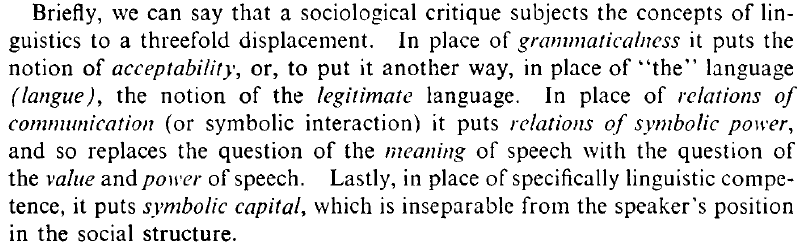
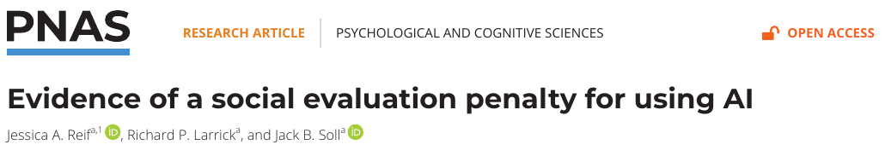
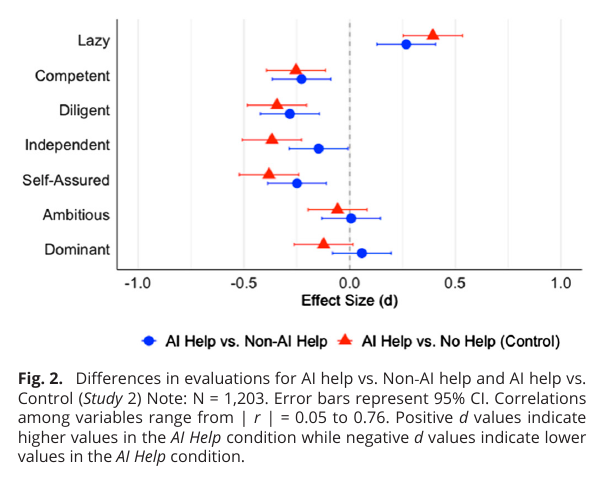
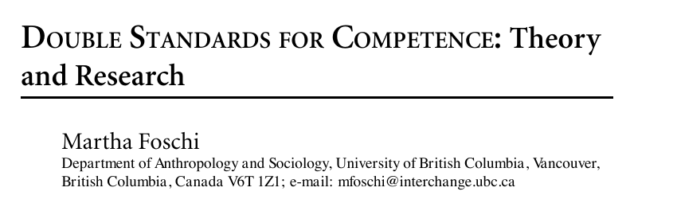
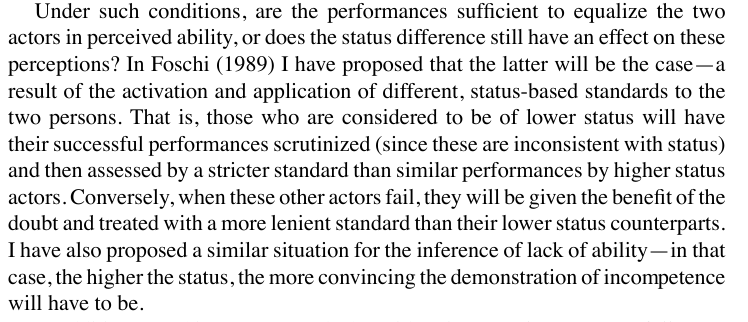
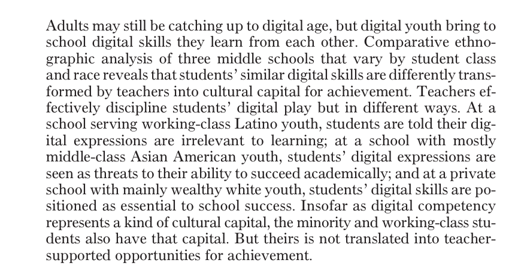
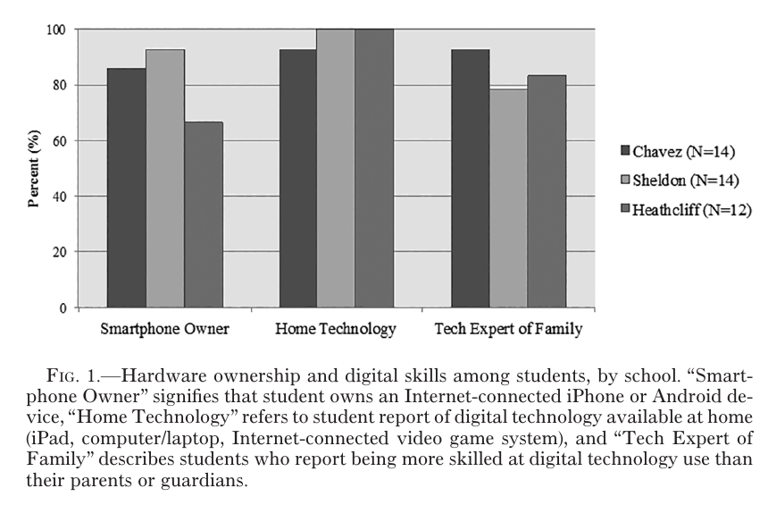
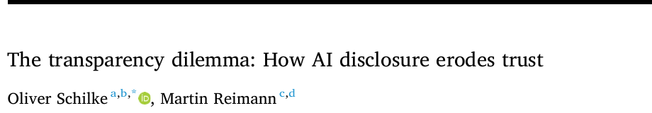
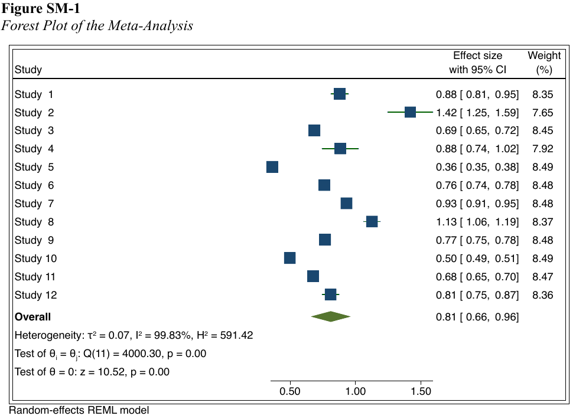

## When is AI use taken as a sign of ability?

<p class="large-question">The same writing assistance might be called efficient delegation or evidence that the writer cannot do the work. Who gets each interpretation?</p>

---

## One report, two employees

<div class="report-page"><div class="report-heading">Monthly competitor report · fictional teaching example</div><p>RivalCo launched a monthly subscription in April at $18. Our comparable plan costs $20. RivalCo advertises a free trial. We do not yet have data on customer switching after the launch.</p></div>

<div class="role-pair"><div><strong>Senior executive</strong><span>Director of strategy, presenting the report to colleagues</span></div><div><strong>Junior employee</strong><span>Market analyst, presenting the same report to colleagues</span></div></div>

<p class="small-note">The text is identical. We can vary whether readers are told the writer used ChatGPT to edit it.</p>

---

## Bourdieu: the value of writing depends on its setting

<div class="market-visual"><div><strong>Writer</strong><span>What skills and resources do they bring?</span></div><div><strong>Report</strong><span>What does the text say, and how was it produced?</span></div><div><strong>Evaluator</strong><span>Which forms of work count as credible here?</span></div></div>

<p>Bourdieu’s “linguistic market” directs attention to the institution that values the writing and to the social position of the writer. It does not predict a particular verdict on ChatGPT.</p>

<p class="citation">Bourdieu (1977), “The Economics of Linguistic Exchanges,” <em>Social Science Information</em> 16(6): 645–668. <a href="https://doi.org/10.1177/053901847701600601">doi:10.1177/053901847701600601</a>.</p>

---

## Acceptable writing is more than correct grammar



<p>A report may be accurate and clear while its method of production is judged differently across jobs or organizations.</p>

<p class="citation">Bourdieu (1977), p. 646. The application to AI-assisted reports is ours.</p>

---

## Cultural capital and recognized forms of skill

<p class="lead">Lamont and Lareau ask how institutions recognize some cultural signals as valuable and use them in processes of inclusion and exclusion.</p>

<p>That helps specify the question here: does “knows how to use AI” count as professional judgment, or as a failure to possess a skill the job is expected to require?</p>

<p class="citation">Lamont and Lareau (1988), “Cultural Capital: Allusions, Gaps and Glissandos in Recent Theoretical Developments,” <em>Sociological Theory</em> 6(2): 153–168. <a href="https://doi.org/10.2307/202113">doi:10.2307/202113</a>. The AI question is an application, not their finding.</p>

---

## Judgments about the report’s author

<div class="judgment-list"><div><strong>Competence</strong><span>Can this employee do the work?</span></div><div><strong>Laziness</strong><span>Did they avoid effort expected of them?</span></div><div><strong>Trust</strong><span>Would I rely on this person?</span></div><div><strong>Legitimacy</strong><span>Was this an acceptable way to complete the task?</span></div></div>

<p>The report stays the same. We want to know whether the writer’s position and the use of AI change these judgments.</p>

---

## Reif and colleagues asked how people judge AI users



<p class="article-intro">Across four preregistered experiments, participants evaluated people who used AI to help with work. The question is how observers judge the <em>person</em> using the tool.</p>

<p class="citation">Reif, Larrick and Soll (2025), <em>Proceedings of the National Academy of Sciences</em> 122, e2426766122. <a href="https://doi.org/10.1073/pnas.2426766122">doi:10.1073/pnas.2426766122</a>.</p>

---

## Comparing AI help with other kinds of help

<div class="three-row"><div><strong>AI help</strong><span>A professional uses generative AI for part of a task.</span></div><div><strong>Human help</strong><span>A professional receives comparable assistance from another person.</span></div><div><strong>No help</strong><span>A professional completes the task without described assistance.</span></div></div>

<p>In Study 2, participants rated workers described in occupational vignettes. The help source changed; the work context was specified in the vignette.</p>

<p class="citation">Reif et al. (2025), Study 2. The experiment included 384 vignettes and 1,203 participants in its final sample.</p>

---

## Study 2: ratings of workers who received AI help

<div class="figure-explain"><div><p>Positive values mean a higher rating for AI help; negative values mean a lower one.</p><p>AI users were rated as lazier and less competent, diligent, independent and self-assured. These are observers’ judgments, not tests of the workers’ skills.</p></div></div>

<p class="citation">Reif, Larrick and Soll (2025), published article, Fig. 2, Study 2. Blue circles compare AI with non-AI help; red triangles compare AI with no described help. Error bars are 95% confidence intervals.</p>

---

## Reif does not establish a class difference

<p class="lead">Study 2 did not find significant moderation of the AI-use penalty by the vignette worker’s age, gender or occupation.</p>

<p>Occupation in that study is also different from a senior–junior comparison within the same organization. We need a separate test of whether status changes the interpretation of AI use.</p>

<p class="citation">Reif et al. (2025), Study 2 and supplementary analyses.</p>

---

## Foschi: competence is judged against expectations



<p class="article-intro">Foschi reviews experiments on how status affects judgments of competence. The same performance can be read differently when the performer carries a different status cue.</p>

<p class="citation">Foschi (2000), “Double Standards for Competence,” <em>Annual Review of Sociology</em> 26: 21–42. <a href="https://doi.org/10.1146/annurev.soc.26.1.21">doi:10.1146/annurev.soc.26.1.21</a>.</p>

---

## Foschi on judging the same performance



<p>Foschi’s question is how a performance becomes evidence of competence. A status cue can change the standard applied to it.</p>

<p class="citation">Foschi (2000), p. 25, from the published article.</p>

---

## What a double standard would look like here

<div class="threshold-diagram"><div class="threshold-axis"><span>Less evidence of ability</span><span>More evidence of ability</span></div><div class="threshold-row"><strong>Higher-status worker</strong><span class="threshold-line"><i style="left:38%"></i></span><em>competent</em></div><div class="threshold-row"><strong>Lower-status worker</strong><span class="threshold-line"><i style="left:65%"></i></span><em>competent</em></div></div>

<p>Foschi’s framework suggests a testable possibility: observers may demand more proof of competence from a lower-status worker. The positions above are schematic, not estimates from an AI study.</p>

<p class="citation">Conceptual diagram based on Foschi (2000); threshold positions are illustrative.</p>

---

## The opposite result is also possible

<p class="lead">A senior executive may be expected to exercise independent judgment. Readers could penalize that person <em>more</em> for outsourcing the report.</p>

<p>Foschi discusses conditions under which status-linked standards can reverse. The direction of any AI-use effect should be measured, not assumed from the theory.</p>

<p class="citation">Foschi (2000), discussion of double standards and reverse double standards. The executive example is our proposed hypothesis.</p>

---

## Rafalow observed three schools



<p>In the working-class Latino school, teachers treated students’ digital expression as irrelevant. In the middle-class Asian American school, they saw it as a risk to achievement. In the affluent, mostly white school, they made it an educational asset.</p>

<p class="citation">Rafalow (2018), “Disciplining Play: Digital Youth Culture as Capital at School,” <em>American Journal of Sociology</em> 123(5): 1416–1452, p. 1416. <a href="https://doi.org/10.1086/695766">doi:10.1086/695766</a>.</p>

---

## Students had digital skills in all three schools

<div class="figure-explain rafalow-figure"><div><p>Access to devices and students’ reported expertise were broadly similar across the interviewed groups.</p><p>The ethnography then asks why teachers valued comparable digital activity differently.</p></div></div>

<p class="citation">Rafalow (2018), Fig. 1, p. 1428. Bars describe interviewed students: Chávez <em>n</em> = 14, Sheldon <em>n</em> = 14, Heathcliff <em>n</em> = 12; they are not representative school-wide estimates.</p>

---

## Rafalow’s comparison changes our question

<p class="lead">The schools evaluated similar kinds of digital practice differently. What counted as useful creativity depended on the school setting.</p>

<p>Class, race and school context varied together, so this is not an isolated causal effect of class. Rafalow did not study ChatGPT. His study shows why we should examine the institution doing the evaluation, alongside the tool user.</p>

<p class="citation">Rafalow (2018), fieldwork and discussion.</p>

---

## Writing assistance was normal before ChatGPT

<div class="aid-comparison"><div><small>Predictive assistance</small><strong>Gmail Smart Compose</strong><span>Suggests words or phrases while someone writes an email.</span></div><div><small>Generative assistance</small><strong>ChatGPT</strong><span>Can draft or revise an entire report from an instruction.</span></div></div>

<p>At what point does assistance become something a writer is expected to disclose? The answer may depend on the task and the workplace, not only on the technology.</p>

<p class="citation">Google (2018), <a href="https://blog.google/products-and-platforms/products/gmail/subject-write-emails-faster-smart-compose-gmail/">Smart Compose announcement</a>. Tool descriptions are illustrative; no claim about comparative stigma is made here.</p>

---

## The same act may carry different workplace meanings

<div class="role-pair big"><div><strong>Director of strategy</strong><span>“She used the tool to work quickly.”</span></div><div><strong>Market analyst</strong><span>“He needed the tool to write the report.”</span></div></div>

<p>These are possible interpretations, not observed reactions. Our proposed study asks whether readers actually make them when the report is held fixed.</p>

---

## Schilke and Reimann studied AI disclosure



<p class="article-intro">Across preregistered experiments, they examine what happens to trust when another person reveals that AI helped with a task. In Study 11, participants assess a market analyst’s monthly competitor report.</p>

<p class="citation">Schilke and Reimann (2025), “The transparency dilemma: How AI disclosure erodes trust,” <em>Organizational Behavior and Human Decision Processes</em> 188: 104405. <a href="https://doi.org/10.1016/j.obhdp.2025.104405">doi:10.1016/j.obhdp.2025.104405</a>.</p>

---

## Study 11 held the report task in view

<div class="three-row"><div><strong>Evaluator</strong><span>Head of marketing considering a report from Alex Harper.</span></div><div><strong>Worker</strong><span>Market research analyst preparing a monthly competitor analysis.</span></div><div><strong>Two variations</strong><span>Prior knowledge of AI use, and whether AI assistance was disclosed with the report.</span></div></div>

<p>Participants then rated their trust in the worker. The control did not state that Alex used no AI. This experiment did not vary the worker’s rank.</p>

<p class="citation">Schilke and Reimann (2025), Study 11, pp. 9–10 of the published article.</p>

---

## Disclosure lowered trust in Study 11

<div class="bar-chart two" role="img" aria-label="Mean trust: no AI disclosure 4.62, AI disclosure 4.10"><div><span>No AI disclosure</span><i style="--bar:77%"></i><b>4.62</b></div><div><span>AI disclosure</span><i style="--bar:68%"></i><b>4.10</b></div></div>

<p>The reported difference was statistically significant, <em>d</em> = 0.50. The authors link the trust effect to whether AI assistance was seen as a legitimate way to complete the work.</p>

<p class="citation">Schilke and Reimann (2025), Study 11. Bars recreate reported mean trust ratings (4.62 and 4.10); not a reproduction of the published figure.</p>

---

## The trust penalty appeared across their studies



<p class="citation">Schilke and Reimann (2025), supplementary Fig. SM-1. The figure summarizes trust effects across studies; it is not a plot of Study 11 alone. The supplement numbers its included studies differently from the main article.</p>

---

## Trust and competence are separate outcomes

<p class="lead">A reader might think a report is accurate and still distrust its author for using AI. Another might accept AI use but doubt that the worker could write without it.</p>

<p>Reif and Schilke–Reimann study related but different judgments. Neither tells us whether a senior and a junior worker are penalized differently for the same report.</p>

---

## Two predictions about status

<div class="hypotheses"><div><strong>Prediction A</strong><span>AI help is treated as strategic delegation for the senior worker but as evidence of weak skill for the junior worker.</span></div><div><strong>Prediction B</strong><span>The senior worker is penalized more because the job carries a stronger expectation of independent expertise.</span></div></div>

<p>Both are plausible. A study must test which interpretation readers actually use.</p>

---

## A proposed four-condition experiment

| Report author | No reported AI use | Reported AI use |
|---|---|---|
| **Senior executive** | A | B |
| **Junior employee** | C | D |

<p>Randomly assign a reader to one description. Every reader sees the same report text. The “no reported AI use” version says nothing about AI; it does not claim the writer used none. Ask separately about competence, laziness, trust and whether assistance was acceptable.</p>

---

## What the four conditions cannot tell us by themselves

<p>“Senior” and “junior” mark organizational rank. They do not directly measure a worker’s social class. Different job duties may also change what readers expect from the report.</p>

<p>We would need to define the roles carefully, pretest what people infer from them, and collect judgments from actual readers. The classroom code only prepares materials for such a study.</p>

---

## Questions for discussion

<ol class="task-list"><li>Which judgment is Reif measuring, and which is Schilke and Reimann measuring?</li><li>What does Foschi lead us to predict about the same report under different job titles?</li><li>How might Rafalow’s schools help us think about workplace norms for AI use?</li><li>What additional evidence would let us say something about class rather than job rank?</li></ol>

---

## Python: edit the report, then prepare the conditions

<div class="flow-line"><span>fictional report</span><span>model editing request</span><span>raw revision</span><span>human fact check</span><span>four reader versions</span></div>

<p>The LLM edits text. Python prepares the four descriptions. We do not collect human judgments in this exercise.</p>

---

## The report begins as a string

```python
SOURCE_PARAGRAPH = (
    "RivalCo launched a monthly subscription in April at $18. "
    "Our comparable plan costs $20. RivalCo advertises a free trial. "
    "We do not yet have data on customer switching after the launch."
)
print(type(SOURCE_PARAGRAPH))
```

<p>Input: quoted report text. Output: <code>&lt;class 'str'&gt;</code>. The last sentence states what the writer does <em>not</em> know.</p>

---

## Send the model an editing request

```python
separator = "\n\nOriginal report:\n"
prompt = EDITING_INSTRUCTION + separator + SOURCE_PARAGRAPH
messages = [{"role": "user", "content": prompt}]
print(messages)
```

<p><code>messages</code> is a list with one dictionary. The local and hosted versions show their calls separately and print the raw returned text.</p>

---

## Check the revised report yourself

<div class="fact-check"><span>April launch</span><span>$18 rival plan</span><span>$20 comparable plan</span><span>Free trial</span><span>No switching data yet</span></div>

<p>Reject a revision that claims customers switched, that the rival is winning, or that our plan has the same features. The model has no evidence for those claims.</p>

---

## Make the four reader versions

```python
conditions = []
for role_cue in ROLE_CUES:
    for ai_use_label in AI_USE_LABELS:
        condition = {
            "condition_id": len(conditions) + 1,
            "role_cue": role_cue,
            "ai_use_label": ai_use_label,
            "report_text": REVISED_PARAGRAPH,
        }
        conditions.append(condition)
```

<p>First pass: senior executive, no reported AI use. Second pass: senior executive, reported AI use. The report text stays unchanged.</p>

---

## What the Python checks establish

```python
assert len(conditions) == 4
assert all(item["report_text"] == REVISED_PARAGRAPH
           for item in conditions)
```

<p>Python confirms that all four records exist and use identical report text. It cannot tell us how readers would judge the workers.</p>

---

## Week 11 coding task

<ol class="task-list"><li>Run the report edit and show the raw return.</li><li>Check the revision against the five stated facts and uncertainty.</li><li>Trace the first two passes through the nested loop.</li><li>Make the editing instruction more conservative and rerun.</li><li>Explain what human-reader data would be needed to test either status prediction.</li></ol>

<p>Submit a narrated screen recording. The local script, notebook and course-book Python page use the same report and conditions.</p>

---

## What this lecture establishes

<p>Experiments show that AI users can incur penalties in judgments of effort, competence and trust. Sociological work gives us reasons to ask who sets the standard for competent work and how the same practice is valued in different settings.</p>

<p>We have not shown that junior workers face a larger penalty. The proposed reader experiment is designed to test that possibility against the opposite prediction.</p>
